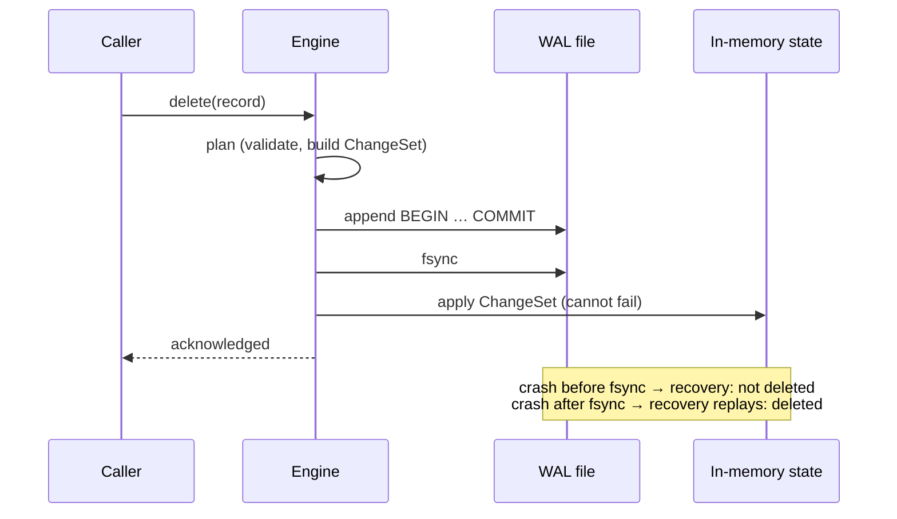
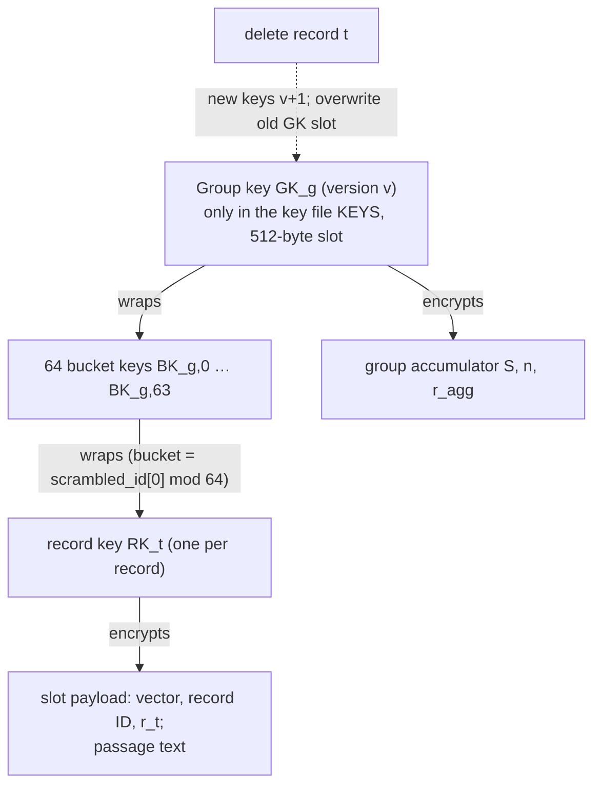

# 01 · Background concepts

This file explains every concept SEVER-DB's code uses, from the basics up to the level the project
needs. It explains only ideas the repository actually uses. Each section says where the idea shows up
in the code or the specification (`docs/SEVER-DB_SPECIFICATION.md`, cited as **§N**).

**How to read it.** Each section starts in plain words, then gives the precise term, then a small
worked example with numbers. You can read the sections in order; later ones use earlier ones.

**Contents**

1. [Vectors, embeddings and similarity search](#1-vectors-embeddings-and-similarity-search)
2. [Partitioned search: k-means and IVF](#2-partitioned-search-k-means-and-ivf)
3. [Search quality metrics: Recall@k and nDCG@10](#3-search-quality-metrics-recallk-and-ndcg10)
4. [Floating point, fixed point and the Q24 format](#4-floating-point-fixed-point-and-the-q24-format)
5. [Exact deletion with integer sums](#5-exact-deletion-with-integer-sums)
6. [Detecting unusual data: the Mahalanobis distance](#6-detecting-unusual-data-the-mahalanobis-distance)
7. [How databases survive crashes: WAL, fsync, checkpoints, transactions](#7-how-databases-survive-crashes)
8. [Hash functions and domain separation](#8-hash-functions-and-domain-separation)
9. [Digital signatures (Ed25519)](#9-digital-signatures-ed25519)
10. [Merkle trees and transparency logs (RFC 9162)](#10-merkle-trees-and-transparency-logs)
11. [Elliptic-curve groups and ristretto255](#11-elliptic-curve-groups-and-ristretto255)
12. [Pedersen commitments](#12-pedersen-commitments)
13. [Zero-knowledge proofs of knowledge (Schnorr, Fiat–Shamir)](#13-proofs-of-knowledge-schnorr-and-fiatshamir)
14. [Encryption at rest, key hierarchies and crypto-shredding](#14-encryption-at-rest-key-hierarchies-and-crypto-shredding)
15. [Forensic scanning of a disk image](#15-forensic-scanning-of-a-disk-image)
16. [Software testing ideas used here](#16-software-testing-ideas-used-here)
17. [Statistics used in the evaluation](#17-statistics-used-in-the-evaluation)
18. [Tools and languages](#18-tools-and-languages)

---

## 1. Vectors, embeddings and similarity search

**Plain words.** A computer cannot compare the *meaning* of two sentences directly. An *embedding
model* turns each piece of text into a list of numbers so that texts with similar meanings get
similar lists. A *vector database* stores those lists and, given a question's list, finds the stored
lists closest to it.

**Precise terms.**
- A **vector** is an ordered list of `d` numbers; `d` is the **dimension**. SEVER-DB uses `d = 384`
  (§2.2).
- An **embedding** is a vector produced by a model. The project uses
  `sentence-transformers/all-MiniLM-L6-v2`, pinned at revision `1110a243…`
  (`datasets/PINS.json`), which outputs 384 numbers and reads at most 256 tokens; longer text is cut
  (truncated) (`configs/experiments.yaml`, `encoder`).
- A vector is **normalised** (unit length) when the square root of the sum of its squared entries is 1.
  SEVER-DB only *checks* this (to within 8 float32 rounding steps, about 9.54 × 10⁻⁷) and refuses
  vectors that fail; it never fixes them itself (§4.1, `check_normalised` in
  [crates/sever-quant/src/lib.rs](../crates/sever-quant/src/lib.rs)).
- **Squared Euclidean (L2) distance** between `q` and `x` is `Σ (q_i − x_i)²`. For unit vectors,
  ranking by L2 distance gives the same order as ranking by cosine similarity. The search ranks by
  L2 (§8.1).
- **Nearest-neighbour search** returns the `k` stored vectors closest to the query. **Brute force**
  compares the query with every stored vector; it is exact but slow for large collections.

**Example.** Two 3-dimensional unit vectors `q = (0.6, 0.8, 0)` and `x = (0.8, 0.6, 0)`:
L2² = (0.6−0.8)² + (0.8−0.6)² + 0² = 0.04 + 0.04 = 0.08. A vector `y = (0, 0, 1)` gives
L2² = 0.36 + 0.64 + 1 = 2.0, so `x` is nearer to `q` than `y`.

---

## 2. Partitioned search: k-means and IVF

**Plain words.** Comparing a question with a million vectors is slow. Instead, sort the vectors into
groups ("buckets of similar things") and only look inside the few groups closest to the question.

**Precise terms.**
- **k-means clustering** splits a set of vectors into `k` groups. Each group has a **centroid** (the
  average of its members). It repeats two steps: assign each vector to its nearest centroid, then move
  each centroid to the average of its members.
- **IVF (inverted file) search** stores, for each centroid, the list of vectors assigned to it. A query
  ranks the centroids by distance, then scans only the closest `nprobe` lists. **IVF-flat** means the
  vectors inside the lists are stored whole, not compressed.
- SEVER-DB is IVF-flat. It builds **128 frozen groups** once, by k-means on a public *reference*
  dataset (SciQ), and never moves them (§2.2, §6). A query scans the closest **25 % of all groups,
  rounded up** (§8.1). Results are approximate (a true neighbour in an unscanned group is missed);
  deletion is exact (§1).
- The baseline in the experiments is FAISS's `IndexIVFFlat` (`configs/experiments.yaml`,
  `baseline_ivf`; [python/sever_experiments/ex6.py](../python/sever_experiments/ex6.py)).

**Why groups that never move matter here.** In an ordinary IVF index, centroids are retrained from
the stored data, so every record nudges every centroid. If centroids never move, deleting one record
can only change the one group that holds it. That is the basis of exact deletion (section 5).

**Example.** With 171 groups, `nprobe = ⌈0.25 × 171⌉ = ⌈42.75⌉ = 43`. This is exactly the setting
recorded for seed 42 in `results/p4-ex6-nq-10k-20261030T154119Z.json` (`nlist` 171, `nprobe` 43).

---

## 3. Search quality metrics: Recall@k and nDCG@10

**Plain words.** How good is an approximate search? Compare its answers with the perfect (brute
force) answers and count how many it got.

**Precise terms.**
- **Recall@k** = (number of the true top-`k` items that the search also returned in its top `k`) ÷ `k`,
  averaged over all queries. In this project, "true" means brute force over the **original float32
  vectors** of the records that are currently searchable (`configs/experiments.yaml`, `metrics`;
  [ex6.py](../python/sever_experiments/ex6.py) docstring).
- **nDCG@10** (normalised discounted cumulative gain) uses human relevance judgements (*qrels*)
  instead of brute force: a relevant answer at rank 1 counts more than one at rank 10
  (gain ÷ log₂(rank + 1)), and the total is divided by the best possible total, so 1.0 is perfect.
- **Drift** (this project's own statistic): the standard deviation of Recall@10 across the five
  deletion rungs (`drift_statistic: stddev_recall10_across_rungs`). It measures how much search
  quality changes as records are deleted.

**Example.** True top-3 = {A, B, C}; the search returned {A, C, D}. Recall@3 = 2/3 ≈ 0.667.

**Caution used later.** Recall@k against brute force tells you whether the *approximation* is good,
not whether the answers are *relevant*. Only nDCG uses human judgements.

---

## 4. Floating point, fixed point and the Q24 format

**Plain words.** Computers store most decimals approximately. Adding and then subtracting the same
approximate number does not always bring you back to where you started. Integers do not have this
problem: 7 + 5 − 5 is always exactly 7.

**Precise terms.**
- **Floating point** (IEEE 754) stores a number as a sign, a fraction and an exponent. `float32` has
  24 significant bits, `float64` has 53. After each operation the result is **rounded** to the nearest
  representable number, so `(a + b) − b` can differ from `a`, and the order of additions changes the
  result.
- **Fixed point** stores a number as an integer count of small fixed steps. **Q24** means steps of
  `2⁻²⁴`: the stored integer is `x̃ = round(x · 2²⁴)` (§4.2).
- **Round half to even** ("banker's rounding"): when a value lies exactly halfway, round to the even
  neighbour (2.5 → 2, 3.5 → 4). It is the IEEE default and does not push sums up or down on average
  (§4.2).
- **Dequantisation** turns the integer back: `x̂ = x̃ / 2²⁴` (§4.3).

**Example.** In Python, `0.1 + 0.2 == 0.30000000000000004`, not `0.3`. In Q24, the component
`0.1` becomes `round(0.1 × 16,777,216) = round(1,677,721.6) = 1,677,722`, an integer. Integer sums
of such values add and subtract exactly.

**Bounds that keep the integers safe (§4.4).** Each `|x̃_i| ≤ 2²⁴ + 16 = 16,777,232 < 2³¹`, so it fits in
an `i32`. A group sum over at most 10⁶ members is at most about 1.68 × 10¹³ < 2⁴⁴, which fits easily
in an `i64`. The 10⁶-member cap is enforced on every insert.

Code: `quantise_component` and `quantise` in
[crates/sever-quant/src/lib.rs](../crates/sever-quant/src/lib.rs).

---

## 5. Exact deletion with integer sums

**Plain words.** Each group keeps a running total of its members' (integer) vectors and how many
members it has. Deleting a member subtracts its vector from the total and 1 from the count. Because
integer arithmetic is exact, the group ends up in *exactly* the state it would be in if that member
had never been added.

**Precise terms (§5).**
- Group state: the integer sum vector `S` (`i64` per component), the count `n`, the blinding sum
  `r_agg` and the commitment `C_S` (sections 12–13). The four change together (§5.3).
- **Physical excision**: the record is removed from storage, not just marked "deleted". Marking
  (a *tombstone* or *soft delete*) leaves the data present (§5.4).
- **The exactness relation (§5.5)**: after any sequence of inserts and deletes, every group equals, field
  by field, the group built from only its surviving members. The code compares five fields (CLAUDE.md
  §7, "five-field equivalence").
- Contrast — the "ghost": an ordinary IVF centroid is an average trained over data that may include the
  deleted record, so the deleted record still shapes the index after deletion.

**Example.** A group has members `a = (3, −1)` and `b = (5, 4)`: `S = (8, 3)`, `n = 2`. Delete `b`:
`S = (8 − 5, 3 − 4) = (3, −1)`, `n = 1` — identical to a group that only ever held `a`. With a
float running mean instead, `mean = (4.0, 1.5)`; "undoing" `b` by `(2·mean − b)` works here, but with
real float32 values and many members the rounding error accumulates and the result differs in its last
bits. The repository's Part 1 demo measured such residues (see 03, P1-T14).

---

## 6. Detecting unusual data: the Mahalanobis distance

**Plain words.** The frozen groups were built from science passages (SciQ). New data may look very
different. Before putting a new vector into the nearest frozen group, SEVER-DB asks: "Is this vector
unusually far from that group, given how spread out the reference data was?" If so, it does not force
it in.

**Precise terms.**
- The **Mahalanobis distance** `d_M = sqrt(δᵀ P δ)` measures distance after accounting for the spread
  and correlation of the data; `δ` is the vector minus the group centroid and `P` is an inverse
  covariance (precision) matrix (§7.2). The builder uses a *shrinkage* estimate of the covariance to
  keep `P` well behaved (§6.2, [python/sever_partition/build.py](../python/sever_partition/build.py)).
- The threshold `τ` is the **99th percentile** of reference distances (`build.py`, "§6.2 step 6").
- **In-distribution** if `d_M ≤ τ` → the nearest frozen group. **Out-of-distribution (OOD)** → an
  existing **spawned** group that has room, else the **holding area**. When 200 OOD vectors wait in
  the holding area, they form a new spawned group, which is then frozen too (§7.3–§7.4).
- Holding-area records are stored and deletable but **not searchable** until their group forms
  (overview limit L-12).

**Example.** The τ values recorded by the partition builder for the five seeds are 25.699–25.795
(`artefacts/partition-seed*.json`, field `tau`; these files are build outputs and are not tracked by
git).

---

## 7. How databases survive crashes

**Plain words.** If the power fails halfway through saving, a file can be left half-written. A
database must make sure that, after restart, every change it *told you* was saved really is saved,
and that no change is half-applied.

**Precise terms.**
- **`fsync`**: asks the operating system to push buffered data to the storage device before
  continuing. Without it, "written" data may still sit in memory.
- **Write-ahead log (WAL)**: before changing the main data, append a record describing the change to a
  log and `fsync` it. After a crash, *recovery* replays the log (§12.3, §15.7).
- **Storage checkpoint**: a full snapshot of the state, after which the log can be truncated (§12.4).
  (The spec also has *log checkpoints*, a different thing — section 10; §0.4 warns about the two
  meanings.)
- **Transaction**: a group of changes that is applied all-or-nothing. **Acknowledged** means the
  database has returned success to the caller; acknowledged changes must survive any later crash
  (§15.8).
- **Crash testing with a simulated file system**: the project's `SimVfs` / `SnapVfs` (crate
  `sever-vfs`) records every write, so a test can "crash" the database after any single write,
  recover, and check the result. This makes crash tests deterministic (CLAUDE.md §6.2).
- **Plan, then apply**: every mutation is first computed by a pure `plan` step that validates
  everything and returns a `ChangeSet`; `apply` then cannot fail (Build §1.1;
  `plan_insert`, `plan_delete`, `apply` in
  [crates/sever-index/src/index.rs](../crates/sever-index/src/index.rs)).

(Simplified: a real deletion also writes its certificate, log leaf and key-file phases before it is
acknowledged; §15.3, §15.8.)

**Example.** A deletion is acknowledged at the moment its WAL commit record is `fsync`ed. A crash one
write before that point must recover to "not deleted"; a crash one write after must recover to
"deleted". Part 2's gate checks both sides at every write (see 03, P2-T1…T3).

---

## 8. Hash functions and domain separation

**Plain words.** A hash function turns any input into a short fixed-size fingerprint. Changing the
input even slightly changes the fingerprint completely, and it is infeasible to find two inputs with
the same fingerprint.

**Precise terms.**
- **SHA-256** and **SHA-512** (FIPS 180-4) give 32- and 64-byte outputs (§9.1).
- **HMAC-SHA-512** is a keyed hash. SEVER-DB uses it to turn a record ID into a *scrambled ID*, so
  the public log never shows raw IDs (§9.7).
- **Domain separation**: every hash, signature and proof input starts with a fixed label (a *domain
  string*), so a value computed for one purpose can never be mistaken for another (§2.3).
- **CRC-32C** is a checksum for detecting accidental disk corruption only, not attacks (§9.1).

**Example.** `SHA-256("abc")` begins `ba7816bf…`; `SHA-256("abd")` begins `a52d159f…` — no visible
relation.

---

## 9. Digital signatures (Ed25519)

**Plain words.** A signature is like a wax seal that only the key holder can make but anyone can
check.

**Precise terms.** **Ed25519** (RFC 8032) has a private signing key and a public verification key.
`verify_strict` rejects unusual encodings that other implementations might accept (§9.1). SEVER-DB
uses three kinds of signer: the **user** (insert signatures — in practice the application backend
holds this key, overview L-27), the **operator** (the database, which signs every certificate) and
**witnesses** (section 10). Operator and witness keys change every 90 days (*key epochs*, §9.8).

---

## 10. Merkle trees and transparency logs

**Plain words.** A transparency log is a public, append-only list. Anyone can check that an entry is
in the list, and that the list was only ever added to, never rewritten — without downloading the
whole list.

**Precise terms.**
- A **Merkle tree** hashes pairs of entries, then pairs of those hashes, up to a single **root hash**.
  An **inclusion proof** is the short list of sibling hashes from one leaf up to the root
  (about log₂ N hashes).
- **RFC 9162** (Certificate Transparency 2.0) fixes the exact hashing rules; SEVER-DB follows it
  (§10.1).
- A **log checkpoint** is a signed statement "the log has N leaves and root R" (§10.3); one is made
  every 10,000 leaves and on demand (§2.2).
- **Witnesses** are independent parties who cosign a checkpoint only if it extends the previous one
  they saw. That stops the operator from showing different logs to different people. SEVER-DB uses 5
  witnesses with threshold 4 (§10.4). **In this project the witnesses are simulated** — they run as
  part of the same system (overview limit L-7).

**Example.** With 8 leaves, an inclusion proof has 3 hashes (log₂ 8 = 3). The verifier hashes the
leaf with each sibling in turn and checks it reaches the signed root.

---

## 11. Elliptic-curve groups and ristretto255

**Plain words.** Modern cryptography often works with "points" that can be added together. Adding a
point to itself many times is easy; working backwards ("how many times was it added?") is believed to
be infeasible.

**Precise terms.**
- A **group** here is a set of points with an addition operation. **Scalar multiplication** `a·G`
  means adding `G` to itself `a` times. Scalars are integers modulo the group order `ℓ` (a prime of
  about 2²⁵²).
- The **discrete-logarithm assumption**: given `G` and `a·G`, finding `a` is infeasible.
- **ristretto255** (RFC 9496) is a prime-order group built on Curve25519, with exactly one valid
  32-byte encoding per point. SEVER-DB decodes every untrusted point *canonically* and rejects any
  other encoding (§0.2, §9.9). The **identity** (the "zero" point) is 32 zero bytes.
- **Generators** `H, G_0 … G_383` are derived by hashing fixed labels to points (RFC 9380
  `hash_to_group`), so nobody knows any relation between them (§9.2). The engine checks them against a
  frozen golden file at startup.
- **Negative integers as scalars**: `scalar(v) = v mod ℓ` for `v ≥ 0`, and `ℓ − (|v| mod ℓ)` for
  `v < 0` (§4.5). This is how a signed Q24 integer enters the commitment.

---

## 12. Pedersen commitments

**Plain words.** A commitment is a sealed envelope: you publish it now, it hides the contents, and
later you cannot pretend it contained something else. Pedersen commitments have a special property:
adding two envelopes gives the envelope of the sum.

**Precise terms (§9.3).**
- Record: `C_t = r_t·H + Σ_i scalar(x̃_i)·G_i`. The random **blinding value** `r_t` (64 OS-random bytes
  reduced mod ℓ, §9.4) *hides* the vector; the discrete-log assumption makes it *binding* (you cannot
  find a second vector with the same commitment).
- Group: `C_S = r_agg·H + Σ_i scalar(S_i)·G_i`, where `r_agg` is the sum of the members' `r_t`.
- **Homomorphism**: `C_S` of a group equals the sum of its members' `C_t`. So after deleting record
  `t`, anyone can check `C_S_post + C_t = C_S_pre` without seeing any vector.

**Example (one dimension, toy numbers).** Members with `x̃ = 3, r = 10` and `x̃ = 5, r = 20`:
`C_1 = 10H + 3G`, `C_2 = 20H + 5G`, group `C_S = 30H + 8G`. Delete the second: `C_S_post = 10H + 3G`,
and `C_S_post + C_2 = 30H + 8G = C_S_pre`. ✓

**What it does not show by itself**: that the operator *knows* the opening of `C_S_post`. That is what
the proof in section 13 adds.

---

## 13. Proofs of knowledge: Schnorr and Fiat–Shamir

**Plain words.** The operator wants to prove "I know the numbers inside this envelope" without
revealing them.

**Precise terms (§9.5).**
- A **Schnorr-style proof of knowledge of a representation** (Okamoto; Camenisch–Stadler): the prover
  picks random nonces `k`, sends `A = k_r·H + Σ k_i·G_i`, receives a challenge `c`, and answers
  `z = k + c·secret` for every secret. The verifier checks
  `z_r·H + Σ z_i·G_i = A + c·C_S_post`.
- **Fiat–Shamir**: instead of a live challenger, `c` is computed as a hash of the statement, `A` and a
  **context** (`C_S_pre`, `C_t`, scrambled ID, database log position, collection ID — 152 bytes). Binding
  the context means a proof made for one certificate cannot be copied into another.
- **One stated exception (G-34, DB-95)**: if the deletion emptied the group, `C_S_post` is the identity,
  the check no longer depends on `c`, and a proof from one emptied certificate verifies in any other
  emptied certificate. §9.5 now states this; such a certificate rests on the step-6 sum check and the
  operator's signature instead.
- **Hedged nonces** (§9.6): nonces are derived from both fresh OS randomness and the secret
  statement, using **Merlin** transcripts, because reusing a nonce once would leak the entire group sum
  (§9.5 "soundness note").
- Size: the proof is `32 + 32 + 32·384 = 12,352` bytes at `d = 384` (§9.5).

---

## 14. Encryption at rest, key hierarchies and crypto-shredding

**Plain words.** Deleted files often survive on disk (old log copies, free space, flash cells). Rather
than trying to find and wipe every copy, encrypt everything, and on deletion destroy the key. The
copies remain but are unreadable.

**Precise terms.**
- **AEAD** (authenticated encryption with associated data) encrypts and also detects tampering. The
  project uses **AES-256-GCM-SIV** (RFC 8452), which also resists accidental nonce reuse (§9.1).
- **Three-level key hierarchy (§13.1)**: a **group key** per group (stored only in the small key file
  `KEYS`), 64 **bucket keys** per group (wrapped — encrypted — under the group key), and a **record
  key** per record (wrapped under its bucket key). A record's bucket is `scrambled_id[0] mod 64`.

- **Rotation (§13.3)**: deleting a record rotates its group's keys; the old group key is overwritten in
  the key file's two-slot layout (§14.7). Only group keys ever need physical erasure (§13.1).
- **Crypto-shredding / cryptographic erasure**: data is "erased" by destroying the key it is encrypted
  under. §13.5 argues step by step why a deleted record's key is then unrecoverable.
- **Cost (§13.6)**: about 12.9 KB of rewritten secret material per deletion in the specification's
  capacity example (64 bucket keys, ~90 record keys, the accumulator), versus about 342 KB with a
  two-level scheme.
- **Memory hygiene (§12.8)**: secrets are zeroed after use (`zeroize`), memory is locked so it is not
  swapped to disk, and core dumps are disabled.

---

## 15. Forensic scanning of a disk image

**Plain words.** To test erasure, write the database to a fake disk, delete things, then search the
*raw bytes of the whole disk* — including free space — for anything that was deleted.

**Precise terms.** The project's scanner `sever-scan`
([crates/sever-scan/src/lib.rs](../crates/sever-scan/src/lib.rs)) searches a raw ext4 image for
**known plaintext** (each deleted vector as `i32`, `i64` and `f32`, passage text windows, `r_t`, retired
keys), **carves** the engine's own structures (WAL records, key slots, envelopes) and tries every
carved key on every carved ciphertext ([python/sever_experiments/ex2.py](../python/sever_experiments/ex2.py)
docstring).
- **Positive controls** show the scanner *can* see: known secrets are planted on the image before each
  scan and must be found. **Sabotage builds** that deliberately leak (for example, keep the old key)
  must produce at least one finding (Build 3-4 §2.8).
- The project states that the scan is **evidence, not proof** (overview limit L-18).

---

## 16. Software testing ideas used here

| Term | Plain meaning | Where used |
|---|---|---|
| **Specification-first** | The written spec is the authority; tests are derived from it, not from the code | CLAUDE.md §2, §6.3 |
| **Reference model / differential testing** | A second, separately written implementation (here in Python, `python/sever_refmodel_*`) runs the same operations; any difference is a bug | P1-T2, P3-T5 |
| **Trace replay** | A recorded sequence of operations is replayed through each build and the results compared | `sever-tracekit`, P2-T5 |
| **Property-based testing** | Random inputs generated by a library (Hypothesis, proptest) check a rule over many cases | L2 tests |
| **Fuzzing** | A tool (`cargo fuzz`, libFuzzer) feeds mutated random bytes to a parser looking for crashes | `fuzz*/`, P1-T12 |
| **Line / branch coverage** | Fraction of code lines / branches executed by the tests | P1-T10 |
| **Mutation testing** | A tool (`cargo-mutants`) makes small changes ("mutants") to the code; a good test suite fails on ("kills") most of them. **Score** = caught ÷ (caught + missed + timeouts); surviving mutants must be *triaged* (explained) | P1-T11 |
| **Sabotage build (must-fail test)** | The same source built with one deliberate bug (`sabotage-SB-N` feature); some test must go red | SB-1…SB-30 |
| **Test oracle** | Where a test's expected value comes from: A = the spec by hand; B = an independent implementation or RFC vectors; B-shared = an independent oracle written by the same AI; C = frozen earlier code; D = the code itself | CLAUDE.md §6.3 |
| **Red proof** | A patch that breaks one rule, plus evidence that the labelled test passes without it and fails with it | `tests/proofs/`, `docs/PROOFS_P*.md` |
| **Clean-room (fair) testing** | Fresh AI sessions that see only the spec and public API write tests against a sealed engine; a different model judges failures | `scripts/fair.sh`, `docs/FAIR_TESTING.md` |
| **Gate vs measure** | A *gate* has a pass/fail threshold fixed before the run; a *measure* is reported as found and is never a reason to change code or rerun | Build §2.5 |
| **Run ledger** | Append-only log of every gate run, with commit, platform and outcome | `docs/RUN_LEDGER.jsonl` |
| **Traceability** | Every "MUST" in the spec has an ID (`SR-…`) and at least one test that names it | `docs/TRACE_PART_*.md` |
| **Freeze** | A finished part's files are hashed and tagged; CI then fails on any change | `freeze/PART-N.sha256` |

---

## 17. Statistics used in the evaluation

The pre-registered statistics are in `configs/experiments.yaml` (`statistics:`) and computed in
`statistics()` in [python/sever_experiments/ex6.py](../python/sever_experiments/ex6.py).

- **Seed**: a number that fixes a random generator, so a run can be repeated. Five seeds
  `[42, 123, 777, 2024, 9999]` vary data order and k-means; keys and nonces always come from the OS
  (CLAUDE.md §6.2).
- **Standard deviation, `ddof`**: `ddof = 0` divides by `n`, `ddof = 1` by `n − 1` (slightly larger).
  Both are reported; `ddof = 0` is the primary one and the more permissive (overview L-20).
- **Welch's t-test**: compares the means of two groups without assuming equal variances. Here the unit
  is the seed (n = 5 per arm), α = 0.005, two-sided.
- **TOST** (two one-sided tests): tests *equivalence* — whether two means differ by less than a margin
  δ (here 0.005). A small p-value would show equivalence; the project expected it to be underpowered at
  n = 5 (`expectation: likely_underpowered_at_n5`).
- **Percentile bootstrap 95 % interval**: resample the five per-seed values with replacement 10,000
  times, take the mean each time, and report the 2.5th and 97.5th percentiles. With five values this is
  descriptive only.
- **Coefficient of variation**: standard deviation ÷ mean of group sizes — a balance measure.

---

## 18. Tools and languages

| Tool | What it is | Used for |
|---|---|---|
| **Rust** (toolchain pinned in `rust-toolchain.toml`) | Systems language with memory safety checked at compile time | The engine, 35 crates in `crates/`, plus `verifier/` and `audit/` workspaces |
| **Python 3.13** with **uv** | Scripting language; `uv` manages the locked environment (`uv.lock`) | Partition builder, reference models, test kits, experiments |
| **PyO3 / maturin** | Bridge that lets Python call Rust | The Python SDK `sever_db` (crate `sever-py`) |
| **NumPy, SciPy, scikit-learn, pyarrow** | Numerical arrays, linear algebra and statistics, k-means (`sklearn.cluster.KMeans`), Parquet files | Partition builder, data, statistics (`pyproject.toml`; SciPy arrives as a scikit-learn dependency) |
| **FAISS** (`faiss-cpu`) | Library of vector indexes | IVF baselines in EX-6 |
| **curve25519-dalek, ed25519-dalek, sha2, hmac, merlin, aes-gcm-siv** | Pinned crypto crates (§9.1) | All cryptography; the project implements only `expand_message_xmd` itself |
| **cargo-fuzz, cargo-mutants, `cargo llvm-cov --branch`, pytest-cov, Hypothesis, proptest** | Fuzzing, mutation testing, coverage, property tests | Gates (`python/sever_testkit/gates.py` docstring) |
| **fuse2fs, mkfs.ext4** | Mount an ext4 image file without root | EX-2 forensic images |
| **WSL2** | Linux virtual machine inside Windows | Every recorded run (see 03) |
| **Claude Code** | AI coding assistant | Used throughout development (CLAUDE.md §3, §6.3–§6.4) |
