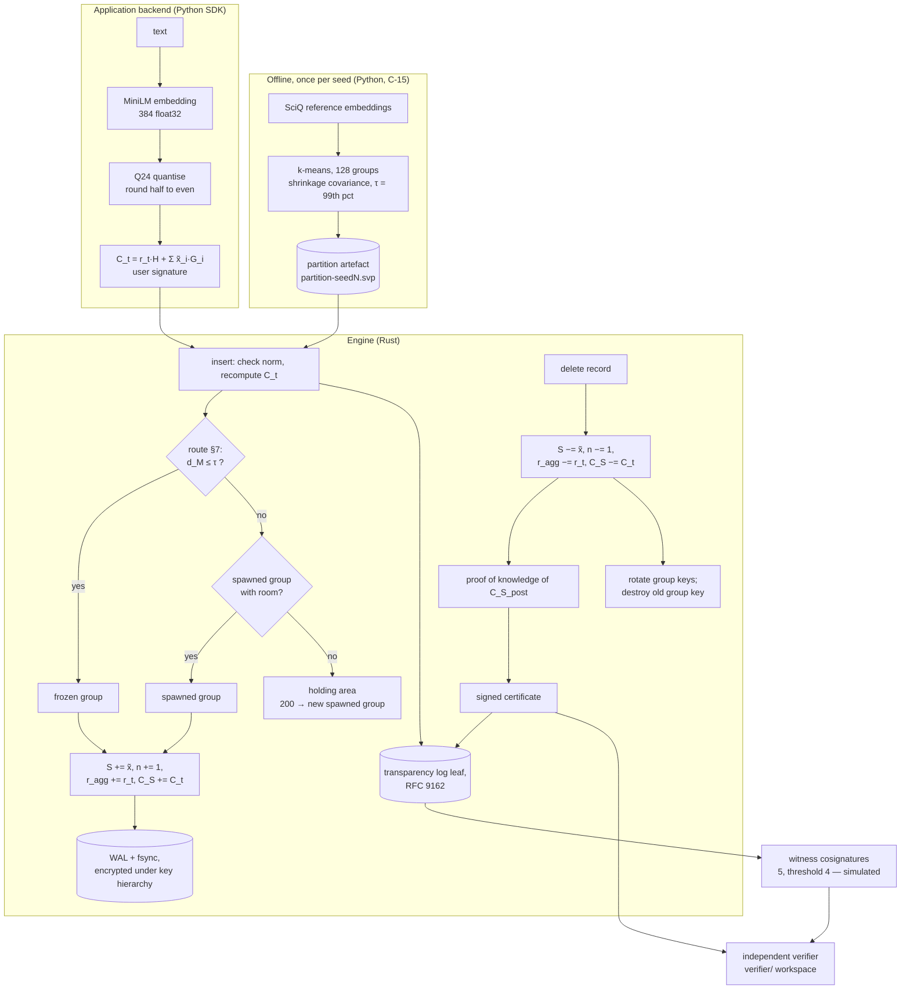

# 02 · The project and its method

Terms in **bold** are defined in [01_background_concepts.md](01_background_concepts.md). Every claim
names its source. "§N" is `docs/SEVER-DB_SPECIFICATION.md`; "Overview" is
`docs/SEVER-DB_PROJECT_OVERVIEW.md`; "Build" and "Build 3-4" are the two build plans in `docs/`.
"Ledger L*n*" means line *n* of `docs/RUN_LEDGER.jsonl`.

State of the repository described here: branch `p6-studio-company`, HEAD `294f1e3` (9 Nov 2026).
The ledger's last entry is 2026-11-01T19:51Z; no gate or measure has run since.

---

## 1. Overview

**What it is.** SEVER-DB is an embedded vector database (a library that an application links in, not
a server) written in Rust with a Python SDK. Its purpose is *provable deletion*: when a record is
deleted, the system should be able to show three things (§1):

1. **Exact deletion in the index.** Each group of vectors keeps an integer sum and a count, never an
   average, so subtracting a deleted vector returns the group bit for bit to the state it would have
   had if the vector had never arrived.
2. **A public receipt.** Each group carries a **Pedersen commitment** to its sum. A deletion produces a
   signed **deletion certificate** that anyone can check offline, with no database access, using a
   separate verifier program.
3. **Physical erasure on disk.** Everything secret is stored encrypted under a three-level key
   hierarchy; every deletion destroys the old group key (**crypto-shredding**), so old copies on disk
   become unreadable.

**Why it matters.** The overview states the problem this way: "When a person asks to be deleted,
most systems only hide the record. The summaries still carry that person's contribution, and so do
the write-ahead log, old storage files, freed disk blocks and backups. We call these surviving traces
**the ghost**. And nobody outside the company can check even the accounting of a deletion"
(Overview §1.2). The overview's reference list cites work on formalising deletion under the "right to
be forgotten" (Garg, Goldwasser, Vasudevan, EUROCRYPT 2020, [R27]), but the overview itself does not
name a specific law. [NEEDS INPUT: which legal texts (e.g. GDPR Art. 17, India's DPDP Act) the paper
will cite as motivation, and from which official sources — none is cited in the specification or the
overview.] SEVER-DB asks whether a vector index can be built so that deletion is exact, checkable by
an outsider, and physically effective on disk.

**What it is not.** It is not a faster or more accurate vector search engine. Its search is plain
IVF-flat (§8.3 explains why not a graph index), and the evaluation compares it only with in-repository
baselines (see [03](03_experiments_and_results.md)).

---

## 2. Problem statement and objectives

### 2.1 How the work was organised

The project was built in **four parts**, each adding one claim, and each frozen (hashed and tagged)
before the next began (CLAUDE.md §6.1; Build §0.1).

| Part | The one claim it adds | Spec sections | Freeze tag (commit, date from `git`) |
|---|---|---|---|
| 1 The Idea | Deleting a vector returns its group, bit for bit, to the never-inserted state | §2–§8, §9.7 | `part-1-frozen` (b1d4576, 2026-10-06) |
| 2 The Database | Exactness survives a crash at any point; no acknowledged operation is lost; a multi-group deletion is all-or-nothing | §12, §14 (part), §15, §16.1, §17 | `part-2-frozen-e1` (7729302) and `part-2-frozen-e2` (a244264), both 2026-10-15 |
| 3 The Receipt | Every deletion yields a certificate anyone can verify offline | §9, §10, §11, §16.2–16.3 | `part-3-frozen` (a304014, 2026-11-01) |
| 4 The Erasure | After an acknowledged deletion, nothing deleted can be recovered from raw storage | §12.8–12.9, §13, §14.5, §14.7, §15.3–15.4, §15.8–15.9 | `part-4-frozen` = `v1.0.0` (7942c1d, 2026-11-01) |

Part 2 has no plain `part-2-frozen` tag in the repository today; it was tagged only after errata E-1
and E-2 (`ERRATA.md`). See [04](04_limitations_and_paper_outline.md) §2 on how Part 2's freeze relates
to the fair-testing rule.

### 2.2 Pre-registered targets (hypotheses)

The targets were fixed on **27 September 2026**, before any result, in `configs/experiments.yaml`
("Committed once and never changed afterwards"; first commit of the repository is also 2026-09-27,
`git log --reverse`).

| Target | Pre-registered value (`configs/experiments.yaml`, `targets:`) | Plain meaning |
|---|---|---|
| T-1 crash violations | 0 | Crashing at any point never breaks exactness or loses an acknowledged operation |
| T-2 forensic findings | 0 | A raw-disk scan after deletion finds nothing deleted |
| T-3 engine vs reference mismatches | 0 | The Rust engine and the independent Python model agree exactly |
| T-4 certificates | honest accepted = 1.0; attacks accepted = 0.0 | The verifier accepts every honest certificate and rejects every forgery |
| T-5 search stability | drift (std. dev. of Recall@10 across rungs) ≤ 0.005 per seed | Search quality barely changes as records are deleted |
| T-6 quantisation cost | Recall@10 of Q24 vectors ≥ 0.999 | Converting to integers costs almost no search accuracy |

The same file pre-registers one confirmatory statistical test (Welch's t-test, α = 0.005, SEVER-DB vs
soft-delete IVF, unit = seed), an equivalence test (TOST, δ = 0.005, "likely underpowered at n5"), and
descriptive bootstrap intervals.

### 2.3 Experiments EX-1 … EX-8

The overview names eight experiments; [03](03_experiments_and_results.md) maps each to its gate or
measure. In short: EX-1 crash campaign (T-1), EX-2 forensic scan (T-2), EX-3 engine vs reference
(T-3), EX-4 certificate attacks (T-4), EX-5 quantised recall (T-6), EX-6 search stability (T-5),
EX-7 cost of erasure, EX-8 scale at one million vectors.

---

## 3. Data

All numbers in this section are read from `datasets/processed/meta.json` (written by
`scripts/data-preparation/prepare_data.py` on 2026-09-27T21:08Z) and `datasets/PINS.json`. The raw
and processed data files themselves are not in git (CLAUDE.md §5); their SHA-256 hashes are in
`datasets/MANIFEST.sha256`.

### 3.1 Sources

| Role | Dataset (Hugging Face, pinned revision) | Licence | Text used |
|---|---|---|---|
| **Reference** (builds the frozen groups) | `allenai/sciq` @ `2c94ad3e…`, splits train+validation+test | CC BY-NC 3.0 | `support`, else the question |
| **Live corpus** (what is stored and deleted) | `BeIR/nq` @ `b7253e6c…` | CC BY-SA 3.0 | `title + " " + text`; ID = corpus `_id` |
| **Queries** | `BeIR/nq-qrels` @ `519acd4e…`, split `test` | — | NQ test queries and their relevance judgements |
| **Encoder** | `sentence-transformers/all-MiniLM-L6-v2` @ `1110a243…` | — | 384-D, max 256 tokens, truncate, normalise, CPU, float32 |

The reference set is deliberately a different dataset from the live data, so the groups contain no
user data (Overview DB-41). Users are *simulated*: each Wikipedia article title is treated as one
"person", and deleting a person means deleting every passage with that title (a **cohort**;
`cohorts: {by: title}`; Overview limit L-22).

### 3.2 Sizes (computed, from `meta.json`)

| Item | Count |
|---|---|
| NQ corpus, total passages | 2,681,468 |
| NQ test queries | 3,452 |
| Relevance judgements / judged passages | 4,201 / 4,201 |
| SciQ reference passages | 13,679 (1,427 of them use the question because `support` is empty) |
| `nq-1m` | 1,000,000 passages: all 4,201 judged passages, then a seeded uniform sample of the rest (numpy PCG64, corpus seed 42) |
| `nq-100k` | the first 100,000 rows of `nq-1m` (`small_is_prefix_of_big: true`) |
| `nq-10k` | the first 10,000 rows of `nq-1m` (DB-59; `SLICES` in [python/sever_testkit/traces.py](../python/sever_testkit/traces.py)) |
| Cohorts (distinct titles) | 101,670 in `nq-1m`; 51,350 in `nq-100k` |
| Truncated at 256 tokens | NQ: 49,148 of 1,000,000 (4.91 %); SciQ: 960 of 13,679 (7.02 %); queries: 0 |
| Largest deviation from unit norm after encoding | NQ 1.84 × 10⁻⁷; queries 1.31 × 10⁻⁷; SciQ 1.39 × 10⁻⁷ |
| Encoding time for NQ 1M | 30,023.4 s |

Because judged passages come first, **`nq-10k` is 4,201 judged passages plus 5,799 others** (42 % of
it is a relevant answer to some query), and `nq-100k` is 4.2 % judged. This follows directly from the
construction in `prepare_data.py` (lines 295–303) and matters for how nDCG at `nq-10k` should be read
([04](04_limitations_and_paper_outline.md)).

### 3.3 Splits and leakage checks

There is no training/test split in the machine-learning sense: no model is trained on the live data.
The only fitted components are (a) the frozen partition, fitted on SciQ, and (b) the FAISS baselines,
trained by k-means on the streamed NQ corpus. Queries are never stored.

The data build checks overlap by ID and by SHA-256 of lower-cased, whitespace-collapsed text
(`meta.json`, `non_overlap`): **0** shared IDs, **0** queries whose text equals an NQ corpus passage,
and **0** SciQ passages equal to an NQ passage. The overview explains why: overlap "would make
recall look better than it is and would contaminate the drift measurement" (Overview §10.5).

### 3.4 Seeds and streams

Five seeds `[42, 123, 777, 2024, 9999]`; sub-seeds are `first8(sha256(u64be(seed) ‖ label))` for the
labels `kmeans`, `stream` and `cohort-order` (`configs/experiments.yaml`). Seeds change the k-means
start, the order in which passages arrive, and the order of cohorts in the deletion rungs. Keys,
blinding values and nonces always come from the operating system and are never seeded (CLAUDE.md
§6.2). The five deletion rungs delete 10 %, 25 %, 50 %, 75 % and 90 % of cohorts cumulatively
(`deletion_rungs`).

---

## 4. Methodology: how the system works

### 4.1 Pipeline

### 4.2 Step by step

1. **Build the frozen partition (offline).** `python/sever_partition/build.py` runs scikit-learn
   k-means with 128 groups on the SciQ embeddings, estimates a shrinkage covariance, and sets the drift
   threshold τ to the 99th percentile of reference Mahalanobis distances. It writes a binary artefact
   (§6.3) and refuses to write it if an independent oracle computation differs (shrinkage tolerance
   1e-12, τ tolerance 1e-9; the recorded differences are in [03](03_experiments_and_results.md)).
2. **Prepare an insert (application backend, §3.3, §16.2).** Embed the text; check it is unit-length;
   quantise to Q24 integers (§4.2); draw a random blinding value `r_t`; compute the commitment
   `C_t` (§9.3); sign it with the account's key.
3. **Insert (engine).** Recompute `C_t` from the integers and `r_t` and reject a mismatch (§9.3).
   **Route** the vector (§7): nearest frozen centroid; if its Mahalanobis distance exceeds τ, send it to
   a spawned group with room, else to the holding area; 200 waiting vectors form a new spawned group
   (§7.4). Update `S`, `n`, `r_agg`, `C_S` together (§5.3). Append an insert leaf to the transparency
   log (§10.2). Every routing decision is a pure function of the vector and the state — no clock or
   counter (§7, §7.7).
4. **Make it durable.** Every change is first planned (all validation), then written to the WAL and
   `fsync`ed, then applied; a multi-record `delete_user` is one transaction (§12.3, §12.5, §15).
   Everything secret is encrypted with AES-256-GCM-SIV under record → bucket → group keys (§13.1–§13.2).
5. **Delete.** Check membership; subtract exactly (§5.3–§5.4); compute a proof that the operator knows
   the new group state (§9.5); build and sign a certificate (§11.1); log a deletion leaf; rotate the
   group's keys and overwrite the old group key in the two-slot key file (§13.3–§13.4, §14.7). A
   deletion is acknowledged only after all of this is durable (§15.3, §15.8).
6. **Verify (anyone, offline).** `sever-verify` (the separate `verifier/` workspace, which shares no
   code with the engine; CLAUDE.md §7) runs the eight steps of §11.3: strict parsing, operator
   signature, insert inclusion in the signed log, ≥ 4 witness cosignatures, ordering, and for a group
   deletion `C_S_post + C_t = C_S_pre` plus the proof. `sever-audit` (`audit/`) additionally checks
   the log chain with log access (§11.3 "What it does not prove").
7. **Search (§8).** Rank all group centroids, scan the closest 25 % of groups, return the top *k*.
   Holding-area records are not searchable (§7.4).
8. **Recover (§15.7).** On every start: platform and memory checks, re-derive the generators, replay
   every WAL transaction that has a valid `COMMIT` and discard the rest, apply the key-file rule, then a
   full invariant check of every group (`n`, `S`, `C_S`, locator, log root); refuse to serve on any
   violation. Any later `IntegrityViolation` stops the engine serving (§17, DB-117).

### 4.3 What a certificate does and does not prove (§11.3)

- **Proves:** the record was inserted under the account's key into a signed, witnessed log; for a
  group deletion, the group's commitment moved by exactly that record's commitment; the operator knows
  an opening of the new state.
- **Cannot prove:** that the operator kept no copy, or that the user personally authorised the
  deletion (the backend holds the user key; Overview L-2, L-27).
- **Leaves to the auditor:** that the deletion leaf itself was appended; that consecutive certificates
  of a group chain; that the log is consistent across checkpoints (Overview L-13).
- **Known exception:** proofs for deletions that empty a group are not bound to their context (§9.5,
  G-34, DB-95; see [03](03_experiments_and_results.md) §4.3).

---

## 5. Implementation

### 5.1 Technology stack

Rust (35 crates in `crates/`, toolchain pinned in `rust-toolchain.toml`) for the engine; two separate
Rust workspaces `verifier/` and `audit/`; Python 3.13 managed by `uv` (`pyproject.toml`, `uv.lock`)
for the partition builder, three reference models, the test kits and the experiments; PyO3/maturin for
the SDK. Pinned crypto crates are listed in §9.1. The Studio demo has its own environment in
`studio/` (DB-106).

Size at HEAD (`git ls-files`): 1,277 tracked files; 59,523 lines of Rust; 25,308 lines of Python
outside `studio/` and 11,554 inside it (computed with `git ls-files '*.rs' | xargs cat | wc -l` and the
same for `*.py`). 436 commits, all by one git author.

### 5.2 Crates by part

From the `PART` map in [tests/architecture/test_architecture.py](../tests/architecture/test_architecture.py):

| Part | Crates |
|---|---|
| 1 | `sever-types`, `sever-quant`, `sever-index`, `sever-search`, `sever-partition`, `sever-spec`, `sever-tracekit`, `sever-p1` |
| 2 | `sever-vfs`, `sever-format`, `sever-wal`, `sever-checkpoint`, `sever-appendstore`, `sever-txn`, `sever-engine`, `sever-crashkit`, `sever-p2`, `sever-py-p2` |
| 3 | `sever-crypto`, `sever-commit`, `sever-log`, `sever-cert`, `sever-crashkit-p3`, `sever-p3`, `sever-py-p3` |
| 4 | `sever-keys`, `sever-seal`, `sever-erasure`, `sever-platform`, `sever-scan`, `sever-db`, `sever-py`, `sever-eval`, `sever-explain`, `sever-crashkit-p4` |

Python packages (`python/`): `sever_partition` (builder), `sever_refmodel_core`,
`sever_refmodel_durable`, `sever_refmodel_certs` (reference models), `sever_testkit*` (gate runners
for each part), `sever_experiments` (EX-2, EX-6, EX-7/8), `sever_fair` (clean-room testing),
`sever_db*` (SDKs), `sever_demo*`.

### 5.3 Key files and functions

| Concern | Where |
|---|---|
| Normalisation check and Q24 quantiser | `check_normalised`, `quantise` — [crates/sever-quant/src/lib.rs](../crates/sever-quant/src/lib.rs) |
| Routing, plan/apply, exact delete | `route`, `plan_insert`, `plan_delete`, `plan_delete_many`, `apply` — [crates/sever-index/src/index.rs](../crates/sever-index/src/index.rs) |
| Pinned distance kernel (scalar and AVX2) | [crates/sever-search/src/kernel.rs](../crates/sever-search/src/kernel.rs) (the only `unsafe` code, for AVX2) |
| Partition builder | [python/sever_partition/build.py](../python/sever_partition/build.py) |
| Independent verifier, §11.3 | `verify` — [verifier/src/verify.rs](../verifier/src/verify.rs); proof check in `verifier/src/posk.rs`, Merkle in `verifier/src/merkle.rs` |
| Key hierarchy, sealer, erasure | `crates/sever-keys`, `crates/sever-seal`, `crates/sever-erasure` |
| Final engine composition | `crates/sever-db` |
| Forensic scanner | [crates/sever-scan/src/lib.rs](../crates/sever-scan/src/lib.rs) |
| Experiments | [python/sever_experiments/ex2.py](../python/sever_experiments/ex2.py), [ex6.py](../python/sever_experiments/ex6.py), [ex7.py](../python/sever_experiments/ex7.py) |
| Gate runners and ledger | `python/sever_testkit*/gates.py`, [python/sever_testkit/ledger.py](../python/sever_testkit/ledger.py) |

### 5.4 How the work was carried out

- **Specification first.** The specification (2,055 lines) is normative; code that disagrees is wrong
  or a gap is recorded (52 rows `G-…` in `docs/SPEC_GAPS.md`), and design choices are recorded as
  decisions DB-1 … DB-119 in the overview (CLAUDE.md §2).
- **AI-assisted.** Development was done with an AI pair programmer (Claude Code) under rules in
  `CLAUDE.md`. Because the same AI wrote code and tests, the project added declared test oracles and
  "red proofs" (CLAUDE.md §6.3) and clean-room testing by fresh AI sessions (§6.4,
  `docs/FAIR_TESTING.md`). [NEEDS INPUT: how the paper should describe the human/AI division of
  work; git records a single author for all 436 commits.]
- **Gate runners** write every run to the append-only ledger with commit, dirty-tree flag, platform and
  result-file hash ([python/sever_testkit/ledger.py](../python/sever_testkit/ledger.py)).

### 5.5 How to run it

Commands from CLAUDE.md §9. **None of them was executed while writing these documents**; the owner
asked that only existing output files be used.

| Purpose | Command |
|---|---|
| Environment | `uv sync` |
| All Python tests | `PYTHONHASHSEED=0 uv run pytest -q` |
| All Rust tests | `cargo test --workspace` |
| Build the partition | `PYTHONHASHSEED=0 PYTHONPATH=python uv run python -m sever_partition.build --all-seeds` |
| Part 1 demo | `cargo run --release -p sever-p1 --bin sever-demo -- idea --data nq-10k --seed 42` (offline: `--data synthetic`) |
| Part 1 differential gate | `PYTHONHASHSEED=0 PYTHONPATH=python uv run python -m sever_testkit.gates p1-differential --data nq-10k --all-seeds` |
| Part 2 crash gate (~7 h) | `PYTHONHASHSEED=0 PYTHONPATH=python uv run python -m sever_testkit_p2.gates p2-crash --data nq-10k --all-seeds --jobs 3` |
| v1.0 gate run | `scripts/hpc/HPC_GUIDE.md` and `scripts/hpc/steps.sh` (used on the laptop, DB-113) |
| Verify a certificate | `sever-verify` (from `verifier/`; §16.3) |
| Studio demo | `studio/studio.sh setup`, `prepare`, `run` (`studio/README.md`) |

The exact command line of every recorded run is in the `command` field of its ledger line.

### 5.6 The demo (Studio)

`studio/` is a desktop demo of the finished engine (DB-106). Its latest stage (DB-119, 6 Nov 2026)
adds "Acme Notes", a mock company assistant that stores notes, searches them, optionally sends the
retrieved passages to Groq's `llama-3.1-8b-instant` when a key is set, and performs "Forget me" with
receipts. It also stores the same notes in Chroma and searches Chroma's folder after deletion. DB-119
reports a 3-note spike in which Chroma's files still contained 3/3 IDs, 6/6 text windows and 3/3
vectors after `delete()`. This is a demo observation, **not a recorded experiment**: no ledger line or
`results/` file backs it.
