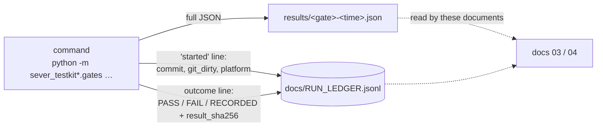

# 03 · Experiments and results

Every number below was read in this session from a file in the repository, by a read-only Python
parser; no gate, test or experiment was run for these documents. Sources use these short forms:

- **L*n*** = line *n* of `docs/RUN_LEDGER.jsonl` (the append-only run ledger; 224 lines,
  2026-10-04T15:23Z … 2026-11-01T19:51Z).
- **`results/…`** = the full result file a gate runner wrote; its SHA-256 is in the ledger line.
- **`artefacts/…`** = an output file that exists on disk but is **not tracked by git** and has no
  ledger line (weaker evidence; marked ⚠).

Labels: **GATE** = pass/fail with a threshold fixed before the run; **MEASURE** = reported as found;
**INTERIM** = an earlier run kept for the record, superseded by a later gate run (Build §2.5, DB-94).
Outcomes (PASS, FAIL, aborted, RECORDED, measured) are the ledger's own `outcome` field.

**Where everything ran.** Every ledger line records the same platform: `x86_64`, kernel
`6.6.114.1-microsoft-standard-WSL2`, CPU flags `avx2 fma aes sha_ni`. DB-113 names the machine: the
owner's laptop (Intel Core Ultra 5 226V, 8 cores, 16 GB; WSL2 Ubuntu 24.04 with 12 GB). There is no
run on native Linux or on other hardware.

---

## 1. What was tested

| Experiment (Overview) | Gate / measure | What it tests | Data, seeds | Baseline / comparison | Metric and threshold |
|---|---|---|---|---|---|
| Part 1 differential | P1-T1, T2, T4, T5 (GATE) | Engine vs independent Python reference model; each touched group after a delete equals a survivors-only group; scalar kernel = AVX2 kernel; no deleted record returned | nq-10k, nq-100k, 5 seeds; plus 1,000 synthetic streams | Python reference model `sever_refmodel_core` | mismatches = 0 |
| EX-5 | P1-T7 / P4-T13 (MEASURE, target T-6) | Recall@10 of dequantised Q24 vectors vs float brute force | nq-100k, nq-1m; 3,452 queries | float64 brute force on the original vectors | ≥ 0.999 |
| EX-1 | P2-T1…T3, P3-T4, P4-T3 (GATE, T-1) | Crash at every protocol step, at WAL byte offsets, at random points, and during recovery; with certificates (P3) and with keys on a second disk (P4) | nq-10k, 20,000 ops per seed, 5 seeds (P4-T3: two 300-op windows) | the durable reference model `sever_refmodel_durable` (B-shared) | 0 violations, 0 lost acknowledged ops |
| EX-3 | P3-T5, P4-T9 (GATE, T-3) | Replay Part 1 traces through later builds; five fields and certificate arithmetic | nq-100k (P3), nq-10k (P4), 5 seeds | Part 1 traces | 0 mismatches |
| EX-4 | P3-T1, T2; P4-T9 (GATE, T-4) | Honest certificates accepted and 20 attack kinds AT-1…AT-20 rejected by the independent verifier | nq-10k, 1,000 honest certificates per seed, 5 seeds | — | 100 % honest accepted, 0 attacks accepted |
| EX-2 | P4-T1, T2 (GATE, T-2) | Raw 16 GiB ext4 image scanned after ingest and after each deletion rung; planted positive controls; sabotage builds | nq-10k, 5 seeds; sensitivity on seed 42 | sabotage builds SB-24…SB-30 | 0 findings; 100 % controls found; each sabotage build ≥ 1 finding |
| EX-6 | P4-T12 (MEASURE, target T-5) | Recall@10 across 5 deletion rungs | nq-10k, 5 seeds, 3,452 queries | frozen-only arm; FAISS soft-delete IVF; FAISS rebuild IVF | drift ≤ 0.005 per seed; Welch t (α 0.005) |
| EX-7 | P4-T14 (MEASURE) | Cost of erasure: latency, bytes, fsyncs | nq-10k 5 seeds; nq-100k seed 42 | same engine without erasure (`noerase`); Part 2 engine with tombstones (`softdelete`) | descriptive |
| EX-8 | P4-T15 (MEASURE) | Memory and recovery at one million vectors | nq-1m | Appendix A prediction (≈ 3.8 GB) | descriptive |
| Code quality | P*n*-T9/T10/T11/T12 etc. (GATE) | Coverage, mutation score, fuzzing, traceability, sabotage builds, full-tier check suites | — | — | see tables |

**How to reproduce.** The exact command of each run is the `command` field of its ledger line; the
commands are summarised in [02](02_project_and_method.md) §5.5 and `scripts/hpc/steps.sh`. Each
result can be re-checked against its stored hash: `sha256sum results/<file>` must equal the line's
`result_sha256`.

---

## 2. Part 1 — The Idea

| Check | Kind | Result | Source |
|---|---|---|---|
| P1-T1/T2/T4/T5 at nq-10k, 5 seeds | GATE | **PASS**: 89,245 ops; 10,648,947 values compared, 0 mismatches; 43,562 survivor-group checks, 0 failures; 508,183,412 kernel pairs, 0 mismatches; 0 deleted records returned | L13; `results/p1-differential-nq-10k-20261005T133904Z.json` |
| same at nq-100k, 5 seeds | GATE | **PASS**: 731,105 ops; 12,389,642 compared, 0 mismatches; 427,455 survivor-group checks, 0 failures; 2,252,810,672 kernel pairs, 0 mismatches | L38; `results/p1-differential-nq-100k-20261006T170158Z.json` |
| L4 synthetic differential | GATE | **PASS**: 5 seeds, 13,155,903 values compared, 0 mismatches of any kind, 0 failed streams | L19; `results/p1-synthetic-20261005T134647Z.json` |
| P1-T7 (EX-5, T-6) | MEASURE | Recall@10 = **1.0** at nq-100k (86.3 s) and **1.0** at nq-1m (917.4 s); `met: true` | L9, L180; `results/p1-quant-recall-nq-100k-20261005T131137Z.json`, `…-nq-1m-20261030T232039Z.json` |
| P1-T10 coverage | GATE (Rust lines ≥ 90 %, branches ≥ 85 %; Python ≥ 90 %) | **PASS**: Rust lines 1,127/1,175 = 0.9591; branches 134/154 = 0.8701; Python lines 515/521 = 0.9885 | L32; `results/p1-coverage-20261006T150803Z.json` |
| P1-T11 mutation | GATE (≥ 85 %, survivors triaged) | **PASS**: 325 caught, 22 missed, 0 timeout, 71 unviable of 418 → 325/347 = 0.9366 | L30; `results/p1-mutants-20261006T150012Z.json` |
| P1-T12 fuzzing | GATE (10⁸ runs per parser, 0 crashes) | L18 **FAIL** (`artefact_parse` out-of-memory crash; fixed in `e7b4285`/`c7d1df3` "never reserve more than the remaining bytes can fill"); L22, L24, L26 **aborted** (OOM kill, WSL restart, machine down overnight); L28 **PASS**: `artefact_parse` 10⁸ in 1,777 s, `blob_parse` 10⁸ in 619 s | L18–L28; `results/p1-fuzz-*.json` |
| Full-tier checks (P1-T3, T6, T8, T9, T13) | GATE | L34 **FAIL** (step `sabotage`), then L36 **PASS** (17 of 17 steps) | L34, L36 |
| P1-T13 proof spikes | GATE | **PASS** | L16 |
| P1-T9 traceability | GATE (100 %) | 70 of 70 requirements have a test | `docs/TRACE_PART_1.md` |
| P1-T6 builder vs oracle | GATE (shrinkage 1e-12, τ 1e-9) | Largest differences over 5 seeds: shrinkage 2.08 × 10⁻¹⁷, τ 1.42 × 10⁻¹⁴ | ⚠ `artefacts/partition-seed*.json` (`oracle_shrinkage_diff`, `oracle_tau_diff`) |
| P1-T14 "the ghost" (nq-10k, seed 42) | MEASURE | After deleting a record, distance from the survivors-only summary: soft-delete IVF centroid 0.00504 (L2); float running mean max abs difference 1.86 × 10⁻⁸; SEVER Part 1: **0** (bit-identical). Measured on 4 spawned groups | ⚠ `artefacts/demo/idea-nq-10k-seed42.json` (`ghost`), written 2026-10-21 by the Part 1 demo; one seed only |

Aborted Part 1 runs, kept for completeness: L2, L4, L10 (P1-T2/T5: stopped to move the repository,
VM restart, stopped by operator), L7 (stopped seconds after start), L21 (nq-100k, OOM kill).

---

## 3. Part 2 — The Database

| Check | Kind | Result | Source |
|---|---|---|---|
| P2-T1…T3 crash campaign (EX-1, no certificates) | GATE | **PASS**, nq-10k, 5 seeds × 20,000 ops: **343,837** crash points (321,689 at protocol steps, 17,148 at 512-byte WAL offsets, 5,000 random); 6,874 double crashes (crash during recovery); 28,707 generic-record points; 0 states the oracle does not allow, 0 lost acknowledged ops, 0 partial `delete_user`, 0 startup refusals | L56; `results/p2-crash-nq-10k-20261008T012927Z.json` (an earlier one-seed PASS on a dirty tree: L40) |
| P2-T5 trace replay | GATE | **PASS**: 5 seeds × {plain, close, crash} | L51 (dirty tree, see [04](04_limitations_and_paper_outline.md) §2) |
| P2-T6 fuzzing, 4 parsers | GATE | L43, L45 **FAIL** (no target finished); L50 **PASS**: `wal_record` 524 s, `manifest` 580 s, `checkpoint_file` 1,251 s, `store_record` 281 s, each 10⁸ runs | L43–L50 |
| P2-T7 proof spikes | GATE | **PASS** | L48 |
| P2-T8 sabotage SB-1…SB-15 | GATE | **PASS** | L53 |
| P2-T9 coverage | GATE (lines ≥ 90 %, branches ≥ 85 %) | **PASS**: lines 3,689/3,891 = 0.9481; branches 339/391 = 0.8670 | L55; `results/p2-coverage-20261007T231603Z.json` |
| P2-T9 mutation | GATE (≥ 85 %) | **PASS**: 652 caught, 60 missed, 1 timeout, 155 unviable of 868 → 652/713 = 0.9144 | L60; `results/p2-mutants-20261008T072950Z.json` |
| P2-T9 traceability | GATE | 46 of 46 | `docs/TRACE_PART_2.md` |
| Full-tier checks (P2-T4, T10, E2E-2.x) | GATE | L62 **FAIL** (`ruff-format`, `python-tests`, `deny` of 19 steps); then **PASS** L64, L67, L76, L78, L82 | L62–L82 |
| P2-T11 cost (nq-100k, seed 42) | MEASURE | insert 8,062 B and 1.00036 fsyncs per op (100,000 ops); single delete 14,157 B/op (24,743 ops); multi-record `delete_user` 24,608 B/op (21,472 ops); recovery 0.0518 s from a checkpoint, 0.8472 s by WAL replay; peak resident memory 1,093,044 kB | L58; `results/p2-measures-nq-100k-20261008T013402Z.json` |
| Errata re-runs (E-1, E-2) | GATE-like | Clean-room suite: 256 tests, 255 passed, 0 failed, 1 skipped (opt-in slow test), both after E-1 and after E-2. Before E-1: "254 passed, 1 skipped, 1 deadlocked" | L79, L83; `results/cleanroom-p2-after-e1.json`, `…-e2.json` |
| Fair testing, Part 2 | — | L68 DRY; L72 **FAIL** (judge output missing; "valid planted bugs 0 of 0"). **No Part 2 fair-testing PASS exists in the ledger.** | L68, L72; `docs/audit/FAIRNESS_P2.md` |

---

## 4. Part 3 — The Receipt

### 4.1 Gates

| Check | Kind | Result | Source |
|---|---|---|---|
| P3-T1, T2 (EX-4, T-4) | GATE | L103, L113, L119 **FAIL** (see 4.3); **PASS** L123, L141, L206. Final (L206): 5 seeds × 1,000 honest = **5,000 accepted**; **226,410 attacks** (45,282 per seed) **all rejected**; 0 wrongly judged | L206; `results/p3-attacks-nq-10k-20261101T085746Z.json` |
| P3-T4 (EX-1 with certificates) | GATE | **PASS**, 5 seeds × 20,000 ops: **938,129** crash points (914,464 step, 18,665 offset, 5,000 random); 18,759 double crashes; **192,964 certificates checked**, 0 bad, 0 not-oracle states, 0 refusals | L144; `results/p3-crash-nq-10k-20261029T225309Z.json` |
| P3-T4 interim (19 Oct) | INTERIM | PASS: 145,919 crash points, 76,852 certificates | L97 |
| P3-T5 (EX-3, T-3) | GATE | **PASS**, nq-100k, 5 seeds (L148, 30 Oct); interim seed 42 PASS (L99) | L99, L148 |
| P3-T9 coverage | GATE (≥ 95 % `sever-crypto` and verifier; ≥ 90 % others) | L107 **FAIL** (verifier 0.7776), L115 **FAIL** (verifier 0.9448); **PASS** L121, L176, L200. Final (L200): crypto 0.9542, commit 0.9158, log 0.9309, cert 0.9589, verifier 0.9627 | L107–L200; `results/p3-coverage-*.json` |
| P3-T9 mutation | GATE (≥ 90 % crypto and verifier; ≥ 85 % cert and log; all triaged) | L147 **FAIL** (verifier mutants never ran — 0.0, 83 untriaged; sever-cert 0.8013); L156 **FAIL** (setup fault, every score 0.0); L158 **PASS**: cert 132/155 = 0.8516, crypto 0.9344, log 0.8910, verifier 219/225 = 0.9733, 0 untriaged | L147, L156, L158; DB-114 items 1–2 |
| P3-T10 fuzzing, 6 parsers | GATE | Interim at 10⁷ PASS (L102); **PASS** at 10⁸ (L162), slowest `audit/fuzz:export` 40,084 s | L102, L162 |
| Full-tier checks (P3-T3, T6–T8, T9 sabotage, T11, T12) | GATE | **PASS** L105 (36 steps), L172, L196 (42 steps) | L105, L172, L196 |
| Part 3 proof spike | GATE | **PASS** L111, L167, L204 | — |
| Traceability | GATE | 108 of 108 | `docs/TRACE_PART_3.md` |
| P3-T13 proof cost (d = 384) | MEASURE | Final (L182, 30 Oct; 20 deletions, 200 proofs): prove median 15.78 ms (max 46.29), verify median 2.74 ms (max 13.74), delete on the simulated disk median 13.38 ms; certificate 1,197–13,645 bytes (predicted 14,093 for a group deletion). Earlier (L109, 19 Oct): prove 12.17 ms, verify 2.20 ms medians | L109, L182; `results/p3-measures-nq-10k-*.json` |
| Fair testing, Part 3 | — | FAIL L131, L135, L194, L213; **PASS** L215 (`20261101T134211Z-p3-bb4bac5e`: 180 clean-room tests, 0 failing, 0 engine bugs, 0 spec gaps, 0 oracle disagreements) | `results/fair-*.json` |

### 4.2 Attack mix per seed (final run)

From `results/p3-attacks-nq-10k-20261101T085746Z.json`, seed 42 (identical counts for all 5 seeds):
AT-1 1,798; AT-2 899; AT-3 1,000; AT-4 12,586; AT-5 1,000; AT-6 1,000; AT-7 1,999; AT-8 1,000;
AT-9 1,000; AT-10 1,000; AT-11 1,798; AT-12 1,000; AT-13 303; AT-14 899; AT-15 1,000; AT-16 5,000;
AT-17 1,000; AT-18 6,000; AT-19 2,000; AT-20 3,000 → 45,282. The meaning of each AT-*n* is in Build 3-4
(the attack register). [NEEDS INPUT: whether the paper should list the 20 attack kinds; they are
defined in `docs/SEVER-DB_BUILD_PLAN_PART_3-4.md`, not summarised here.]

### 4.3 What the failed attack runs show (a finding, not a footnote)

- **First run (L103, 19 Oct)** generated 47,000 attacks per seed. The verifier **accepted** three
  AT-14 forgeries (seed 42: 2; seed 777: 1). Commit `2cd8b12` found that the *generator* was wrong:
  AT-14 "flips the emptied flag instead of setting it to its own value" — setting a flag to the value it
  already had produces an honest certificate, which the verifier correctly accepted.
- **Second run (L113)** stopped in the generator on every seed ("sever-crashkit-p3: no group cert"):
  a harness fault, fixed in `9d1cb3d` (only some holding-area records are deleted at once, so not every
  certificate is a holding-area one).
- **Third run (L119)** failed on **AT-2** for seeds 777 (1 accepted) and 9999 (2 accepted): a proof
  copied from one group-emptying certificate into another was accepted. This is a real property of
  the construction, recorded as gap **G-34**
  (`docs/SPEC_GAPS.md`): when the group is emptied, `C_S_post` is the identity and the proof check
  `z·G = A` holds "whatever the challenge". The response (DB-95) was to **state the exception in §9.5**
  and change the generator so that AT-2/AT-3/AT-13 take their donor from a certificate that does not
  empty its group (commit `59e0a45`). A special proof form was rejected as changing the certificate
  format "for no security gain", since step 6 (`C_S_post + C_t = C_S_pre`) and the operator signature
  still bind the certificate.
- Consequence for reading T-4: the attack set **changed after failures**. Between L103 and L119 the
  generator fixes (`2cd8b12`, `9d1cb3d`) changed the per-seed mix from 47,000 to 45,282 attacks
  (AT-1 2,000 → 1,798; AT-2 1,000 → 899; AT-4 14,000 → 12,586; AT-11 2,000 → 1,798; AT-14
  1,000 → 899; AT-13 0 → 303). After L119, the AT-2/AT-3/AT-13 donors were restricted to
  non-emptying certificates (`59e0a45`); the counts stayed the same (L123, L206), but the attack that
  succeeded is no longer generated. The weakness G-34 describes is documented, not removed.

---

## 5. Part 4 — The Erasure

### 5.1 Gates

| Check | Kind | Result | Source |
|---|---|---|---|
| P4-T1, T2 (EX-2, T-2) | GATE | **PASS**: nq-10k, 5 seeds, 16 GiB images, override `allow_unsafe_fs` recorded (fuse2fs mounts are not on §12.9's list; G-35, DB-96). 6 scans per seed (after ingest and each rung): **0 findings in all 30 scans**; every planted secret found in every scan (plaintext vector, float vector, passage text, `r_t`, retired key) | L159; `results/p4-forensics-nq-10k-20261030T141339Z.json` |
| P4-T2 sensitivity (seed 42, ingest + rung 1) | GATE | Every sabotage build found: SB-24 2,374 findings; SB-25 1,178; SB-26 924; SB-28 4,246; SB-29 65,738; SB-30 65,229 | same file, `sensitivity` |
| P4-T3 (EX-1 on the final build) | GATE | Window A (ops 17,694–17,993), seeds 42/123/777: **PASS**, 15,240 / 15,170 / 15,225 crash points incl. torn key-slot writes; 100/100 key losses refused per seed; 0 stale key slots, 0 unreadable records (L164). Window B (ops 18,700–18,999), seeds 2024/9999: L168 **FAIL** (82 method mismatches — harness fault, DB-114 item 5), then **PASS** (L192): 7,915 and 9,050 crash points | L164, L168, L192; `results/p4-crash-nq-10k-*.json` |
| P4-T9 (T-3 on the final build) | GATE | **PASS**, nq-10k, 5 seeds (L154, L210) | — |
| P4-T9 (T-4 on the final build) | GATE | **PASS** (L142, L208): 5,000 honest accepted, 226,410 attacks rejected | `results/p4-attacks-nq-10k-20261101T090800Z.json` |
| P4-T10 fuzzing, 5 parsers | GATE | **PASS** at 10⁸ (L153) | `results/p4-fuzz-20261030T063228Z.json` |
| P4-T10 coverage | GATE (lines ≥ 95 % on keys, seal, erasure) | L179 **FAIL** (keys 0.9139, seal 0.9337, erasure 0.9231); **PASS** L191, L202: keys 0.9813, seal 0.9615, erasure 0.9558 (L202) | `results/p4-coverage-*.json` |
| P4-T10 mutation | GATE (≥ 90 %, 0 untriaged) | L170 **FAIL** (erasure 0.7652, seal 0.7793, 71 untriaged); L189 **FAIL** as recorded (all ≥ 0.90, but 1 untriaged survivor — a timeout, `sever-keys/src/lib.rs:103:25`) — **accepted as a pass by the owner** (DB-114); L220 **PASS** (1 Nov): erasure 0.9044, keys 0.9767, seal 0.9586, 0 untriaged | L170, L189, L220 |
| Full-tier checks (P4-T4…T8, T10 sabotage, T11) | GATE | **PASS** L174, L198 (42 steps) | — |
| Traceability | GATE | 69 of 69 | `docs/TRACE_PART_4.md` |
| Fair testing, Part 4 | — | FAIL L133, L137, L217, L222; **PASS** L224 (`20261101T192712Z-p4-36291aec`: 101 clean-room tests, 0 failing) | `results/fair-*.json` |

### 5.2 EX-2 detail: the "live record" control

Each scan also tries to recover 20 *live* records by carving the engine's structures with the keys
it knows. The pass rule does not require this (`ok = clean and n_findings == 0 and all planted found`
in [ex2.py](../python/sever_experiments/ex2.py)), and the code comment says the count "depends on what
free space still holds". Recorded counts (same result file):

| Seed | ingest | rung 1 | rung 2 | rung 3 | rung 4 | rung 5 |
|---|---|---|---|---|---|---|
| 42 | 20 | 0 | 0 | 0 | 6 | 16 |
| 123 | 20 | 0 | 0 | 0 | 4 | 12 |
| 777 | 19 | 0 | 0 | 0 | 9 | 12 |
| 2024 | 20 | 0 | 0 | 0 | 5 | 12 |
| 9999 | 20 | 0 | 0 | 0 | 4 | 16 |

So after rungs 1–3 the scanner recovered **none** of the 20 live records it should be able to read.
"0 findings of deleted data" in those scans is therefore weaker evidence than after ingest or rung 5.
The sabotage builds (5.1) do show that the scanner finds deleted payloads and keys when they leak.
[NEEDS INPUT: why live-record recovery drops to 0 after rungs 1–3 — not explained in the code or the
decision register.]

### 5.3 EX-6: search stability (T-5) — target **not met**

`results/p4-ex6-nq-10k-20261030T154119Z.json`, L161 (`outcome: RECORDED`, `t5_met: false`). Run at
nq-10k instead of the pre-registered nq-100k (DB-113). 171 groups at rung 0 (128 frozen + 43 spawned);
FAISS arms use `nlist` 171, `nprobe` 43. Records searchable at rungs 0…5 (seed 42): 9,821; 8,839;
7,365; 4,930; 2,466; 993.

**Drift (std. dev. of Recall@10 over rungs 1–5, ddof 0) per seed**

| Seed | SEVER-DB | Frozen-only | Soft-delete IVF | Rebuild IVF |
|---|---|---|---|---|
| 42 | 0.01295 | 0.02314 | 0.02097 | 0.00937 |
| 123 | 0.01046 | 0.01862 | 0.02014 | 0.00810 |
| 777 | 0.01279 | 0.02569 | 0.01919 | 0.00761 |
| 2024 | 0.00791 | 0.02101 | 0.02089 | 0.01016 |
| 9999 | 0.01037 | 0.01880 | 0.02133 | 0.00648 |
| Bootstrap 95 % of mean | [0.00938, 0.01240] | [0.01917, 0.02380] | [0.01976, 0.02109] | [0.00726, 0.00943] |

Pre-registered target: ≤ 0.005 per seed → **missed on all five seeds** (ddof 1 values are larger still,
0.00884–0.01448).

**Pre-registered tests (SEVER-DB vs soft-delete IVF, per-seed drift, n = 5 each):** Welch
t = −9.571, p = 0.00015 (< α = 0.005): SEVER-DB's drift is smaller than soft-delete IVF's. TOST with
δ = 0.005: p = 0.997, so equivalence is **not** shown (as the pre-registration expected).

**Recall@10, rung 0 → rung 5 (range over seeds):** SEVER-DB 0.952–0.954 → 0.917–0.930; frozen-only
0.925–0.941 → 0.855–0.887; soft-delete IVF 0.959–0.963 → 0.900–0.909; rebuild IVF 0.959–0.963 →
0.933–0.941.

**Shape:** out-of-distribution rate of the inserts 0.8722–0.8750 per seed; 165–193 records in the
holding area at rung 0 (not searchable and excluded from the ground truth of every arm).

**nDCG@10 for SEVER-DB rises** from 0.923–0.928 at rung 0 to 0.957–0.974 at rung 5 — recorded, and
discussed in §8.

### 5.4 EX-7: the cost of provable erasure

One `delete_user` call per cohort; "per record" divides by deleted records. Source:
`results/p4-ex7-nq-100k-20261031T073714Z.json` (L186, seed 42 only, no interval) and
`results/p4-ex7-nq-10k-20261031T021052Z.json` (L184, 5 seeds; mean and bootstrap 95 % over seeds).

| Arm (what it is) | nq-100k delete p50 / p99 per call (µs) | nq-100k bytes / fsyncs per deleted record | nq-10k delete p50 per call, mean [95 %] (µs) | nq-10k bytes per deleted record | Insert p50 nq-10k (µs) | Search p50 nq-100k (µs) |
|---|---|---|---|---|---|---|
| `sever` (final engine) | 109,129 / 504,920 | 39,525 B / 10.11 | 75,333 [74,539, 76,381] | 38,874 | 18,644 | 453 |
| `noerase` (encrypted, no key rotation or erase) | 59,880 / 376,341 | 27,279 B / 7.70 | 65,528 [64,885, 66,324] | 27,122 | 17,802 | 446 |
| `softdelete` (Part 2 engine, durable tombstone) | 907 / 18,930 | 11 B / 0.51 | 1,417 [1,328, 1,522] | 10 | 1,881 | 4,711 |

Deletes per second at nq-100k: 7.63 (`sever`), 12.70 (`noerase`), 741.37 (`softdelete`). Certificate
size at nq-100k: mean 13,986 B (`sever`, `noerase`), 0 (`softdelete`). The `sever` arm's secret
material per deleted record at nq-100k: WAL 13,706 B, of which bucket blocks 4,208 B; key file 972 B;
wrapped-key store 4,752 B (field `secret_material_per_deleted_record`).

### 5.5 EX-8: scale at one million vectors — **not completed**

No ledger line and no result file exist (`grep -c ex8 docs/RUN_LEDGER.jsonl` → 0). DB-114 records
that the kernel's out-of-memory killer stopped the benchmark after 6 h 11 min at 10.39 GB resident
memory (12 GB WSL, no swap); before that it held 6.4–6.9 GB, against Appendix A's 3.8 GB prediction,
a figure that includes the benchmark's own 1.5 GB copy of the input. The owner chose not to rerun.
These memory figures come only from the decision text (DB-114), not from an output file.

---

## 6. Aims vs outcomes

| Aim (pre-registered) | What we got | Status |
|---|---|---|
| T-1: 0 crash violations | 0 in 343,837 (Part 2), 938,129 (Part 3) and 62,600 (Part 4: 15,240 + 15,170 + 15,225 + 7,915 + 9,050, two 300-op windows) crash points | **Achieved**, with two scope limits: Part 4 covers two windows per seed, not all 20,000 ops (DB-113); P3-T4 and P4-T3 last ran on commit `7c445b5`, before the final November changes, and were not rerun on the frozen commit (DB-116) |
| T-2: 0 forensic findings | 0 in 30 scans; all planted controls found; all 6 sabotage builds detected | **Achieved at nq-10k** (pre-registered nq-100k; DB-113), inside a WSL2 guest with `allow_unsafe_fs`; live-record control 0/20 after rungs 1–3 (§5.2) |
| T-3: 0 engine vs reference mismatches | 0 at nq-10k and nq-100k (Part 1), nq-100k (Part 3), nq-10k (final build) | **Achieved**; final-build check at nq-10k only |
| T-4: honest = 1.0, attacks = 0.0 | 5,000/5,000 accepted; 226,410/226,410 rejected (Part 3 and final build) | **Achieved on the final attack set**, which was narrowed after the G-34 failure (§4.3) |
| T-5: drift ≤ 0.005 per seed | 0.0079–0.0130 | **Not achieved** |
| T-6: quantised Recall@10 ≥ 0.999 | 1.0 at nq-100k and nq-1m | **Achieved** |
| EX-7 cost of erasure | Recorded at nq-10k (5 seeds) and nq-100k (1 seed) | **Partial** (pre-registered nq-100k and nq-1m, all seeds; DB-113) |
| EX-8 scale | No result | **Not achieved** (OOM) |
| Every part frozen after a fair-testing PASS (FT-10) | PASS for Parts 3 and 4 | **Partial**: no Part 2 PASS (§3) |
| Every gate of v1.0 passes | 16 of 17 pass as recorded; P4-T10 recorded FAIL, accepted by the owner, later PASS at L220 | **Partial / owner-accepted** (DB-114) |

---

## 7. Bugs found by the testing

The repository records these defects found by its own tests (sources: `ERRATA.md`, commit messages,
DB entries). They are evidence that the testing could fail, and part of the honest record.

| What | Found by | Fix |
|---|---|---|
| Partition parser allocated memory from an untrusted length (OOM) | Fuzzing, P1-T12 (L18) | `e7b4285` / `c7d1df3` |
| `apply` lost slots on a drain into a missing group | Closing branch-coverage gaps (P1-T10) | `9a460ce` |
| **E-1**: Python SDK deadlock when one database is used from several threads | Clean-room tester (fair-testing run `…-p2-42fc06df`) | Erratum E-1, tag `part-2-frozen-e1` |
| **E-2**: a participant's `pre_transaction` hook was never called | Building Part 3 | Erratum E-2, tag `part-2-frozen-e2` |
| A stored log leaf past the last committed WAL entry was accepted on recovery | Fair testing, 20 Oct (DB-99) | `3f2aef5` |
| Damaged log-checkpoint store opened as an older log (BH-7); older store segment cut short read as shorter (BH-6); a missing checkpoint store caused the whole log to be re-created and erased (BH-9) | Fair run `20261031T225306Z-p3-1479019b` and the bug hunt (DB-116) | `a35c5c2`, `c629c6a`, `d5e41db` |
| Empty vector accepted as d = 0 | Part 4 fair run (DB-118) | `36291ae` |
| Proof replay between group-emptying certificates | P3-T2 (L119) | Documented as G-34 / DB-95; not changed in code |

Harness faults (bugs in the test tooling, not the engine) were also found and fixed: the AT-14
generator (§4.3), the verifier's mutants never running, mutants of sabotage-only code counted as
survivors, a FAISS seed overflow, EX-6 mis-tracking the holding area (which would have reported
SEVER-DB recall ≈ 0.10 instead of ≈ 0.94 — caught before any result was recorded), and P4-T3's
method check comparing a file size recovery legitimately changes (DB-114 items 1–5). DB-114 states
that between `7c445b5` and the fix commit "only test code, the test kits and documents differ".

---

## 8. Findings and discussion

**What the results support.**
1. *Exact deletion is real at the tested scale.* Across 13.2 M synthetic and 23.0 M real compared
   values and 471,017 survivor-group checks, the Rust engine and the separately written Python model
   never disagreed, and every touched group after a delete was identical to a survivors-only group.
   The Part 1 demo shows the contrast: a float running mean left a residue of about 1.9 × 10⁻⁸ and a
   soft-delete IVF centroid 0.005, against exactly 0 for SEVER-DB (one seed, ⚠ untracked file).
2. *Crash safety held* in 1,344,566 crash points across the three campaigns (343,837 + 938,129 +
   62,600), with certificates
   checked at every recovery in Part 3 (192,964).
3. *Certificates can be checked by a separate program.* The verifier shares no code with the engine
   and accepted all honest and rejected all forged certificates of the final attack set.
4. *Q24 integers cost no measurable search accuracy* against float brute force (Recall@10 = 1.0 at
   10⁶ vectors).
5. *Erasure has a price.* A provable-erasure delete took about 75 ms (nq-10k) to 109 ms (nq-100k) per
   call and wrote about 39 KB per deleted record, against about 0.9–1.4 ms and 10–11 bytes for a
   tombstone. Most of the gap is from encryption and certificates (`noerase` already costs 60–66 ms and
   27 KB); key rotation and erasure add roughly 10–50 ms and 12 KB.

**What they do not support.**
- *Search stability (T-5) failed.* SEVER-DB's recall drifts 1.6–2.6 times the target (0.0079–0.0130 against 0.005). It drifts
  significantly less than a soft-delete IVF (Welch p = 0.00015) but more than an IVF rebuilt after every
  rung, and it starts lower than both FAISS arms at rung 0 (≈ 0.953 vs ≈ 0.960).
- *No comparison with production vector databases.* All baselines are in-repository variants or FAISS
  configured by the project. Nothing here shows SEVER-DB is better or worse than Milvus, Qdrant,
  pgvector, Chroma, etc. (the Studio's 3-note Chroma observation is a demo, §5.6 of 02).
- *Laptop scale.* Results above nq-100k exist only for P1-T7 (recall, not the database); EX-8 did not
  complete.

**Surprises.**
- About **87 % of NQ inserts are out-of-distribution** for the SciQ-fitted partition (EX-6 shape:
  0.872–0.875; the Part 1 demo: 0.8779). The design predicted "about 90 %" (DB-41), so most live data
  lives in spawned groups, not in the frozen groups the design is built around. The frozen-only arm
  (spawning off) has the worst recall and drift, which shows spawning matters.
- **nDCG@10 rises as records are deleted** (0.92 → 0.96–0.97). The nDCG function receives the set of
  live IDs (`ndcg10(found, qrels, live_ids)` in ex6.py), so the ideal ranking also shrinks; with 42 %
  of nq-10k being judged passages, deleting cohorts changes the judged set itself. This should not be
  read as deletion improving search. [NEEDS INPUT: confirm the intended nDCG normalisation before
  reporting nDCG in the paper.]
- **The verifier accepted forged-looking proofs** for emptied groups (G-34); the response was a spec
  statement, not a code change.
- Many gates **failed first** and passed after fixes (P1-T12, P2-T6, P3-T1/T2, P3-T9 ×2, P4-T3,
  P4-T10 ×2). The ledger keeps every failure. In several cases (P3-T9 coverage, P3/P4 mutation)
  tests were added until the unchanged threshold was met; thresholds were never lowered (DB-114
  "Rejected: … Lowering a threshold").

---

## 9. README numbers vs output files

The repository README (`README.md`) quotes results. Checked against the files above:

| README (line) | File value | Verdict |
|---|---|---|
| P1-T4 "10^7 random pairs" (L123) | Loop of 10,000,000 in [crates/sever-search/src/tests.rs:115](../crates/sever-search/src/tests.rs#L115); no output file records the run separately | Code exists; **no recorded output** |
| P1-T6 "2e-17 and 1.4e-14" (L125) | 2.08e-17, 1.42e-14 | ✓ (⚠ untracked file) |
| P1-T14 ghost "5.0e-3, 1.9e-8, 0" (L133) | 0.00504, 1.86e-8, 0 | ✓ (⚠ untracked file, one seed) |
| P2 "28,707 generic-record points" | Σ `generic.points` = 28,707 | ✓ (the earlier `project_report/11_results.md` wrongly listed this as not found) |
| P3 numbers in README (crash 145,919; 76,852 certificates; coverage; 10⁷ fuzz; prove 12.2 ms) | Interim values (L97, L102, L109, L121) | ✓ but **interim**; final values differ (§4.1) |
| Part 3 status "it freezes after a fair-testing pass" (L19); "run once, in full, on the college HPC" (L294, L356, L381) | `part-3-frozen` and `part-4-frozen` tags exist; the v1.0 runs were on the laptop (DB-113) | **Stale** |
| P4-T10 "68 / 68 requirements traced" (L361) | `docs/TRACE_PART_4.md`: 69 of 69 | **Mismatch** |
| T-5 | Not met | **Not reported** in README |
