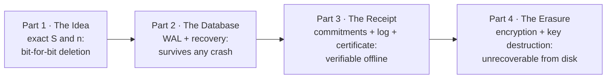

# 01 · Overview and the core idea

## In simple words

AI applications store text as lists of numbers (vectors) in a **vector database**, so they can find
passages with a similar meaning. When a person asks for their data to be deleted, most vector databases
only hide it: the numbers stay in the index, and summaries computed from them still carry their trace.
SEVER-DB is a vector database built so that deletion is **exact**, **provable** to anyone, and
**permanent** on disk. It does this with exact integer arithmetic, cryptographic receipts, and
encryption whose keys are destroyed on deletion.

> **Prerequisites.** None beyond basic programming. Start with
> [B00 Start here](background/B00_START_HERE.md); the terms in this file link to
> [16_glossary.md](16_glossary.md). Background: [B01](background/B01_vectors_embeddings_and_search.md)
> (vectors), [B03](background/B03_floating_point_vs_exact_integers.md) (exact integers).

## The problem this solves: "ghosts"

Picture a help-desk AI that stored 10,000 passages, including three written by Asha. Asha asks for
deletion. A typical vector database:

1. marks her three records as deleted (a **tombstone**) but keeps the bytes until a later clean-up;
2. leaves each group's **centroid** (average position) computed *with* her vectors;
3. keeps old copies in log files and free disk space.

So her data still influences the system and can still be recovered. This leftover trace is what the
project calls a **ghost** ([glossary](16_glossary.md#ghost)). Even subtracting her vector from a
floating-point running mean does not restore the survivors' mean exactly
([B03](background/B03_floating_point_vs_exact_integers.md): `0.20000000000000004` vs `0.2`). The legal
and research background (the right to erasure, embedding inversion) is in
[R01](research/R01_motivation_and_problem.md).

## The core idea, built up step by step

### Step 1 — Fixed groups

Vectors are sorted into **groups** (clusters). SEVER-DB fixes 128 groups once, offline, on a public
dataset (SciQ) that contains no user data, and never moves them. So every vector lives in exactly one
group, and deleting it touches exactly one group [DOC: docs/SEVER-DB_SPECIFICATION.md §1, §6.1].

### Step 2 — Exact integers instead of floats

Each vector component is converted to a whole number: `x̃ = round(x · 2^24)` (**Q24**). Each group keeps
the exact integer **sum** `S` of its members and the **count** `n`. Deleting subtracts exactly:

**Illustrative example, not from the repository** (one dimension):

| | Members | `S` | `n` |
|---|---|---|---|
| after inserting a, b, c | a = 1677722, b = 11744051, c = 3355443 | 16777216 | 3 |
| after deleting b | a, c | 5033165 | 2 |
| if b had never arrived | a, c | 5033165 | 2 |

Rows 2 and 3 are **bit-for-bit identical**. That is Part 1's claim.

### Step 3 — Survive crashes

A **write-ahead log** and checkpoints make every change all-or-nothing, even if the power fails at any
moment. That is Part 2's claim.

### Step 4 — A receipt anyone can check

Each group also carries a **Pedersen commitment** (a public value that locks in the hidden sum). After a
deletion, the group's commitment equals the old one minus the deleted record's, and the database signs
a **deletion certificate** containing that arithmetic, a proof, and the record's position in a public
**transparency log**. Anyone can check it offline with `sever-verify`. That is Part 3's claim.

### Step 5 — Nothing recoverable from disk

Everything secret is stored encrypted under a three-level key hierarchy. Each deletion rotates the keys
of the group and destroys the old top-level key before saying "done", so every old copy becomes
unreadable (**crypto-shredding**). That is Part 4's claim.

## Everyday analogy

*Analogy:* Think of a bank vault with labelled drawers (groups). Each drawer has a till slip showing the
exact total of coins inside (S) and how many (n). Taking coins out changes the slip exactly (Part 1).
Every change is first written in a diary so a power cut cannot leave a drawer half-changed (Part 2). The
bank publishes a sealed-envelope version of every slip and gives you a notarised receipt that your coins
left (Part 3). And every drawer's lock is changed when coins leave, and the old key is burned (Part 4).
*Where it stops:* a bank's customers trust the bank; SEVER-DB's receipt is checkable without trusting the
database, but it cannot stop an operator who secretly copied your data beforehand (limit L-2).

## The four parts and their verified status

| Part | Claim | Status | Evidence |
|---|---|---|---|
| 1 The Idea | deleting returns the group, bit for bit, to the never-inserted state | done, frozen (`part-1-frozen`, 6 Oct 2026) | 427,455 survivor checks, 0 failures (nq-100k) [DATA: ledger line 38] |
| 2 The Database | exactness survives any crash; nothing acknowledged is lost; multi-group deletion is all-or-nothing | done, frozen (`part-2-frozen-e2`, after errata E-1, E-2) | 343,837 crash points, 0 failures [DATA: line 56] |
| 3 The Receipt | every deletion yields a certificate anyone can verify offline | done, frozen (`part-3-frozen`, 1 Nov 2026) | 5,000 honest certificates accepted, 226,410 attacks rejected [DATA: line 206] |
| 4 The Erasure | after acknowledgement nothing deleted is recoverable from raw storage | done, frozen (`part-4-frozen` = `v1.0.0`, 1 Nov 2026) | 0 forensic findings in 30 raw-image scans [DATA: line 159] |

Honest caveats (details in [14](14_status_gaps_and_pending.md)): witnesses are simulated in v1; the
operator holds every key; the search-stability target T-5 was not met; the EX-8 scale measure did not
complete; P4-T10 passed first by the owner's acceptance of one untriaged timeout.

## How SEVER-DB does it (one paragraph each, with pointers)

- **Index**: `sever-index` keeps `S: i64` and `n: u64` per group and physically removes deleted records
  [CODE: crates/sever-index/src/index.rs:L747-L836] → [05](05_part1_the_idea.md).
- **Storage**: eight-step transaction protocol with a single commit point
  [CODE: crates/sever-txn/src/protocol.rs:L1-L16] → [06](06_part2_the_database.md).
- **Receipts**: `C_S_post + C_t = C_S_pre` checked by an independent verifier
  [CODE: verifier/src/verify.rs:L191-L215] → [07b](07b_pedersen_commitments_and_proofs.md)–[07d](07d_deletion_certificate_and_verification.md).
- **Erasure**: new key before COMMIT, old key zeroed after it
  [CODE: crates/sever-erasure/src/participant.rs:L1-L9] → [07e](07e_encryption_and_crypto_shredding.md).
- **Testing**: independent reference model, crash campaigns, attacks, forensics, sabotage, fair testing
  → [10](10_testing_methodology.md); results → [11](11_results.md).

## Key points to remember

- A "ghost" is what ordinary deletion leaves behind: tombstones, biased centroids, float drift, disk copies.
- Fixed groups + integer sums make deletion exact.
- WAL + recovery make it crash-safe; commitments + log + certificates make it verifiable; key
  destruction makes it permanent.
- All four parts are frozen at `v1.0.0`, with stated limits.

## Check your understanding

1. *Why can't a float running mean be "un-averaged" exactly?* — Each float operation rounds; the errors do not cancel.
2. *Why are the groups fitted on SciQ, not on user data?* — So the groups hold no user data and never move.
3. *What does a deletion certificate let a stranger check?* — That the group's commitment fell by exactly the deleted record's commitment, under signed, witnessed log data.
4. *What does Part 4 add that Part 3 does not?* — Encryption and key destruction, so old disk copies are unreadable.
5. *Name one thing SEVER-DB does not guarantee.* — That a dishonest operator kept no copy (L-2).
