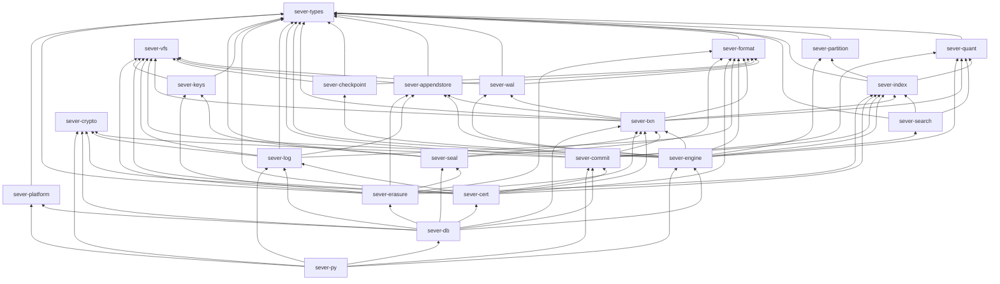

# 04 · Architecture

## In simple words

SEVER-DB is built in layers. At the bottom is a **pure core** (Part 1) with no files, clock or
randomness. Part 2 puts a storage engine under it. Part 3 plugs a commitment extension and a
transparency-log participant into extension points that Parts 1 and 2 declared. Part 4 plugs in
encryption and key rotation the same way. The final database `sever-db` is a **composition root** that
wires them together. Nothing in a lower layer depends on a higher one.

> **Prerequisites.** Traits and generics ([B06](background/B06_rust_and_python_for_this_project.md));
> transactions ([B02](background/B02_how_databases_store_and_delete.md)). Glossary:
> [extension point](16_glossary.md#ep-n-extension-point), [composition root](16_glossary.md#composition-root),
> [participant](16_glossary.md#participant).

## The problem this solves

Each part must be frozen and its evidence must stay valid, yet later parts add behaviour. The answer is
**extend, never edit** (F-3): later parts only implement interfaces that earlier parts declared.

## Crate dependency graph (from `cargo metadata`, normal dependencies only)



[RUN: `cargo metadata --format-version 1 --no-deps` in this session; edges to `sever-types`/`format`/
`index`/`quant`/`vfs` from `sever-db` and `sever-py` are omitted from the drawing for readability; the
full lists are in [_notes/inventory.md](_notes/inventory.md)]. `sever-crypto` and `sever-vfs` depend on
no other SEVER crate. The verifier and auditor are outside this graph entirely.

## Layering and where it is enforced

| Layer | Crates | Rule | Enforced by |
|---|---|---|---|
| Pure core (Part 1) | types, quant, partition, index, search | no file I/O, clock, RNG; scrambling key handed in | `tests/architecture/test_architecture.py:L117` (regex + dependency-closure ban on `std::fs`, `std::time`, `OsRng`, `rand`, `getrandom`, …) |
| Storage (Part 2) | vfs, format, wal, appendstore, checkpoint, txn, engine | all file I/O through `Vfs`; no `mmap` | `test_architecture_p2.py` (SR-12.2-1, SR-12.7-3) |
| Receipt (Part 3) | crypto, commit, log, cert | only pinned primitives | `test_architecture_p3.py` (SR-9.1-1) |
| Erasure (Part 4) | keys, seal, erasure, platform | `aes-gcm-siv 0.11.1` pinned; one copy per crypto family | `test_p4_pins.py` |
| Independent checkers | verifier/, audit/ | share no code with the engine | `test_architecture_p3.py:L52-L106` |
| All | — | part N depends only on parts ≤ N | `test_architecture.py` PART map |

[CODE: tests/architecture/*; DOC: _notes/testing.md §12]

## Extension points (EP) and contract suites

| EP | Declared by | Interface | Implementations | Contract suite |
|---|---|---|---|---|
| EP-1 | Part 1 | `GroupExtension` (per-group public/secret state, admit, add, remove, check_removal, blob region) | `NoExtension` (P1, magic `SEVERC`); `CommitmentExtension` (P3, magic `SEVERG`) | sever-index `contract-tests` |
| EP-2 | Part 1 | `IdScrambler` | `HmacSha512Scrambler` | sever-index |
| EP-3 | Part 1 | `ChangeSet` (read by later parts) | logged (P2), certified (P3), rotated (P4) | — |
| EP-4 | Part 1 | `SecretMemory` provider | heap (P1); mlock provider (P4) | `p4_platform_ep4_mlock_provider_passes_contract` |
| EP-5 | Part 2 | `Vfs` | `PosixVfs`, `SimVfs` | `ep5_functional_contract`, `ep5_crash_contract` |
| EP-6 | Part 2 | `Sealer` | `PlaintextSealer` (P2, P3); `AeadSealer` (P4) | spike + contract |
| EP-7 | Part 2 | `TxnParticipant` (prepare, phase A, after_commit, replay, recover) | `LogParticipant` (P3); `KeyRotationParticipant` (P4) | spike + contract |
| EP-8 | Part 2 | `AppendStore` | `FileStore` | sever-appendstore `contract-tests` |
| EP-9 | Part 2 | `Clock` | `SystemClock`, `SimClock` | — |
| EP-10 | Part 3 | `Witness` | `SimulatedWitness` | `ep10_contract` (P3-T12) |
| EP-11 | Part 4 | platform probe | Linux probe | sever-platform `contract.rs` |

[CODE: crates/sever-index/src/ext.rs:L11-L102; scramble.rs:L9-L12; crates/sever-txn/src/sealer.rs:L34-L100;
participant.rs:L67-L141; clock.rs:L7-L51; crates/sever-vfs/src/contract.rs; crates/sever-log/src/witness.rs:L28-L238;
DOC: Build §3.3, Build 3-4 §1.5, §2.4]. Each part's **proof spike** showed the next part could plug in
before the part froze (P1-T13, P2-T7, Part 3 spike) [DATA: ledger lines 16, 48, 204].

The final composition root is `Engine<CommitmentExtension, AeadSealer, (LogParticipant,
KeyRotationParticipant)>` [CODE: crates/sever-db/src/lib.rs:L2 (doc comment); the Rust type is
`pub type FinalEngine = Engine<CommitmentExtension, AeadSealer>` at L46, with the two participants
registered at open].

## End-to-end flows

### insert (final build)

```mermaid
sequenceDiagram
  participant B as App backend (SDK)
  participant E as Engine
  participant I as Index (P1)
  participant C as Commitment ext (P3)
  participant L as Log participant (P3)
  participant K as Key rotation (P4)
  participant W as WAL (P2)
  B->>B: prepare_insert: quantise, r_t ← OS, C_t, sign
  B->>E: insert(request)
  E->>I: plan_insert (check vector, ID, route, capacity, maybe flush)
  I->>C: admit (recompute C_t, verify signature)
  E->>L: prepare (insert leaf)
  E->>K: prepare (new RK_t, wrap; new domain keys if a group spawns)
  K->>K: phase A (new keys to KEYS + fsync)
  E->>W: BEGIN … COMMIT + fsync
  E->>I: apply (S += x̃, n += 1, C_S += C_t, r_agg += r_t)
  E-->>B: Receipt(database_lsn, placement)
```

### search

Check the query (§4.1) → rank all frozen and spawned groups by centroid distance → probe `⌈k/4⌉` →
score members with the pinned kernel over the float32 mirror → top-k by `(score, ID bytes)`. Search
never writes and never touches keys on disk [DOC: §8, §15.5].

### delete (one record)

Plan (membership check; absent → `AlreadyAbsent`, nothing written) → `pre_transaction` (an on-demand
witnessed log checkpoint, committed as its own transaction, if none covers the insert leaf) → prepare:
certificate built with the proof ([07d](07d_deletion_certificate_and_verification.md)), domain rotated
([07e](07e_encryption_and_crypto_shredding.md)) → phase A → COMMIT → apply (S −= x̃, …) → phase C (old
key zeroed) → acknowledge with the certificate.

### delete_user (several records, several groups)

Same as delete, but all records are planned into **one** ChangeSet and **one** transaction; one
certificate per record; every touched domain rotates once; all or nothing.

| Part | insert adds | delete adds |
|---|---|---|
| 1 | route, `S += x̃`, `n += 1` | membership check, `S −= x̃`, excision |
| 2 | WAL transaction, payload store | one transaction for the whole cohort |
| 3 | `C_t` check, insert leaf, `C_S += C_t` | witnessed checkpoint, certificate + proof, delete leaf |
| 4 | sealed payload, wrapped `RK_t` | rotation, phase A/C, old key zeroed before ack |

## Key points to remember

- Lower layers never depend on higher ones; the pure core has no I/O, clock or RNG.
- Later parts add behaviour only through declared extension points (EP-1 … EP-11).
- The final database is one generic engine instantiated with Part 3 and Part 4 plug-ins.
- `delete_user` is one transaction regardless of how many groups it touches.

## Check your understanding

1. *Which extension point carries key rotation?* — EP-7 (`TxnParticipant`).
2. *How did Part 3 add commitments without editing Part 1?* — By implementing EP-1 `GroupExtension`.
3. *Where is "no I/O in the core" checked?* — `tests/architecture/test_architecture.py`.
4. *What runs before a deletion's own transaction?* — An optional on-demand log checkpoint (`pre_transaction`, the E-2 fix).
