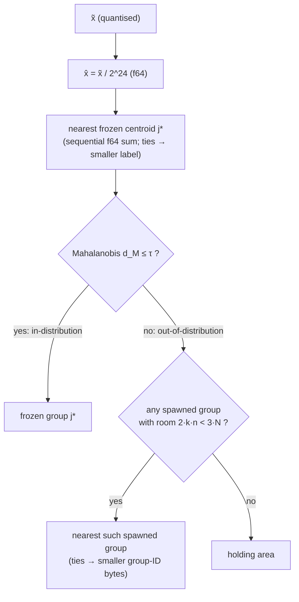

# 05 · Part 1 — The Idea: exact deletion in the index

## In simple words

Part 1 is the heart of SEVER-DB. It is an in-memory vector index in which every group keeps an exact
integer sum of its members and a member count. Deleting a vector subtracts it, so the group becomes
**bit for bit** the group it would have been if that vector had never arrived. Everything else in the
project (crash safety, receipts, encryption) is built on top of this frozen core. Part 1 is
**done and frozen** (tag `part-1-frozen`) [RUN: `git tag`].

> **Prerequisites.** Vectors, centroids, IVF ([B01](background/B01_vectors_embeddings_and_search.md));
> Q24 and exact integers ([B03](background/B03_floating_point_vs_exact_integers.md)); hashes and HMAC
> ([B04](background/B04_cryptography_basics.md)); Rust syntax ([B06](background/B06_rust_and_python_for_this_project.md)).
> Glossary: [group](16_glossary.md#group), [canonical blob](16_glossary.md#canonical-blob),
> [holding area](16_glossary.md#holding-area), [ChangeSet](16_glossary.md#changeset).

## The problem this solves

In an ordinary vector index, deleting a record leaves a trace: a tombstone, a centroid that still
includes the record, or a floating-point mean that no longer equals the survivors' mean
([B03](background/B03_floating_point_vs_exact_integers.md) shows `0.20000000000000004` vs `0.2`).
Part 1 removes that trace from the index's state, and proves it by comparing bytes.

## Build up step by step

### Step 1 — Fixed groups from a public dataset (the partition)

The groups are **not** learned from user data. The Python **partition builder** (component C-15,
`python/sever_partition`) runs k-means once, offline, on the public **SciQ** reference embeddings and
writes a hashed file, the **partition artefact** `partition.svp` [CODE: python/sever_partition/build.py:L77, L91-L104].
The k-means call is pinned: `KMeans(n_clusters=128, init="k-means++", n_init=10, max_iter=300,
tol=1e-4, algorithm="lloyd", random_state=sub_seed(seed,"kmeans") % 2**32)`, run single-threaded for
reproducibility [CODE: build.py:L91-L104]. The builder also fits a **pooled Ledoit–Wolf** covariance
(one fit over all residuals), inverts it by Cholesky to a precision matrix `P`, and sets a drift
threshold `τ` = the 99th percentile of reference Mahalanobis distances [CODE: build.py:L106-L128].
An **independent oracle** re-derives Ledoit–Wolf from the 2004 formula in plain NumPy and the builder
refuses to write unless shrinkage agrees to 1e-12 and `τ` to 1e-9 [CODE: build.py:L130-L137;
python/sever_partition/lw_oracle.py:L1-L34]. Seeds are the five overview seeds 42, 123, 777, 2024,
9999, and a sub-seed is the first 8 bytes of `SHA-256(u64be(seed) ‖ label)`
[CODE: python/sever_testkit/seeds.py:L9-L23].

Artefact byte layout (all big-endian) [CODE: python/sever_partition/artefact.py:L38-L57;
crates/sever-partition/src/lib.rs:L113-L181]:

| Offset | Size | Field |
|---|---|---|
| 0 | 8 | magic `SVDBPART` |
| 8 | 2 | `format_version` = 1 |
| 10 | 2 | `d` (multiple of 8) |
| 12 | 2 | `k_frozen` (1 … 10,000) |
| 14 | 8 | run seed |
| 22 | 8 | `τ` (f64) |
| 30 | 8 | Ledoit–Wolf shrinkage (f64) |
| 38 | 8 | `m`, reference rows |
| 46 | 32 | SHA-256 of the reference embeddings |
| 78 | 2 + len | encoder name, e.g. `repo@commit` |
| … | 8·k·d | centroids (f64) |
| … | 8·d·d | precision matrix `P` (f64) |
| last | 32 | SHA-256 of every preceding byte |

The Rust parser checks the final SHA-256 **first**, so no field of a corrupted file is trusted, and
refuses to allocate more memory than the remaining bytes can fill — a fuzzing finding (P1-T12; the
88-byte file claiming 5 GB, regression file `golden/p1_regression_artefact_oom.bin`)
[CODE: crates/sever-partition/src/lib.rs:L92-L124]. The small golden artefact (d = 16, 4 groups) is
exactly 2,686 bytes = 80 + 14 (encoder `test-encoder@0`) + 512 + 2,048 + 32 [CODE: golden/p1_partition_small.json].

### Step 2 — Quantise every vector (Q24)

Each component becomes `round_half_to_even(x · 2^24)` as `i32`, after a strict normalisation check
([B03](background/B03_floating_point_vs_exact_integers.md); [CODE: crates/sever-quant/src/lib.rs:L24-L80]).

### Step 3 — Route the vector to exactly one group

Routing is a **pure function of (x̃, state)**: no clock, no counter, no "latest group" (§7). Code:
`Index::route` [CODE: crates/sever-index/src/index.rs:L233-L276].



- **Mahalanobis distance** (definition: a distance that accounts for how spread out the reference
  data is in each direction) is `d_M = sqrt(δᵀ P δ)` with `δ = x̂ − μ_j*`, summed sequentially
  [CODE: crates/sever-index/src/route.rs:L21-L38]. If `q < 0`, that is an `IntegrityViolation`.
- **Room** is tested in exact `u128` integers [CODE: index.rs:L141-L143].
- **Holding area** (definition: a per-collection waiting room for unusual vectors): records there are
  stored and deletable at once, but not in any sum and not searchable. When an insert brings it to
  exactly the **spawn target** (200 in v1; 8 in small fixtures), the same transaction **flushes**
  those records into one new **spawned group** [CODE: index.rs:L305-L308, L840-L897;
  crates/sever-types/src/constants.rs:L27].
- A spawned group's ID is `spawn-` + the first 16 hex characters of SHA-256 over its founders' IDs
  sorted by bytes, so it depends only on membership [CODE: index.rs:L147-L159]. Its centroid
  `μ_i = (S_i / 2^24) / n` is computed once and then frozen [CODE: index.rs:L862-L867].

### Step 4 — Exact sums

Each frozen or spawned group holds `S` (`i64` per dimension) and `n` (`u64`). Insert adds, delete
subtracts [CODE: index.rs:L747-L757 `join`, L825-L836 `subtract`]:

```rust
    fn subtract(&mut self, g: GroupId, slot: &Slot<E>) {
        let ext = self.ix.ext.clone();
        let st = self.state_mut(g);
        for (acc, &v) in st.s.iter_mut().zip(slot.x.as_slice()) {
            *acc -= i64::from(v);
        }
        // SB-2: skip the count decrement on deletion.
        if !cfg!(feature = "sabotage-SB-2") {
            st.n -= 1;
        }
        ext.remove(&mut st.ext_public, &mut st.ext_secret, &slot.x, &slot.ext);
    }
```
[CODE: crates/sever-index/src/index.rs:L825-L836]

- `&mut self` — the method may change the planning draft (see [B06](background/B06_rust_and_python_for_this_project.md)).
- `st.s.iter_mut().zip(slot.x.as_slice())` — walk the group sum `S` with write access, paired with the
  record's quantised components.
- `*acc -= i64::from(v)` — widen the `i32` component to `i64` and subtract it exactly.
- `if !cfg!(feature = "sabotage-SB-2")` — in the normal build this is always true; only the sabotage
  build SB-2 skips the count decrement, so a test can prove it notices.
- `ext.remove(...)` — the extension point EP-1; in Part 3 this subtracts `r_t` and `C_t` too.

**Illustrative example, not from the repository** (d = 2, one group):

| Step | Members | `S` | `n` |
|---|---|---|---|
| start | — | (0, 0) | 0 |
| insert a = (1677722, 16609444) | a | (1677722, 16609444) | 1 |
| insert b = (11744051, 11979160) | a, b | (13421773, 28588604) | 2 |
| delete b | a | (1677722, 16609444) | 1 |

After the delete, `S` and `n` are identical to the state after inserting only `a`.

### Step 5 — Physical excision and idempotent delete

- Before subtracting, the engine checks the record is still a member; if not, the result is
  `AlreadyAbsent` and nothing changes, so a retried delete cannot subtract twice
  [CODE: index.rs:L767-L776]. (`AlreadyAbsent` is an outcome, not an error.)
- The record is physically removed: the last slot moves into the gap and the list is truncated
  ("swap-with-last"), and the float32 search mirror rows are zero-filled [CODE: index.rs:L786-L816,
  L398-L411]. There is **no deletion marker**.

### Step 6 — The canonical blob and the five-field check

The **canonical group blob** is a byte string of a group's whole state, generated in memory only
[CODE: crates/sever-index/src/blob.rs:L15-L41]:

```
"SEVERC" (Part 1 core form) | "SEVERG" (Part 3 full form)   6 bytes
u16be version = 1 ‖ u16be d ‖ u64be n ‖ i64be × d  (S)
[extension region: empty in Part 1; C_S ‖ r_agg in Part 3]
u64be member_count (= n)
per member, ascending by record-ID bytes: u16be len ‖ id ‖ i64be × d (x̃)
```

Two group states are **equivalent** only if all five are equal: `S`, `n`, `C_S`, the blob byte for
byte, and the member-ID list; `assert_state_equivalent` checks each separately
[CODE: blob.rs:L152-L205]. The **survivors check** compares a group after a deletion with a group
rebuilt from the survivors' own vectors alone [CODE: blob.rs:L207-L234].

### Step 7 — Plan, then apply

Every change is computed by a pure `plan_*` method that returns a `ChangeSet` and does **all**
validation; `apply` then installs it and cannot fail [CODE: index.rs:L282 `plan_insert`, L335
`plan_delete`, L341 `plan_delete_many`, L353 `apply`]. The `ChangeSet` lists the created groups, each
touched group's before/after state, slot and locator operations, counters, and the records that left
or joined each group [CODE: crates/sever-index/src/changeset.rs:L169-L199]. This is extension point
EP-3: Part 2 logs it, Part 3 builds the certificate from it, Part 4 rotates keys for its departures.

### Step 8 — Search

IVF-flat: rank all frozen and spawned groups by squared distance to their centroid, probe
`⌈k/4⌉` groups (empty ones count), score members in float32 with the pinned 8-lane kernel, return
the top `k` ordered by `(score, record-ID bytes)` [CODE: crates/sever-search/src/lib.rs:L39-L92;
kernel.rs:L15-L36]. The AVX2 kernel is the only `unsafe` code in Part 1 (`#![allow(unsafe_code)]` at
kernel.rs:L55), detected at runtime, with FMA disabled; scalar and AVX2 must agree bit for bit
(P1-T4).

### Step 9 — Record IDs are scrambled

Below the API, a record is named by `scrambled_id = HMAC-SHA-512(k_scramble, collection_id ‖ id)`
(64 bytes) [CODE: crates/sever-index/src/scramble.rs:L17-L40]. The 64-byte key and the 16-byte
collection ID come from the OS random generator in the composition root, never inside the index
[CODE: crates/sever-p1/src/root.rs:L24-L36]. Record IDs themselves must be 1–256 UTF-8 bytes and
**not** look like a counter (`^[+-]?[0-9]+$`) [CODE: crates/sever-types/src/id.rs:L80-L101].

## Everyday analogy

*Analogy:* Each group is a till that records the exact total and the number of coins put in. Taking a
coin out subtracts its exact value, so the till's record is the same as if that coin had never been
deposited. The canonical blob is a printed receipt of the till, sorted by coin name, so two tills with
the same coins print identical receipts. *Where it stops:* a till does not care about the order of
deposits, but SEVER-DB's *index shape* (which spawned groups exist) can depend on input order; only the
group *states* are order-independent (§7.7).

## The ghost demo (`sever-demo idea`)

`sever-demo idea --data nq-10k|nq-100k|synthetic [--seed N]` streams passages, deletes one article's
passages (a **cohort**) with one `delete_user`, and checks byte-identity with the survivors, untouched
groups unchanged, a second delete `AlreadyAbsent`, and no search returning a deleted passage
[CODE: crates/sever-p1/src/bin/sever-demo.rs:L11-L30; crates/sever-p1/src/demo.rs:L294-L520]. It
also runs two baselines given the same groups: a **soft-delete IVF** (tombstone; centroid keeps the
record) and a **float running mean** (`mean = (n·mean − x)/(n−1)`)
[CODE: crates/sever-p1/src/ghost.rs:L12-L140]. Measured ghost (P1-T14): see [11](11_results.md) —
the values are stated in the README but not stored in the ledger.

## How SEVER-DB tests Part 1 (summary)

- The Python reference model C-18 (`python/sever_refmodel_core/model.py`, written from the spec only)
  writes a JSONL **trace**; `sever-tracekit` replays it through the Rust index and compares every
  placement, outcome, group hash, statistic and top-k score bits, plus survivors and kernel checks
  [CODE: crates/sever-tracekit/src/lib.rs:L175, L371, L413]. Results in [11](11_results.md).
- Sabotage SB-1 … SB-10 (one deliberate bug each) — table in [10](10_testing_methodology.md).

## Doc-vs-code notes (also in 14)

- `configs/partition.yaml` and `configs/engine.yaml` (spec §18) do not exist; the builder hard-codes
  the same values [RUN: `ls configs` → `experiments.yaml`, `fair.yaml`].
- The search mirror lives in `sever-index`, not `sever-search` as Build §4.4 says [CODE: index.rs:L98-L106].
- Sabotage flags mostly use `cfg!(feature = …)` (compiled in, constant-folded away); only SB-9 uses a
  real `#[cfg_attr]` [CODE: kernel.rs:L79].

## Key points to remember

- Groups are fixed offline on public data (SciQ), so each vector lives in exactly one group.
- `S` (i64) and `n` (u64) make insert and delete exact inverses.
- Deletion is physical (swap-with-last + truncate), idempotent, and leaves no marker.
- Exactness is proved by comparing the canonical blob with a survivors-only rebuild.
- `plan` validates everything; `apply` cannot fail.

## Check your understanding

1. *Why fit the groups on SciQ, not on user data?* — The groups must hold no user data and never
   move, so one deletion touches exactly one group (§6.1; DB-41).
2. *What happens to an out-of-distribution vector when no spawned group has room?* — It waits in the
   holding area until 200 such records flush into a new spawned group.
3. *What are the five fields of equivalence?* — `S`, `n`, `C_S`, the canonical blob, the member IDs.
4. *Why reject the ID `007`?* — It has the shape of a counter; IDs must come from the data, not from
   arrival order (§3.2).
5. *Why can `apply` not fail?* — All validation happens in `plan`, so a half-applied change is
   impossible.
