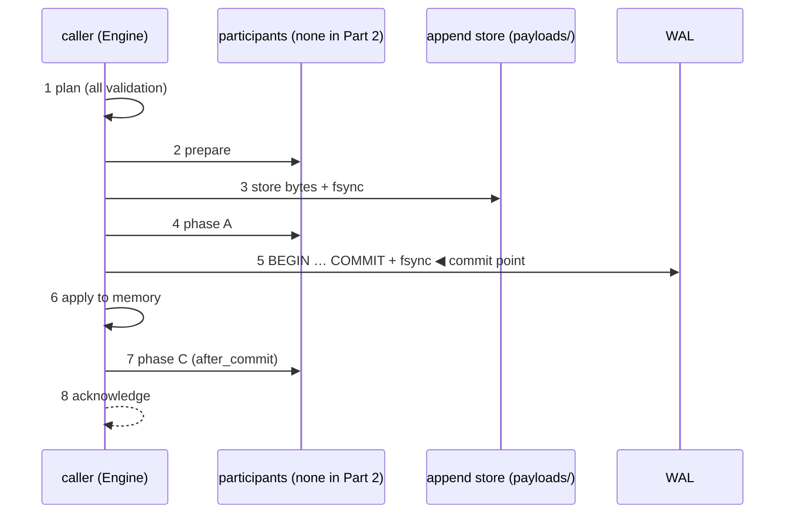

# 06 · Part 2 — The Database: crash safety and all-or-nothing deletion

## In simple words

Part 1 is an in-memory index; a power cut would wipe it. Part 2 wraps it in a storage engine that
writes every change to a **write-ahead log** first, takes periodic **checkpoints**, and on every start
**recovers** and checks every invariant before it serves anything. Its claim: exactness survives a
crash at any point, no acknowledged operation is lost, and a multi-group deletion is all or nothing.
Part 2 stores **plaintext** and makes no confidentiality claim (that is Part 4). It is **frozen** as
`part-2-frozen-e2`, after two errata [RUN: `git tag`; DOC: ERRATA.md].

> **Prerequisites.** fsync, WAL, commit point, checkpoints, torn writes
> ([B02](background/B02_how_databases_store_and_delete.md)); CRC checksums
> ([B04](background/B04_cryptography_basics.md)); traits and `Result` ([B06](background/B06_rust_and_python_for_this_project.md)).
> Glossary: [WAL](16_glossary.md#wal-write-ahead-log), [commit point](16_glossary.md#commit-point),
> [SimVfs](16_glossary.md#simvfs), [participant](16_glossary.md#participant).

## The problem this solves

A `delete_user` removes 5 records spread over 3 groups. If the machine dies half-way, two groups might
be updated and one not — the person's data is then "partly deleted", and the groups' sums no longer
match their members. And if the database said "deleted" before the change reached the disk, a restart
could bring the records back.

## Build up step by step

### Step 1 — One door to the disk: the VFS (EP-5)

Every file operation goes through a trait `Vfs` / `VfsFile` with explicit offsets (`read_at`,
`write_at`, `append`, `truncate`, `fsync`) and directory operations (`fsync_dir`, `rename`, `unlink`,
`list`, `create_dir`) [CODE: crates/sever-vfs/src/lib.rs:L116-L157]. Errors never carry a path or
content [CODE: lib.rs:L71-L96]. Two implementations:

- **`PosixVfs`**: real files with `pread`/`pwrite` and `sync_all`, never `mmap` [CODE: crates/sever-vfs/src/posix.rs:L1-L6].
- **`SimVfs`**: a simulated disk with a *current* view (what reads see) and a *durable* view (what is
  certainly on disk). A crash keeps only durable bytes plus a policy-chosen subset of pending writes
  (`DropAll`, `KeepAll`, `Random(seed)`, which can also tear a write at a random byte). A failed fsync
  behaves like Linux: the pending data is dropped from the durable path, and a retried fsync falsely
  "succeeds" — so the engine never retries [CODE: crates/sever-vfs/src/sim.rs:L15-L17, L32-L42, L340-L450].

### Step 2 — Byte-exact formats with checksums

All integers are big-endian, every record ends with a **CRC-32C** checksum (a 4-byte code that
changes if any byte changes), every file starts with an 8-byte magic (`SVDBWALS`, `SVDBMANI`,
`SVDBSTOR`, …), and parsers reject trailing bytes [CODE: crates/sever-format/src/codec.rs:L11-L14;
lib.rs:L43-L64]. A **WAL record** is [CODE: crates/sever-format/src/wal.rs:L1-L22, L140-L153]:

```
u32 len | u8 type | u64 wal_seq | u64 txn_id | payload | u32 crc32c     (len = 25 + payload)
```

There are 17 record types (BEGIN 1, GROUP_CREATE 2, GROUP_HEADER 3, … COMMIT 15, COLLECTION_CREATE 16,
COLLECTION_DROP 17); types 4, 9, 10, 11, 14 belong to later parts' participants and are carried
verbatim [CODE: wal.rs:L27-L100]. Records hold **after-images** (the new value of a slot, header or
locator entry), so replay just applies them.

**Illustrative example, not from the repository:** a BEGIN record has an empty payload, so its `len`
is 25 bytes: 4 (len) + 1 (type = 1) + 8 (wal_seq) + 8 (txn_id) + 0 + 4 (CRC).

### Step 3 — The transaction protocol and its commit point

`sever_txn::protocol::commit` runs eight steps, shown in [B02](background/B02_how_databases_store_and_delete.md#how-sever-db-does-it)
[CODE: crates/sever-txn/src/protocol.rs:L1-L16]. The commit point is step 5, when
`durable.wal.commit(&wal_records)` has written BEGIN … COMMIT and fsynced [CODE: protocol.rs:L121-L128].
Before it, memory is untouched; after it, `apply` installs the change and cannot fail.



**Multi-group all-or-nothing.** `delete_user(cid, ids)` plans every ID into **one** `ChangeSet`, one
record list and **one** transaction, so recovery replays all of it or none
[CODE: crates/sever-engine/src/engine.rs:L427-L470]. If no ID is live, nothing is written and every
outcome is `AlreadyAbsent` [CODE: engine.rs:L445-L448].

**Isolation.** One writer at a time (a `Mutex`); searches take a read lock; apply takes the write lock
briefly [CODE: engine.rs:L61-L74].

### Step 4 — The WAL and the torn-tail rule

Segments are `wal/<20 digits>.wal`, 64 MiB by default; one transaction may span segments
[CODE: crates/sever-wal/src/lib.rs:L22-L57, L170-L227]. On recovery [CODE: lib.rs:L261-L438]:

- a bad record **at the very end** of the last segment, with no valid record after it, is a **torn
  tail** → discarded;
- a bad record followed by a valid one → `IntegrityViolation "§12.3 corrupt record inside the log"`
  (refuse to serve, because discarding would lose acknowledged work);
- an open transaction at the end (no COMMIT) is discarded; everything after the last complete
  transaction is truncated and fsynced.

This rule came from a bug the tests found: recovery once dropped a damaged committed record in the
newest segment as if it were a torn tail [DOC: README.md L213-L215; see [12](12_bugs_found_and_fixed.md)].

### Step 5 — Storage checkpoints and the MANIFEST

A checkpoint writes six paged files (`meta.bin`, `collections.bin`, `groups.bin`, `slots.bin`,
`locator.bin`, `payloads.bin`, 16,384-byte pages each with a CRC) into `checkpoint/<id>.tmp/`,
renames it, then installs a 32-byte `MANIFEST` (via `MANIFEST.tmp` + rename + directory fsync).
**Installing the MANIFEST is the checkpoint's commit point**; then older checkpoints and covered WAL
segments are deleted [CODE: crates/sever-checkpoint/src/lib.rs:L97-L155; crates/sever-format/src/paged.rs:L1-L90].
Checkpoints happen on demand, after every 1 GiB of WAL, and at clean shutdown
[CODE: crates/sever-engine/src/config.rs:L46-L59; engine.rs:L504-L545].

### Step 6 — Recovery and the invariant check (every start)

`open_existing` [CODE: crates/sever-engine/src/recovery.rs:L117-L181]: read `SECRETS` (the 64-byte
scrambling key, in the separate key directory) → load the checkpoint named by `MANIFEST` → recover
the WAL → replay committed records with the same `DbImage::apply` used at commit → participants
recover → cut the payload store's torn tail → rebuild each collection with a full invariant check:
`S` equals the sum of members (INV-6), `n ≤ 1,000,000` (INV-4), every scrambled ID recomputes,
locator matches (INV-7), `N` and `k` match (INV-8), then Part 1's own `check_invariants`
[CODE: recovery.rs:L184-L292]. Any failure refuses to start.

### Step 7 — Durability discipline

One WAL fsync per transaction; every create/rename/unlink is followed by an fsync of the directory;
a failed fsync is never retried — production aborts the process (`std::process::abort()`), tests
"poison" the engine [CODE: crates/sever-vfs/src/durable.rs:L9-L83; engine.rs:L150-L159].

### Step 8 — The plaintext sealer (EP-6)

All bytes pass through a `Sealer` trait. Part 2 uses `PlaintextSealer` (sealer ID 0, zero overhead),
marks every file header with sealer 0, and claims no confidentiality (DB-48)
[CODE: crates/sever-txn/src/sealer.rs:L34-L100]. Part 4 plugs in AES-256-GCM-SIV (sealer ID 1)
through the same trait.

## Everyday analogy

*Analogy:* The WAL is a shop's order book. A clerk writes the whole order and signs it at the bottom
("COMMIT") before touching the shelves. After a fire, the owner re-does every signed order and tears
up the unsigned ones. *Where it stops:* a torn last page is ignored, but a damaged page *in the middle*
of signed orders means something is badly wrong, and SEVER-DB refuses to open rather than guess.

## Illustrative example: a crash before vs after the commit point (not from the repository)

| Crash moment | Disk holds | Recovery result | What the caller saw |
|---|---|---|---|
| During step 3 (store fsync) | no BEGIN…COMMIT | nothing deleted | an error / no answer |
| After COMMIT fsync, before step 6 | full BEGIN…COMMIT | all 5 deleted | maybe no answer; a retry returns `AlreadyAbsent` |

## How it is tested (summary)

The crash campaign (`sever-crashkit`, P2-T1…T3) runs a 20,000-operation stream on `SimVfs`, crashes at
every VFS operation, at every 512-byte offset of sampled WAL writes, at random points, and during
recovery; it compares each recovered state's SHA-256 digest with the digests allowed by an independent
Python oracle (`sever_refmodel_durable`) and retries the in-flight operation
[CODE: crates/sever-crashkit/src/campaign.rs:L1-L18, L182-L220; python/sever_refmodel_durable/oracle.py:L139-L196].
Result: 343,837 crash points, 0 failures [DATA: docs/RUN_LEDGER.jsonl line 56]. Sabotage SB-11 … SB-15
(accept a bad CRC, skip a directory fsync, replay an uncommitted transaction, retry a failed fsync,
apply before COMMIT) each turn a test red [DATA: line 53]. See [10](10_testing_methodology.md),
[11](11_results.md).

## Interfaces

- CLI `sever-db-p2 <create|load|insert|delete|delete-user|search|stats|drop|checkpoint|verify>
  --data DIR --keys DIR`, one JSON line per command [CODE: crates/sever-p2/src/bin/sever-db-p2.rs:L122-L214].
- Demo `sever-demo-p2 durable --data synthetic|nq-10k`: crashes one `delete_user` just before and just
  after the commit point, first on `SimVfs`, then with a real `SIGKILL` of a child process
  [CODE: crates/sever-p2/src/demo.rs:L106-L300].
- Python SDK `sever_db_p2.Database` (details in [08](08_interfaces_sdk_cli_studio.md)).

## Errata and known limits (frozen part)

- **E-1**: the Python SDK deadlocked when used from several threads (mutex taken while holding the
  GIL); fixed by taking the mutex with the GIL released; found by fair testing; tag `part-2-frozen-e1`.
- **E-2**: the engine never called a participant's `pre_transaction` hook, which Part 3 needed; fixed;
  tag `part-2-frozen-e2` [DOC: ERRATA.md; CODE: crates/sever-engine/src/engine.rs:L191-L201].
- **L-28**: three defects are kept in the frozen Part 2 builds only: a non-UTF-8 record ID raises
  `UnicodeEncodeError`; the engine keeps serving after an `IntegrityViolation`; the frozen tracer misses a
  split `#[spec]` attribute. The v1 build `sever-db` has none of them [DOC: Overview L-28, DB-103, DB-112].

## Key points to remember

- The commit point is the fsync of the WAL COMMIT record; memory changes only after it.
- One `delete_user` = one transaction, so a multi-group deletion is all or nothing.
- A torn tail is discarded; corruption in the middle refuses to start.
- Recovery rebuilds every collection and checks every invariant before serving.
- A failed fsync aborts; it is never retried.

## Check your understanding

1. *Where exactly is the commit point?* — After `wal.commit` has fsynced BEGIN…COMMIT (protocol step 5).
2. *Why does `SimVfs` keep two views?* — To model what reads see vs what survives a crash.
3. *Why not retry a failed fsync?* — On Linux the data may already be dropped; a retry can falsely succeed.
4. *What makes a checkpoint "installed"?* — The durable rename of `MANIFEST`.
5. *Does Part 2 encrypt anything?* — No; `PlaintextSealer`, sealer ID 0, no confidentiality claim.
