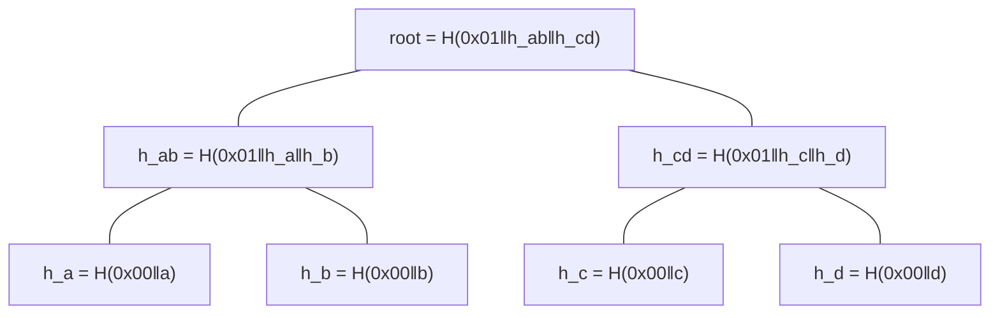

# 07c · Transparency log, checkpoints, witnesses and signatures (Part 3)

## In simple words

Every insert and every deletion is written as a **leaf** in a public, append-only **transparency log**
shaped as a Merkle tree (RFC 9162, the format behind Certificate Transparency). The operator regularly
signs the tree's root (a **log checkpoint**), and **witnesses** check that each new root extends the
previous one before they **cosign** it. A deletion certificate then proves "this record was inserted
here, under this signed and witnessed root". In v1 the five witnesses are **simulated** by the project.

> **Prerequisites.** Hash functions, Merkle trees, digital signatures, Ed25519
> ([B04](background/B04_cryptography_basics.md)). Glossary: [Merkle tree](16_glossary.md#merkle-tree),
> [inclusion proof](16_glossary.md#inclusion-proof), [consistency proof](16_glossary.md#consistency-proof),
> [witness](16_glossary.md#witness), [log checkpoint](16_glossary.md#log-checkpoint).

## The problem this solves

An operator could show one user a log where their record was inserted and deleted, and show an auditor
a different log. Or quietly rewrite history. A Merkle log with signed roots makes the history
tamper-evident: changing any old leaf changes the root, and witnesses refuse a root that does not
extend the one they saw before.

## Build up step by step

### Step 1 — Hashes of leaves and nodes (RFC 9162 §2.1)

```
leaf_hash(leaf)  = SHA-256(0x00 ‖ leaf)
node_hash(l, r)  = SHA-256(0x01 ‖ l ‖ r)
root of 0 leaves = SHA-256("")
```
[CODE: crates/sever-log/src/merkle.rs:L20-L42]. The tree splits at the largest power of two below `n`
(left-heavy) [CODE: merkle.rs:L44-L51]. The `0x00`/`0x01` prefixes stop a leaf from being passed off
as an inner node.

**Illustrative example, not from the repository** — 4 leaves `a, b, c, d`:



**Inclusion proof** for leaf `c`: the path `[h_d, h_ab]`. A verifier computes
`h_c → H(0x01‖h_c‖h_d) = h_cd → H(0x01‖h_ab‖h_cd)` and compares with the signed root. Only
`log₂(n)` hashes are needed. A **consistency proof** shows that the tree of size 4 starts with the tree
of size 2 (here: `h_cd` lets you rebuild both roots from `h_ab`). SEVER-DB implements both RFC 9162
algorithms, inclusion §2.1.3.2 and consistency §2.1.4.2 [CODE: merkle.rs:L135-L274]; consistency
proofs exist only for `0 < m < n` (G-50, DB-116).

### Step 2 — What a leaf contains (§10.2)

| Leaf | Bytes | Code |
|---|---|---|
| Insert | `0x01 ‖ collection_id(16) ‖ scrambled_id(64) ‖ C_t(32) ‖ user_public_key(32) ‖ user_signature(64)` = **209 B** | crates/sever-log/src/leaf.rs:L6-L79 |
| Delete | `0x02 ‖ certificate bytes` | leaf.rs:L81-L96 |

No vector, no record ID in clear, no `r_t`. A record's **`database_lsn`** is the 0-based index of its
own leaf [DOC: §10.2]. Placement (which group) is stored beside the leaf hash, not in it (DB-86)
[CODE: leaf.rs:L98-L153].

### Step 3 — The operator's signed checkpoint

A log checkpoint (an "STH", signed tree head) is `(tree_size u64, root 32, timestamp_ms u64, epoch u32,
operator_signature 64)`, 116 bytes [CODE: crates/sever-log/src/checkpoint.rs:L21-L41]. The signed
message is 66 bytes: `DST_STH ‖ u64be tree_size ‖ root ‖ u64be timestamp_ms ‖ u32be epoch` with
`DST_STH = "SEVERDB-STH-V1"` [CODE: crates/sever-crypto/src/sig.rs:L72-L90]. A checkpoint is issued at
every multiple of 10,000 leaves and on demand before a deletion when no witnessed checkpoint covers the
record's insert leaf [CODE: checkpoint.rs:L11-L12; crates/sever-cert/src/participant.rs:L165-L177].
The genesis checkpoint `(0, SHA-256(""), creation time, epoch 0)` is signed at creation [CODE: checkpoint.rs:L73-L78].

### Step 4 — Signatures and key epochs

All signatures are **Ed25519** (RFC 8032) with `ed25519-dalek =2.2.0`; verification uses only
`verify_strict`, which rejects small-order keys and non-canonical encodings
[CODE: crates/sever-crypto/src/sig.rs:L22-L63]. Four signed messages, each with its own domain string:

| Who signs | Message | Domain string |
|---|---|---|
| User (account key, never rotates) | `DST_INSERT ‖ collection_id ‖ C_t` (65 B) | `SEVERDB-INSERT-V1` |
| Operator | log checkpoint (66 B) | `SEVERDB-STH-V1` |
| Witness | `DST_COSIGN ‖ checkpoint message` (83 B) | `SEVERDB-COSIGN-V1` |
| Operator | `DST_CERT ‖ certificate body` | `SEVERDB-CERT-V1` |

[CODE: sig.rs:L68-L106; crates/sever-crypto/src/dst.rs:L4-L16]. Operator and witness keys change
every **90 days** counted from the database's genesis (`epoch = ⌊(t − genesis)/90 d⌋`)
[CODE: sig.rs:L18, L115-L121]. A new operator epoch key is 32 OS bytes, written durably to `SECRETS`
before its first signature [CODE: crates/sever-p3/src/keys.rs:L29-L34, L172-L189]. Old public keys stay
resolvable forever [CODE: crates/sever-log/src/keys.rs:L9-L35].

### Step 5 — Witnesses and 4-of-5 cosigning

Five witnesses, threshold four [CODE: checkpoint.rs:L13-L17]. A witness remembers the last checkpoint
it cosigned, checks the new one's operator signature, refuses shrinking (`Shrunk`) or a different root
at the same size (`Fork`), verifies an RFC 9162 consistency proof, and only then cosigns
[CODE: crates/sever-log/src/witness.rs:L28-L148]. A cosignature is
`u8 witness_index ‖ u32be witness_epoch ‖ signature(64)` = 69 bytes. A checkpoint is **witnessed** only
with ≥ 4 valid cosignatures from **distinct** witness indices [CODE: checkpoint.rs:L174-L190].

```mermaid
sequenceDiagram
  participant O as Operator
  participant W as Witness i (×5)
  O->>W: new checkpoint (size n, root) + consistency proof from last cosigned
  W->>W: check operator signature; not shrunk; no fork; verify consistency
  W-->>O: cosignature (index, epoch, sig over DST_COSIGN ‖ message)
  O->>O: witnessed if ≥ 4 distinct valid cosignatures
```

**v1 simplification — simulated witnesses.** All five witnesses run in-process, and their epoch keys
and last-seen checkpoints are stored in one `WITNESSES` file in the engine's key directory
[CODE: crates/sever-p3/src/witnesses.rs:L1-L9, L57-L75; crates/sever-log/src/witness.rs:L3]. The spec
states this openly [DOC: §9.8, §10.4; Overview L-7]. **Consequence:** in v1 the 4-of-5 threshold gives no
independence from the operator; someone who controls the operator's machine controls all witnesses
[INFERRED from the shared key file].

### Step 6 — Storage and atomicity

Log stores: `log/leaves`, `log/hashes`, `log/checkpoints`, `certs` (append stores, EP-8)
[CODE: crates/sever-log/src/store.rs:L29-L37]. The log is a **transaction participant** (EP-7): the
delete leaf and certificate are staged in the deletion's transaction and become durable with its
COMMIT; sabotage SB-21 syncs them early to prove a test catches a certificate for a rolled-back
deletion [CODE: crates/sever-p3/src/lib.rs:L156-L167].

## Everyday analogy

*Analogy:* The log is a notebook with numbered, glued-in pages; each day the owner writes a fingerprint
of the whole notebook on a postcard and signs it; neighbours (witnesses) check that today's notebook
still starts with yesterday's pages before countersigning. *Where it stops:* in v1 the "neighbours" live
in the owner's house — they catch accidental inconsistency but not a deliberately dishonest owner.

## Key points to remember

- RFC 9162 hashing with `0x00`/`0x01` prefixes; inclusion and consistency proofs of `log₂ n` hashes.
- Insert leaves are 209 bytes and hold only public values; delete leaves hold the whole certificate.
- Every signature uses Ed25519 `verify_strict` and a distinct domain string.
- A checkpoint is witnessed only with 4 distinct valid cosignatures out of 5.
- Witnesses are simulated in v1, with keys in the operator's key directory.

## Check your understanding

1. *Why prefix leaves with `0x00` and nodes with `0x01`?* — So a leaf cannot be confused with a node (second-preimage defence).
2. *What does a witness refuse?* — A shrunk log, a fork (same size, other root), or a missing/invalid consistency proof.
3. *How many hashes in an inclusion proof for 1,000,000 leaves?* — About 20 (`⌈log₂ 10⁶⌉`).
4. *What is `database_lsn`?* — The 0-based index of the operation's own log leaf.
5. *What does "simulated witnesses" weaken?* — Independence: all witness keys are on the operator's machine.
