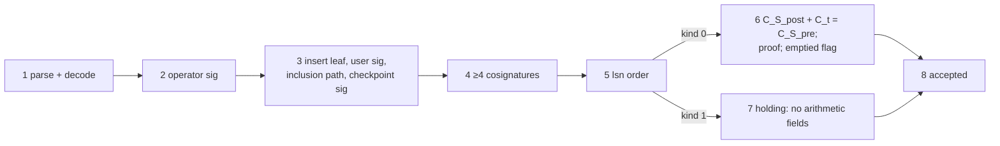

# 07d · The deletion certificate and its offline verification (Part 3)

## In simple words

When SEVER-DB deletes a record from a group, it returns a **deletion certificate**: a few kilobytes of
signed data that anyone can check on their own computer, with no access to the database. The check is
done by `sever-verify`, a separate program that shares **no code** with the engine. A second program,
`sever-audit`, checks the whole log when someone has a log export.

> **Prerequisites.** Commitments and the proof ([07b](07b_pedersen_commitments_and_proofs.md)); log,
> checkpoints, witnesses, signatures ([07c](07c_transparency_log_and_signatures.md)).
> Glossary: [deletion certificate](16_glossary.md#deletion-certificate), [anchors](16_glossary.md#anchors),
> [TLV](16_glossary.md#tlv).

## The problem this solves

"Trust us, it's deleted" is not evidence. A certificate turns the claim into something checkable:
the record existed (signed insert leaf, included under a witnessed root), the group's commitment fell
by exactly the record's commitment, and the operator signed all of it under a known key.

## Build up step by step

### Step 1 — Byte format: TLV fields 1 … 13 and a trailer

**TLV** (*tag–length–value*): each field is `u8 tag ‖ u32be length ‖ value`. Tags 1 … 13 appear
exactly once, in ascending order, then a trailer `0xFF ‖ u32be 64 ‖ operator_signature`, where the
signature is Ed25519 over `DST_CERT ‖ all preceding bytes` [CODE: crates/sever-cert/src/encoding.rs:L216-L253].

| Tag | Field | Size |
|---|---|---|
| 1 | `C_t` (commitment to the deleted vector) | 32 |
| 2 | `C_S_pre` (group commitment before) | 32, empty for holding area |
| 3 | `C_S_post` (after) | 32, empty for holding area |
| 4 | proof of knowledge `A ‖ z_r ‖ z_0…z_{d−1}` | 32·(d+2) = 12,352 at d = 384; empty for holding |
| 5 | user's insert signature | 64 |
| 6 | `insert_inclusion`: `u8 version=1 ‖ insert leaf(209) ‖ u64 leaf_index ‖ checkpoint(116) ‖ u8 path_len ‖ path` | 335 + 32·path_len |
| 7 | witness cosignatures: `u8 count ‖ count × 69` | 1 + 69·count |
| 8 | `key_period` (operator epoch signing this certificate) | 4 |
| 9 | `scrambled_record_id` | 64 |
| 10 | `database_lsn` (this deletion's leaf index) | 8 |
| 11 | `group_emptied_by_this_deletion` (0/1) | 1 |
| 12 | `deletion_kind` (0 = group, 1 = holding area) | 1 |
| 13 | `collection_id` | 16 |
| 0xFF | trailer: operator signature | 64 |

[CODE: encoding.rs:L48-L111 (tag 6), L202-L253]. Measured size: 1,197 bytes (holding area) up to
13,645 bytes (group deletion) against a predicted 14,093 for d = 384 [DATA: docs/RUN_LEDGER.jsonl line 182;
results/p3-measures-nq-10k-20261030T232049Z.json]. Tags 1, 5, 9 and 13 are copied from the insert leaf
so they always agree [CODE: crates/sever-cert/src/builder.rs:L80-L167].

### Step 2 — How the certificate is built (inside the deletion transaction)

The log participant's `prepare` builds one certificate per deleted record, tracking the group state so a
multi-record `delete_user` chains correctly: verify the insert leaf's inclusion path; check the
checkpoint's signature and ≥ 4 cosignatures; require `database_lsn > leaf_index`; compute
`C_S_post = commit_group(S_post, r_post)` and check `transition_holds`; build `ctx`; prove; set tag 11 =
1 iff `n_post == 0`; sign [CODE: crates/sever-cert/src/participant.rs:L324-L470; builder.rs:L80-L167].
The builder refuses to sign anything the verifier would reject.

### Step 3 — The verifier's steps, in order

`sever-verify deletion.cert --anchors anchors.json` [CODE: verifier/src/main.rs:L1-L56]. Each rejection
names a **step number** and a fixed reason string; exit code 0 accepted, 1 rejected, 2 usage, 3 refused
(self-check or anchors) [CODE: verifier/src/main.rs:L1-L8].

| Step | What is checked | Code |
|---|---|---|
| pre | generators' dimension equals the anchors' `d`; anchors' `gdigest` equals the verifier's own derivation | verifier/src/verify.rs:L76-L82; main.rs:L148-L150 |
| 1 | strict parse; canonical decoding of every point and scalar; `C_t` ≠ identity | verify.rs:L83-L104; cert.rs:L187-L239 |
| 2 | operator key for tag 8's epoch exists; `verify_strict` over `DST_CERT ‖ body` | verify.rs:L105-L112 |
| 3 | insert leaf type `0x01`; its fields equal tags 13, 9, 1, 5; user signature verifies; RFC 9162 inclusion path reaches the checkpoint root; checkpoint signature verifies | verify.rs:L113-L169 |
| 4 | ≥ 4 distinct valid witness cosignatures over the checkpoint | verify.rs:L170-L186 |
| 5 | `database_lsn > leaf_index` | verify.rs:L187-L190 |
| 6 | group deletion: tags 2–4 present; `C_S_post + C_t == C_S_pre`; proof verifies with `ctx`; tag 11 = 1 ⇔ `C_S_post` is the identity | verify.rs:L191-L215 |
| 7 | holding-area deletion: tags 2–4 empty and tag 11 = 0 | verify.rs:L216-L227 |
| 8 | accept | verify.rs:L229-L238 |

**Trust anchors** are a JSON file `{"d", "gdigest", "operator": {epoch: key}, "witnesses": [{epoch: key} ×5]}`
produced by `sever-db-p3 anchors` (or `db.anchors()`) [CODE: crates/sever-p3/src/lib.rs:L100-L140;
verifier/src/anchors.rs:L1-L82]. The generator golden values are compiled into the verifier
[CODE: verifier/src/gens.rs:L12-L16].

**What the verifier does not prove** (by design): that the delete leaf is really in the log at
`database_lsn`, that certificates of one group chain, or that checkpoints are mutually consistent —
that is the auditor's job [DOC: §11.3]. It also does not compare timestamps [INFERRED: no timestamp
comparison in verifier/src/verify.rs].

### Step 4 — Independence of the verifier (verified)

- `verifier/` is its own Cargo workspace with its own `Cargo.lock`; its only dependencies are
  `curve25519-dalek =4.1.3`, `sha2 =0.10.9`, `ed25519-dalek =2.2.0`, `serde_json 1`
  [CODE: verifier/Cargo.toml:L12-L28].
- Its single path dependency is a **dev-dependency** on `crates/sever-spec`, a no-op proc-macro that only
  labels tests with `#[spec("SR-…")]` [CODE: verifier/Cargo.toml:L29-L31; crates/sever-spec/src/lib.rs:L1-L32].
  This contradicts the literal wording "no path dependencies" of Build 3-4 §1.6 (recorded in [14](14_status_gaps_and_pending.md)),
  but the shipped binary contains no engine code.
- It reads golden *data* files with `include_str!` (generators, RFC vectors) written by the Python
  reference model, not by the engine [CODE: verifier/src/gens.rs:L12-L16].
- An architecture test enforces this: `test_p3_arch_verifier_shares_no_code_with_the_engine`
  [CODE: tests/architecture/test_architecture_p3.py:L52-L106].
- Shared *libraries* are not shared *code*, but a bug in `curve25519-dalek` would affect both
  [INFERRED].

### Step 5 — The log auditor `sever-audit`

`sever-audit export.json --anchors anchors.json [--certificate FILE]…` [CODE: audit/src/main.rs]. Its
workspace holds byte-identical copies of nine verifier files (anchors, cert, dst, gens, hex, merkle,
posk, verify, xmd) and depends on neither verifier nor engine [CODE: audit/Cargo.toml:L1-L10]. It
replays the export and reports faults AF-1 … AF-5 [CODE: audit/src/audit.rs:L256-L429]:

| Fault | Meaning |
|---|---|
| AF-1 | a deletion leaf is skipped (`database_lsn` ≠ its leaf index, or a checkpoint covers missing leaves) |
| AF-2 | a broken chain: `C_S_pre` ≠ the sum of the group's members' `C_t` |
| AF-3 | two checkpoints not consistent (a forked log) or two roots for one size |
| AF-4 | a leaf at a certificate's `database_lsn` that does not match the certificate |
| AF-5 | a checkpoint root that does not match the tree at its size |

### Step 6 — The emptied-group finding (G-34 / DB-95)

See [07b Step 9](07b_pedersen_commitments_and_proofs.md#step-9--the-emptied-group-exception-g-34-db-95).
The verifier was right and the spec's "cannot be replayed" sentence was too strong; the spec now states
the exception and the attack generator chooses non-emptying donors.

## Everyday analogy

*Analogy:* A deletion certificate is like a notarised receipt that includes a photocopy of the original
registration page, the page number, the notary's stamp and four witnesses' countersignatures. Anyone can
check the stamps at home. *Where it stops:* the receipt alone cannot prove the registry's later pages
were not torn out — that needs the auditor with the whole registry.

## Key points to remember

- 13 TLV fields in fixed order plus an Ed25519 trailer over everything.
- Eight verifier steps; every rejection names its step.
- The verifier is a separate workspace with no engine code (one no-op dev-dependency).
- The auditor covers what certificates cannot: leaf presence, chaining, log consistency.
- Holding-area deletions have no arithmetic fields (kind 1).

## Check your understanding

1. *Which step catches a changed `C_S_pre`?* — Step 2 (signature) if not re-signed; step 6 if re-signed by a dishonest operator.
2. *Why does the verifier need anchors?* — To know the operator and witness public keys for each epoch.
3. *What does step 5 rule out?* — A deletion "before" the record's insert.
4. *Can the verifier tell whether the delete leaf is in the log?* — No; the auditor checks that (AF-1, AF-4).
5. *What is the one path dependency of `verifier/`?* — The `sever-spec` test-label crate, dev-only.
