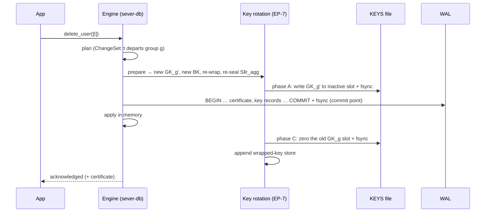

# 07e · Encryption, the key hierarchy and crypto-shredding (Part 4)

## In simple words

Old copies of deleted data hide in many places: old log segments, old checkpoints, free disk blocks,
SSD cells. A program cannot reliably overwrite all of them. Part 4 therefore writes every secret to
disk **only as ciphertext**, and when a record is deleted it **rotates** the keys of the group it left
and **destroys the old top-level key** before saying "deleted". Every old copy is then undecryptable.
This is **crypto-shredding**. Part 4 is frozen (`part-4-frozen` = `v1.0.0`) [RUN: `git tag`].

> **Prerequisites.** Symmetric encryption, AEAD, nonces, key wrapping, key hierarchies, crypto-shredding
> ([B04](background/B04_cryptography_basics.md)); WAL, commit point, fsync
> ([B02](background/B02_how_databases_store_and_delete.md)). Glossary: [AES-256-GCM-SIV](16_glossary.md#aes-256-gcm-siv),
> [associated data](16_glossary.md#associated-data-ad), [wrapped key](16_glossary.md#wrapped-key),
> [crypto-shredding](16_glossary.md#crypto-shredding), [key slot](16_glossary.md#key-slot).

## The problem this solves

Without Part 4, a deleted vector is still in WAL segment 37, in checkpoint 12, and in freed blocks.
Worse, if two versions of a group's encrypted sum survive (before and after a deletion), anyone with
the key can compute `S_pre − S_post` — which **is** the deleted vector — and `r_agg_pre − r_agg_post`,
which is its `r_t` [DOC: docs/SEVER-DB_SPECIFICATION.md §13.3]. The demo's SB-24 build shows exactly this
leak ([07f](07f_platform_safety_and_forensics.md)).

## Build up step by step

### Step 1 — One cipher for everything: AES-256-GCM-SIV

Every ciphertext is AES-256-GCM-SIV (RFC 8452) with a **random 96-bit nonce** from the OS and a 16-byte
tag, so each costs 28 bytes of overhead [CODE: crates/sever-seal/src/aead.rs:L4-L28; DOC: §13.2].
Library `aes-gcm-siv =0.11.1`; the `aes =0.8.4` crate is pinned with its `zeroize` feature so the AES key
schedules are wiped from memory [CODE: crates/sever-seal/Cargo.toml:L23]. **AEAD** (authenticated
encryption with associated data) means: the ciphertext is confidential **and** any change is detected,
and extra public bytes (the **associated data**, AD) are authenticated too. GCM-**SIV** is
"nonce-misuse resistant": a repeated nonce leaks only whether two messages are equal, rather than
breaking the key — a safety net, not a licence (SB-30 tests that a reused nonce is found).

```rust
fn fresh_nonce() -> [u8; NONCE_BYTES] {
    let mut n = [0u8; NONCE_BYTES];
    if cfg!(feature = "sabotage-SB-30") {
        // SB-30: reuse one nonce for everything.
        n.fill(0x5A);
    } else {
        OsRng.fill_bytes(&mut n);
    }
    n
}
```
[CODE: crates/sever-seal/src/aead.rs:L18-L28] — `OsRng.fill_bytes` fills the 12-byte array from the
operating system's random source; the sabotage build instead uses the same bytes every time.

### Step 2 — Three levels of keys

| Level | Key | Where it is stored | How many |
|---|---|---|---|
| 1 | Group key `GK_g` | **only** in the key file `KEYS`, plaintext, erasable | one per group, holding area included |
| 2 | Bucket keys `BK_{g,b}`, b = 0 … 63 | wrapped (encrypted) under `GK_g` | 64 per group |
| 3 | Record key `RK_t` | wrapped under `BK_{g, b(t)}` | one per record |

A record's bucket is `b(t) = scrambled_id[0] mod 64`. All keys are 32 bytes from the OS. **Only group
keys ever need physical erasure** [DOC: §13.1]. To **wrap** a key means to encrypt it under another key.

What each key encrypts, with its associated data [DOC: §13.2]:

| Data | Key | Associated data |
|---|---|---|
| Slot payload (record ID, `x̃`, insert leaf index, `r_t`) | `RK_t` | `collection_id ‖ scrambled_id ‖ 0x01` |
| Passage text | `RK_t` | `collection_id ‖ scrambled_id ‖ 0x02` |
| Wrapped record key | `BK_{g,b}` | `collection_id ‖ group_id(32) ‖ scrambled_id ‖ u64be bucket_version` |
| Wrapped bucket key | `GK_g` | `collection_id ‖ group_id(32) ‖ u8 b ‖ u64be group_key_version` |
| `S ‖ r_agg` (accumulator) | `GK_g` | `collection_id ‖ group_id(32) ‖ u64be group_key_version ‖ u64be n` |

AD code: [CODE: crates/sever-seal/src/ad.rs]. Record ciphertexts carry no group or version, so a slot
can move (swap-with-last, or a flush) without decryption.

**Plaintext on disk, on purpose:** `n`, group sizes, `C_S`, centroids, `scrambled_id`s, log leaves,
certificates, group IDs and key versions — nothing else (§13.2, INV-11).

### Step 3 — The key file: two 512-byte slots per domain

`KEYS` has a 4,096-byte header, then per domain a pair of 512-byte slots; each slot is
`u32 magic "SVKS" ‖ u64 domain_index ‖ u64 key_version ‖ 32-byte key ‖ collection_id ‖ group_id ‖ padding ‖ u32 crc32c`.
An erased slot is 512 zero bytes; a torn slot fails its CRC [DOC: §14.7; CODE: crates/sever-keys/src/file.rs].
512-byte alignment keeps a slot inside one disk sector.

### Step 4 — The rotation rule

**Any committed transaction in which a record leaves a key domain rotates that domain** (deleted from a
group, deleted from the holding area, or moved out of the holding area by a flush). For each such domain:
(1) new group key, version + 1; (2) new bucket keys for every bucket that lost a record; (3) re-wrap all
64 bucket keys under the new group key; (4) re-wrap the survivors' record keys of rotated buckets (new
envelopes go to the **wrapped-key store**, `wrapped/`; slots are not rewritten, DB-91); (5) re-encrypt
`S ‖ r_agg` under the new group key [DOC: §13.3]. Records *joining* a domain never rotate anything.

### Step 5 — The delete sequence (phases A and C)

The key-rotation **participant** (EP-7) plugs into Part 2's protocol
[CODE: crates/sever-erasure/src/participant.rs:L1-L9]:

| Protocol step | Key-rotation participant |
|---|---|
| prepare | rotate every domain a record leaves; log the new bucket blocks and re-wrapped envelopes in the WAL |
| **phase A** (before COMMIT) | write each new group key into the domain's **inactive** slot; fsync [CODE: participant.rs:L289-L322] |
| COMMIT fsync | the commit point |
| **phase C** (`after_commit`) | overwrite each **retired** key's slot with zeros; fsync; append entries to the wrapped-key store [CODE: participant.rs:L332+] |
| acknowledge | only now does the caller see "deleted" (§15.8) |



**Insert sequence** (no rotation): the new record gets a fresh `RK_t`, its payload is sealed under it,
`RK_t` is wrapped under the destination's *current* bucket key; a new spawned group's first keys are
appended to `KEYS` in phase A.

**Key erasure rule (INV-13):** an old group key may be destroyed only after every live byte it protects
exists durably under the new key — in practice, only after the COMMIT is durable. Sabotage **SB-27**
erases the old key *before* the commit [CODE: participant.rs:L316-L319]; the crash campaign then finds
undecryptable live data.

### Step 6 — Recovery between commit and key erase

If the process dies after COMMIT but before phase C, both slots of a domain hold keys. **INV-14**: after
replaying checkpoint and WAL, for each domain with active version `v`, the slot holding `v` must exist
with a valid CRC (otherwise refuse to start — that data could no longer be decrypted); every other slot
of the domain is erased; slots belonging to no domain are erased [DOC: §13.4; CODE: crates/sever-keys/src/recovery.rs].
So recovery **finishes** the erasure. This was one of the hardest bugs: **BH-5** — a crash after a
deletion's commit followed by a clean restart made the database unopenable and lost the rotated keys;
found by a real-process SIGKILL loop, fixed in `449927f` with a red test at `4f2f725`
[DOC: _notes/history.md; see [12](12_bugs_found_and_fixed.md)].

### Step 7 — Key and data directories

Data (`wal/`, `checkpoint/`, `payloads/`, `log/`, `certs/`, `wrapped/`) and keys (`KEYS`, `SECRETS`,
`WITNESSES`) live in separate directories, so the key directory can be kept private and backed up
separately; "losing it makes the data unreadable: that is the erasure" [DOC: README.md L33-L34;
spec §14.1].

## Why deleted data cannot be recovered (the argument, §13.5)

1. Everything with `t`'s data (vector, ID, `r_t`, passage) is encrypted under `RK_t`.
2. `RK_t` was only ever written wrapped under a bucket key of a domain `t` belonged to; each such domain
   rotated when `t` left, and `t`'s bucket key was never re-wrapped under the new group key.
3. Older group keys were destroyed at earlier departures; `GK_{g,v}` is destroyed in phase C.
4. Every accumulator version containing `t` is under a destroyed key.
5. Plaintext copies in memory were zeroed before the acknowledgement (§12.6, §12.8).

The forensic scan (P4-T1, P4-T2) tests this argument on raw disk images: 0 findings in 30 scans
[DATA: docs/RUN_LEDGER.jsonl line 159].

## Everyday analogy

*Analogy:* Each record is a letter in its own locked box (record key). The box keys hang in one of 64
small cabinets (bucket keys), and the cabinets' keys are on one master key (group key). To shred a
letter, you change the master key and the cabinet locks it used, move the other letters' keys to new
cabinets, and **burn the old master key**. Every old photocopy of the cabinet is now useless.
*Where it stops:* burning a physical key is final; on a disk, "burning" means overwriting a 512-byte
slot with zeros and fsyncing — which relies on the filesystem overwriting in place (checked at startup,
[07f](07f_platform_safety_and_forensics.md)).

## Illustrative example, not from the repository

Group `g` at key version 7 holds records `t1, t2`. Delete `t1` (bucket 5):

| Item | Before | After |
|---|---|---|
| `GK_g` | v7 (slot A) | v8 (slot B); slot A zeroed in phase C |
| `BK_{g,5}` | version 3 | version 4 (new key) |
| other 63 bucket keys | wrapped under GK v7 | same keys, re-wrapped under GK v8 |
| `RK_{t2}` (if in bucket 5) | wrapped under BK_{g,5} v3 | re-wrapped under BK_{g,5} v4 |
| `S ‖ r_agg` | sealed under GK v7 | re-sealed under GK v8 (excludes t1) |

Any old copy sealed under GK v7 or BK v3 can no longer be opened.

## Key points to remember

- AES-256-GCM-SIV, random 96-bit OS nonce, 28 bytes overhead, associated data binds owner and version.
- Group → bucket → record keys; only group keys live in plaintext, in the `KEYS` file.
- A departure rotates the domain; the new key is written before COMMIT, the old one zeroed after it.
- Recovery (INV-14) finishes an interrupted erasure or refuses to start.
- What stays plaintext is a fixed, declared list (INV-11).

## Check your understanding

1. *Why must the old accumulator version become undecryptable?* — `S_pre − S_post` would reveal the deleted vector.
2. *Why write the new key before COMMIT (phase A)?* — After COMMIT the WAL's re-wrapped material must be decryptable.
3. *Why zero the old key only after COMMIT (phase C)?* — Before COMMIT the transaction may still roll back (SB-27).
4. *What happens if the crash is between COMMIT and phase C?* — Recovery erases the stale slot (INV-14).
5. *Why do record ciphertexts carry no group in their AD?* — So slots can move without decryption.
