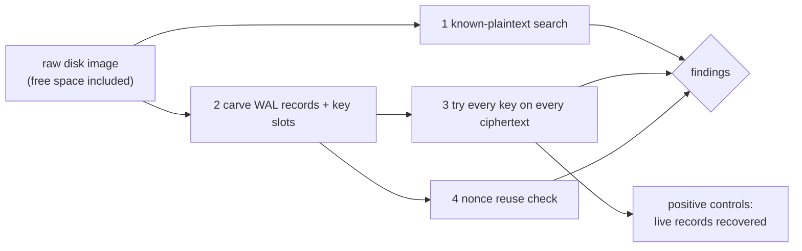

# 07f · Platform safety checks and the forensic scanner (Part 4)

## In simple words

Encryption is only as good as the places plaintext and keys might leak: swap space, a hibernation
image, a core dump, or a filesystem that writes new copies instead of overwriting. So the final
database `sever-db` **refuses to start** on an unsafe platform unless a recorded development override
is given. And to test the erasure claim, `sever-scan` plays an attacker who holds the raw disk image
and tries to recover anything deleted.

> **Prerequisites.** Memory, swap, hibernation, filesystems, copy-on-write
> ([15_prerequisites §1](15_prerequisites.md#1-programming-and-systems-basics)); crypto-shredding
> ([07e](07e_encryption_and_crypto_shredding.md)). Glossary: [swap](16_glossary.md#swap),
> [mlock](16_glossary.md#mlock), [copy-on-write](16_glossary.md#copy-on-write-cow), [forensic scan](16_glossary.md#forensic-scan).

## The problem this solves

Suppose the OS pages a decrypted group sum out to an unencrypted swap file. After deletion and key
erasure, the plaintext sum still sits in the swap file. Or the key file lives on btrfs with
copy-on-write: "overwriting" the old key with zeros writes a *new* block, and the old key stays on disk.

## Build up step by step

### Step 1 — The startup checks, in order

`sever_platform::startup` runs the checks below; the first that fails without its override refuses
with `PlatformUnsafe`, naming the rule; each overridden check is recorded in a `StartupReport`
[CODE: crates/sever-platform/src/lib.rs:L69-L120].

| # | Check | Why it matters | Override |
|---|---|---|---|
| 0 | Linux x86-64 | supported target | none |
| 1 | core dumps disabled (`RLIMIT_CORE = 0`, `PR_SET_DUMPABLE = 0`) | a crash dump would copy secret memory to disk | `allow_unsafe_memory` |
| 2 | swap off or every entry encrypted (zram or dm-crypt `CRYPT-…`) | paged-out secrets would persist | `allow_unsafe_memory` |
| 3 | hibernation off (`/sys/power/state` has no `disk`, or resume is `0:0`) | a hibernation image is a full RAM copy | `allow_unsafe_memory` |
| 4 | memory locked (`mlockall(MCL_CURRENT | MCL_FUTURE | MCL_ONFAULT)`) | locked pages are never swapped | `allow_unsafe_memory` |
| 5 | data directory on ext4 (`0xEF53`) or XFS (`0x58465342`) | supported in-place filesystems | `allow_unsafe_fs` |
| 6 | key file's filesystem overwrites in place: ext4, XFS, or btrfs only with no-COW on `KEYS` | zeroing a slot must really overwrite it | `allow_unsafe_fs` |

[CODE: crates/sever-platform/src/rules.rs:L7-L51; DOC: docs/SEVER-DB_SPECIFICATION.md §12.8–§12.9]

**Copy-on-write (COW)** (definition: a filesystem that writes changes to new blocks instead of
overwriting old ones) defeats key erasure, which is why btrfs is accepted only with the no-COW attribute.
Before `KEYS` exists, the key directory's attribute decides, because a new file inherits it (DB-93).

The overrides are for development only (WSL cannot lock all memory without settings) and are recorded:
`Database.open(..., allow_unsafe_memory=True)` and the CLI's `--allow-unsafe-memory` / `--allow-unsafe-fs`;
the overrides used are reported in `db.startup` and in every run-ledger entry [DOC: README.md L65-L68,
L336-L339]. Example: the P4-T1/T2 forensics gate ran with `"overrides": ["allow_unsafe_fs"]`
[DATA: docs/RUN_LEDGER.jsonl line 159].

### Step 2 — Memory hygiene

Every secret type implements `Zeroize` / `ZeroizeOnDrop` (wiped when freed); Part 4 installs an `mlock`
memory provider through Part 1's extension point EP-4 (`SecretMemory`)
[DOC: §12.8; CODE: crates/sever-types/src/secret.rs:L19-L60]. `mlockall` is called through the safe
`rustix` crate, so **the only `unsafe` code in the whole workspace is the AVX2 kernel**
[RUN: `grep -rln "allow(unsafe_code)" crates verifier/src audit/src` → only crates/sever-search/src/kernel.rs].
(The root `Cargo.toml` comment says "SIMD kernels, mlock" opt out; in the code only the SIMD crate does.)

### Step 3 — The forensic scanner `sever-scan`

`sever-scan IMAGE --targets targets.json` reads a raw disk image, free space included, and does four
things [CODE: crates/sever-scan/src/lib.rs:L1-L18]:

1. **Known plaintext**: search every byte offset for each deleted record's quantised vector (`i32` and
   `i64`, both byte orders), its original `f32` vector, every 32-byte window of its passage, its `r_t`,
   and every retired key (from a `key-export` build, DB-54).
2. **Carving**: cut out every WAL record (length, type, plausible sequence numbers, CRC) and every key
   slot (magic, CRC) wherever it lies.
3. **Every carved key on every carved ciphertext**: group keys on accumulators and bucket blocks, bucket
   keys on wrapped record keys, record keys on payloads. A finding is an old accumulator version that
   opens, or a deleted record whose key or vector is recovered. Recovering a **live** record is the
   positive control (the scanner can see).
4. **Nonces**: two distinct carved ciphertexts with one nonce is a finding.

### Step 4 — EX-2 on a real filesystem image

The forensics gate builds the database on an **ext4 image file mounted with `fuse2fs`** (a user-space
ext4 driver), so the scan sees real filesystem behaviour including freed blocks; images were 16 GiB per
seed [DATA: results/p4-forensics-nq-10k-20261030T141339Z.json `image_gib`: 16]. EX-2 found a real bug:
compaction removed `wrapped.old` while a file in it was still open, which FUSE and NFS refuse
[DOC: README.md L364-L367]. Scripts: `scripts/demo-p4.sh`, `python/sever_experiments` (`sever-ex2`)
[RUN: grep for fuse2fs].

### Step 5 — The Part 4 demo, including the deliberate leak

`scripts/demo-p4.sh`: the scanner recovers a live record; a person's records are deleted with verified
certificates; the scan finds nothing; the **SB-24 build** (group-key rotation skipped) leaks — the
scanner decrypts both accumulator versions and prints `S_pre − S_post` beside the original `x̃`
(identical); a crash between commit and key erase is finished by recovery [DOC: README.md L341-L348;
docs/PROGRESS.md "Decided (24 Oct 2026)"].

## Everyday analogy

*Analogy:* The startup checks are a locksmith refusing to install a safe in a room with a glass wall.
*Where it stops:* the checks cover the listed leak paths (swap, hibernation, core dumps, COW); they do
not cover hardware attacks such as cold-boot RAM reads, or SSD firmware that remaps a "zeroed" slot
(see [14](14_status_gaps_and_pending.md) and [R04](research/R04_threat_model_and_security_analysis.md)).

## Key points to remember

- Four memory checks (core dumps, swap, hibernation, mlock) and two filesystem checks.
- Two separate, recorded development overrides: `allow_unsafe_memory`, `allow_unsafe_fs`.
- The scanner searches raw images, carves records and keys, and tries every key on every ciphertext.
- Positive controls prove the scanner can find things; sabotage builds prove it finds leaks.
- 0 findings in 30 scans on the real build; every sabotage build produced findings.

## Check your understanding

1. *Why refuse unencrypted swap?* — Secrets paged out to swap survive key erasure.
2. *Why is btrfs accepted only with no-COW?* — COW would leave the old key block on disk.
3. *What is a positive control?* — A live record the scanner must recover, proving it works.
4. *What does the SB-24 demo show?* — Skipping group-key rotation lets `S_pre − S_post` reveal a deleted vector.
5. *Where is the only `unsafe` code?* — The AVX2 search kernel.
