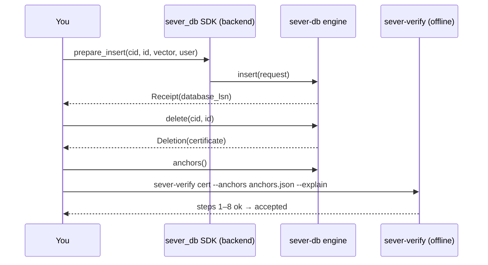

# 08 · Interfaces: command-line tools, Python SDKs and Studio

## In simple words

You can use SEVER-DB in three ways: from the command line (`sever-db`), from Python (`sever_db`), or
through the desktop demo **SEVER-DB Studio**. Anyone can check a deletion certificate with
`sever-verify`, and anyone with a log export can audit it with `sever-audit`. Each earlier part also kept
its own tools and SDK. This file lists what really exists in the code.

> **Prerequisites.** The parts ([05](05_part1_the_idea.md)–[07e](07e_encryption_and_crypto_shredding.md));
> PyO3 and maturin ([B06](background/B06_rust_and_python_for_this_project.md)). Glossary:
> [SDK](16_glossary.md#sdk), [application backend](16_glossary.md#application-backend), [PyO3](16_glossary.md#pyo3).

## The problem this solves

A reader of the report must be able to run the system and see the claims for themselves, offline,
without the 1-million-passage dataset.

## 1. Command-line tools

All three database CLIs (`sever-db`, `sever-db-p3`, `sever-db-p2`) share one style: first the command,
then `--name value` pairs; each command opens the database (recovery + invariant check), does one thing,
prints **one JSON line** and closes. Exit 0 = ok, 1 = `{"error":"<kind>"}`, 2 = usage error
[CODE: crates/sever-db/src/bin/sever-db.rs:L1-L65, L299-L315].

### `sever-db` — the final database (Part 4)

Common flags: `--data DIR --keys DIR [--d N (384)] [--allow-unsafe-fs] [--allow-unsafe-memory] [--config FILE]`
[CODE: sever-db.rs:L180-L187].

| Command | Flags | Does |
|---|---|---|
| `user-key` | `--out FILE` | new account Ed25519 key (mode 0600); no database opened |
| `create` | `--artefact FILE [--spawn-target N] [--frozen-only] [--no-passages]` | new collection → `{"cid": …}` |
| `insert` | `--cid --id --vector JSON --user-key FILE [--passage TEXT]` | plays the application backend (quantise, draw `r_t`, compute `C_t`, sign), inserts → `database_lsn`, placement |
| `delete` | `--cid --id` | → `{"outcome":"deleted","database_lsn","certificate":hex}` or `absent` |
| `delete-user` | `--cid --ids JSON` | all-or-nothing multi-record deletion |
| `certificate` | `--lsn N` | fetch a certificate later |
| `anchors` | `[--out FILE]` | the verifier's trust anchors |
| `export-log` | `[--out FILE]` | log export for the auditor |
| `latest-checkpoint` | — | tree size, root, timestamp, epoch, cosignature count |
| `search` | `--cid --vector JSON [--k N]` | `{"hits":[[id,score],…]}` |
| `stats`, `drop`, `checkpoint`, `verify` | `--cid` (first two) | counters; drop; storage checkpoint; recovery + platform report |

[CODE: sever-db.rs:L129-L295]

### Other tools

| Binary | Crate | Usage | Purpose |
|---|---|---|---|
| `sever-db-p3` | sever-p3 | same commands as `sever-db` (no memory override) | Part 3 database (plaintext) [CODE: crates/sever-p3/src/bin/sever-db-p3.rs:L193-L287] |
| `sever-db-p2` | sever-p2 | `create, load, insert, delete, delete-user, search, stats, drop, checkpoint, verify` | Part 2 database, no certificates [CODE: crates/sever-p2/src/bin/sever-db-p2.rs:L123-L208] |
| `sever-verify` | verifier/ | `sever-verify CERT --anchors FILE [--hex] [--explain]`; `--batch FILE` | offline certificate check; exit 0 accept, 1 reject (names the step), 2 usage, 3 refused [CODE: verifier/src/main.rs:L1-L126] |
| `sever-audit` | audit/ | `sever-audit EXPORT --anchors FILE [--certificate FILE]…` | log audit → `{"leaves","checkpoints","findings"}` [CODE: audit/src/main.rs] |
| `sever-scan` | sever-scan | `sever-scan IMAGE --targets FILE [--chunk-mib N]` | forensic scanner; exit 1 on findings [CODE: crates/sever-scan/src/bin/sever-scan.rs] |
| `sever-demo` | sever-p1 | `sever-demo idea --data nq-10k|nq-100k|synthetic [--seed N]` | Part 1 demo [CODE: crates/sever-p1/src/bin/sever-demo.rs:L11-L45] |
| `sever-demo-p2` | sever-p2 (`--features demo`) | `sever-demo-p2 durable --data nq-10k|synthetic` | Part 2 crash demo |
| `sever-demo-p4` | sever-scan (`--features demo`) | no arguments; always offline | Part 4 erase demo [CODE: crates/sever-scan/src/bin/sever-demo-p4.rs:L1-L13] |
| `sever-ex2`, `sever-bench` | sever-scan, sever-eval | experiment drivers for EX-2, EX-7, EX-8 | evaluation only |
| `sever-tracekit`, `sever-crashkit`, `-p3`, `-p4` | tooling | trace replay, crash campaigns, attacks, measures | gate runners only |

The Part 3 receipt demo is a Python module, not a binary:
`python -m sever_demo_p3.receipt receipt --data nq-10k|synthetic` [CODE: python/sever_demo_p3/receipt.py:L256-L272].

## 2. Python SDKs

Each SDK is a Rust **PyO3** native module (built with **maturin**, ABI3 for Python 3.13) plus a thin
Python wrapper [CODE: crates/sever-py/Cargo.toml (`pyo3 = "=0.29.2"`)]. Engine calls run with the GIL
released [CODE: crates/sever-py/src/lib.rs:L338].

### `sever_db` (final)

```python
from sever_db import Database, UserKey, prepare_insert

user = UserKey.generate()
with Database.open("/path/data", "/path/keys", allow_unsafe_memory=True) as db:   # dev override, recorded
    cid = db.create_collection("artefacts/partition-seed42.svp")
    req = prepare_insert(cid, "note-1", vector, user)   # quantise, draw r_t, compute C_t, sign
    receipt = db.insert(cid, req, passage=b"text")        # Receipt(database_lsn, placement, retried)
    deletion = db.delete(cid, "note-1")                   # Deletion(outcome, database_lsn, certificate)
    anchors = db.anchors()                                # JSON for sever-verify
```
(Usage pattern from [DOC: README.md L41-L53]; method names confirmed in [CODE: python/sever_db/__init__.py;
python/sever_db_native.pyi].)

- Module functions/classes: `prepare_insert(collection_id, record_id, vector, user, *randomness, **more)`
  — any extra argument raises `SeededNonceForbidden`; `UserKey` (`generate`, `from_secret_bytes`,
  `secret_bytes`, `public_key`); `InsertRequest` (read-only; `r_t` is not readable); dataclasses
  `Receipt`, `Deletion`, `Cosignature`, `LogCheckpoint`; `Database` (alias `Engine`); `Explainer`
  (inspect build only).
- `Database`: `open(data_dir, key_dir, d=384, allow_unsafe_fs=False, allow_unsafe_memory=False)`,
  `startup`, `d`, `create_collection`, `insert`, `delete`, `delete_user`, `certificate(lsn)`,
  `latest_log_checkpoint`, `inclusion_proof`, `consistency_proof`, `export_log`, `anchors`, `search`,
  `stats`, `group_sizes`, `collections`, `drop_collection`, `checkpoint`, `close`; `events` and `passage`
  only in the `inspect` build.
- A retried insert of the same request returns `Receipt(..., retried=True)`; a retried deletion returns
  `"absent"` (§15.1, §15.4).

`sever_db_p3` has the same API without the Part 4 extras; `sever_db_p2` has no keys, commitments or
certificates (`insert(collection, record_id, vector, passage=None)`).

### Error kinds (§17)

The 13 `sever_types::Error` variants become Python exceptions of the same names under `SeverError`:
`WrongDimension`, `NonFinite`, `NotNormalised`, `InvalidRecordId`, `DuplicateRecord` (its `args[0]` is
`same_commitment`), `CommitmentMismatch`, `BadUserSignature`, `GroupCapacityExceeded`,
`UnknownCollection`, `SeededNonceForbidden`, `PlatformUnsafe`, `IntegrityViolation`, `DurabilityFailure`
[CODE: crates/sever-py/src/lib.rs:L38-L114]. Messages are fixed text with no IDs, vectors or keys.

## 3. SEVER-DB Studio

A **PySide6 (Qt)** desktop app in `studio/` with its own environment (numpy, scikit-learn, pyarrow,
pyside6, pyqtgraph, onnxruntime, tokenizers, pyopengl) that drives the real final engine only through
public surfaces: the `sever_db` SDK (built with the `inspect` feature), `sever-verify`, `sever-audit` and
each part's proof programs [CODE: studio/pyproject.toml; studio/studio.sh; DOC: studio/README.md].
Six sections: Home; Explore the map (2-D/3-D t-SNE of groups, add/delete yourself, search); Receipts
(verify, flip a byte); Live (log tree, attack lab, kill a delete, float vs exact, groups made); Under
the hood (log, disk, crash, bad input); Proof (each part's programs, sabotage lab, evidence); plus a
34-item checklist and a 21-chapter tour [CODE: studio/sever_studio/ui/main_window.py:L39-L45;
DOC: _notes/interfaces.md §4]. Commands: `studio/studio.sh setup | prepare [--data synthetic] | run |
smoke | test [--full] | clean`. Studio is **not frozen**, and its second audit (`studio/audit/AUDIT2.md`)
lists overstatements still to fix — most importantly that it never says the witnesses are simulated
([14](14_status_gaps_and_pending.md)).

## 4. Try it yourself (offline, synthetic data)

These commands exist in the code; **they were not run while writing this report** (the prompt allowed
only read-only commands). "Synthetic" is the committed fixture: d = 16, 4 frozen groups, spawn size 8.

1. `uv sync --locked` — the pinned Python 3.13 environment.
2. `scripts/p1-demo.sh --data synthetic` — Part 1: delete a cohort, see each touched group's blob equal
   the survivors-only blob, see the soft-delete and float-mean ghosts. Output
   `artefacts/demo/idea-synthetic-seed42.json` and an HTML page.
3. `scripts/p2-demo.sh --data synthetic` — Part 2: crash a multi-group `delete_user` before and after the
   commit point, on a simulated disk and with a real `SIGKILL`.
4. `scripts/p3-demo.sh --data synthetic` — Part 3: insert, delete, check the certificate with
   `sever-verify --explain`, see a flipped byte rejected at a named step, audit the log.
5. `scripts/demo-p4.sh` — Part 4: the scanner finds a live vector, nothing after deletion; then the SB-24
   build shows the leak.
6. `scripts/ci.sh fast` — the fast test tier.



## Key points to remember

- `sever-db` CLI and `sever_db` SDK are the final interfaces; one JSON line per CLI command.
- `prepare_insert` runs on the application backend; `r_t` never reaches Python code.
- `sever-verify` and `sever-audit` are separate programs with no engine code.
- Every demo has an offline synthetic mode; the Part 4 demo is always offline.
- Studio is a demo, not part of the frozen product.

## Check your understanding

1. *Which tool checks a certificate?* — `sever-verify`, with an anchors file.
2. *What happens if you pass a seed to `prepare_insert`?* — `SeededNonceForbidden`.
3. *Why does `sever-db insert` need `--user-key`?* — It signs `C_t` as the application backend would.
4. *Which demo needs no dataset at all?* — The Part 4 erase demo (and every `--data synthetic` run).
