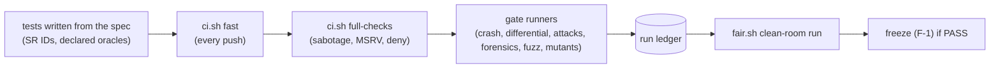

# 10 · Testing methodology

## In simple words

SEVER-DB's claims are only as strong as its tests. The project tests every rule of the specification
(and records which test covers which rule), compares the Rust engine with an independently written
Python model, crashes the database at hundreds of thousands of moments, attacks its certificates,
scans raw disks, fuzzes every parser, mutates the code to see if tests notice, builds deliberately
broken versions, and finally has fresh AI sessions in a sandbox test it without seeing the code.

> **Prerequisites.** [B05](background/B05_software_testing_concepts.md) (all testing concepts).
> Glossary: [oracle](16_glossary.md#oracle-test-oracle), [differential testing](16_glossary.md#differential-testing),
> [mutation testing](16_glossary.md#mutation-testing), [fuzzing](16_glossary.md#fuzzing),
> [red proof](16_glossary.md#red-proof), [fair testing](16_glossary.md#fair-testing).

## The problem this solves

When one author writes both the code and its tests, the tests inherit the author's misreadings. A test
that cannot fail proves nothing. And a single passing run of a random test proves little. Each technique
below closes one of these holes.

## Build up step by step

### Step 1 — Levels L1 … L14 (Build §2.1), with a real example each

| Level | What | Real example |
|---|---|---|
| L1 Unit | one function | `p1_types_error_messages_are_fixed_text` (crates/sever-types/src/error.rs:L160) |
| L2 Property | invariant for generated inputs (proptest, Hypothesis) | `p1_index_prop_survivors_check_after_any_sequence` (crates/sever-index/src/tests.rs:L732) |
| L3 Spec conformance | every MUST has a test | `p1_types_v1_parameters_match_spec_table` (crates/sever-types/tests/constants.rs) |
| L4 Differential | engine vs reference model via traces | `gates p1-differential` (python/sever_testkit/traces.py + crates/sever-tracekit) |
| L5 Model-based stateful | random op sequences, engine = model | `test_p1_stateful_engine_matches_model` (python/sever_testkit/tests/test_stateful.py:L73) |
| L6 Metamorphic | relation between two runs | `p1_index_prop_insertion_order_independent` (sever-index tests.rs:L753) |
| L7 Contract | every extension-point implementer passes a shared suite | `p2_vfs_ep5_sim_passes_functional_contract`; `p4_platform_ep4_mlock_provider_passes_contract` (crates/sever-platform/src/tests.rs:L480) |
| L8 Integration | crates together | crates/sever-engine/tests/engine.rs; crates/sever-db/tests/real_files.rs |
| L9 End-to-end | black box via CLI/SDK | tests/e2e/test_p2_e2e.py; `p1_e2e_demo_synthetic_deletion_is_exact` (crates/sever-p1/tests/e2e_idea.rs:L75) |
| L10 Fault/crash | crashes, torn writes, failed fsync | `p2_crashkit_small_campaign_against_the_python_oracle` (crates/sever-crashkit/tests/small.rs:L42) |
| L11 Fuzz | parsers never crash | 17 cargo-fuzz targets (Step 6) |
| L12 Mutation & sabotage | tests detect bugs | cargo-mutants gates; tests/sabotage/run.sh |
| L13 Architecture | dependency direction, no I/O in core, verifier independence | `p1_arch_core_has_no_io_clock_rng_or_fitting_dependency` (tests/architecture/test_architecture.py:L117) |
| L14 Benchmark | cost only, never a gate | no `benches/`; costs are measured by gate runners (P2-T11, P3-T13, EX-7) |

[DOC: docs/SEVER-DB_BUILD_PLAN_PART_1-2.md §2.1; CODE: as listed; _notes/testing.md §1]

### Step 2 — Counts (from the code, [RUN] greps)

| What | Count |
|---|---|
| Rust `#[test]` functions | 559 (crates 538, verifier 19, audit 2) |
| `proptest!` blocks | 10 |
| Python `def test_` | tests/ 204 (of which clean-room 171), python/ 194, studio/ 116 |
| `#[spec(` (Rust) / `@pytest.mark.spec(` (Python) | 381 / 83 |
| `// oracle:` comments | 370 (A 317, B 11, B-shared 19, C 11, D 12) |
| `@pytest.mark.mustfail` | 1 (SB-10) |
| Requirement IDs in spec/requirements.yaml | 293 |
| Fuzz targets | 17 |
| Proof patches | p2 140, p3 170, p4 92, inspect 7, scan 4 |
| Sabotage items | 30 (SB-1 … SB-30; SB-10 in Python) |

[RUN: commands in _notes/testing.md §2]. The generated `tests/README.md` says "550 Rust and 384 Python
test functions" — a different counting scope [DOC: tests/README.md].

### Step 3 — Spec traceability

Every MUST in the spec has an ID `SR-<section>-<n>` in `spec/requirements.yaml` (293 IDs); tests name
the IDs they check; `python -m sever_testkit.spec_trace` (and `_p2/_p3/_p4`) builds the matrices
`docs/TRACE_PART_N.md` and fails CI on an untraced requirement. Results: Part 1 70/70, Part 2 46/46,
Part 3 108/108, Part 4 69/69 = 293 [DATA: docs/TRACE_PART_1…4.md].

### Step 4 — Independent oracles and differential replay

An **oracle** (definition: an independent source of the expected answer) is declared per test as A
(spec by hand), B (independent model, RFC vector), B-shared (model written by the same AI — listed for
human review), C (frozen Part 1 code) or D (the code itself; never enough alone) [DOC: CLAUDE.md §6.3].
The Python reference models are written from the spec only: `sever_refmodel_core` (Part 1),
`sever_refmodel_durable` (crash oracle with a state digest), `sever_refmodel_certs` (pure-Python
ristretto255, Ed25519, XMD, Merkle, proofs, attacks, audit). The model writes a JSONL **trace**;
`sever-tracekit` replays it through the engine and compares every placement, outcome, blob hash and
top-k score bits [CODE: crates/sever-tracekit/src/lib.rs:L1-L8; python/sever_testkit/traces.py:L1-L10].
Golden files in `golden/` (23 files) come from the spec or the models, never from the engine.

### Step 5 — Crash campaigns

`SimVfs` crashes the engine at every VFS operation of a 20,000-operation stream, at every 512-byte offset
of sampled WAL writes, at random points, and during recovery; each recovered state's digest must equal
one of the two states the oracle allows, and the in-flight operation is retried
([06](06_part2_the_database.md)). Part 3 adds certificate checks (no certificate for a rolled-back
deletion, no orphaned leaves); Part 4 adds both disks, torn key slots and injected key losses
(`sever-crashkit`, `-p3`, `-p4`).

### Step 6 — Fuzzing

`cargo-fuzz` (libFuzzer) targets: fuzz/ `artefact_parse`, `blob_parse`; fuzz-p2/ `checkpoint_file`,
`manifest`, `store_record`, `wal_record`; fuzz-p3/ `certificate`, `log_record`, `placement`, `witnessed`;
fuzz-p4/ `bucket_block`, `envelope`, `key_slot`, `scan_targets`, `wrapped_value`; verifier/fuzz `verify`;
audit/fuzz `export`. Gate: 0 crashes in ≥ 10⁸ executions per parser. Fuzzing found a real bug (the
partition parser reserved memory from an untrusted header) [DATA: ledger line 18].

### Step 7 — Mutation testing

`cargo-mutants` changes the code in small ways (e.g. `==` → `!=`) and reruns the tests; a mutant that
survives must be triaged in `docs/MUTANTS_P*.md` (equivalent mutant or a real test gap). Thresholds:
≥ 85 % (Parts 1, 2; Part 3 non-crypto), ≥ 90 % (crypto, verifier, Part 4). Results in [11](11_results.md).

### Step 8 — Sabotage (must-fail builds)

Each SB-N builds the same source with exactly one deliberate bug; `tests/sabotage/run.sh` runs
`cargo test -p <crate> --features sabotage-SB-N` and passes only if a test fails
[CODE: tests/sabotage/run.sh:L30-L45]. Tables: SB-1 … SB-10 in [05](05_part1_the_idea.md), SB-11 … SB-15
in [06](06_part2_the_database.md), SB-16 … SB-30 in [07g](07g_crypto_attack_testing.md).

### Step 9 — Red proofs (CLAUDE.md §6.3)

A label `SR-X` on a test claims "breaking rule X turns this test red". A **red proof** is a patch in
`tests/proofs/pN/` that breaks exactly that rule; `python -m sever_testkit_p2.proofs run` (and `_p3`,
`_p4`) applies each patch to HEAD in a throwaway worktree and checks the labelled tests pass without it
and fail with it, writing `docs/PROOFS_P*.md`. Manifest entries: p2 red 194 / green 16 / limit 3; p3 red
173; p4 red 92 [RUN: _notes/testing.md §2]. The generated documents report "211 of 211" (P2), "31 of 31"
(P3, an older run) and "79 of 79" (P4, older) — the P3/P4 files are stale relative to the manifests
[DOC: docs/PROOFS_P*.md line 5].

### Step 10 — Fair testing in a clean room (FT-1 … FT-10)

`scripts/fair.sh` (package `python/sever_fair`) runs **fresh** Claude sessions in a `bwrap` sandbox
holding only the spec, public API and inputs: a tester writes tests against a **sealed** engine (every
call raises), the tests are hashed, a script runs them against the real engine, a **different model**
judges failures, planted bugs (the part's cargo-mutants mutants) are scored, and a judge re-derives a
sample of expected values. Pre-registered settings: tester opus, judge sonnet, planter sonnet, fixer
opus; pass rule 0 engine bugs, 0 spec gaps, 0 test gaps, 0 oracle disagreements
[CODE: configs/fair.yaml:L4-L30, L182-L183; DOC: docs/FAIR_TESTING.md]. A part may freeze only after a
PASS on its exact files (FT-10). Fair testing found erratum E-1, gaps G-37 … G-40, G-52, and DB-118
([12](12_bugs_found_and_fixed.md)). The kept clean-room suites are `tests/cleanroom/p3` and `p4`.

### Step 11 — CI tiers

`scripts/ci.sh fast`: rustfmt, clippy (also with all features), `cargo test --workspace`, verifier and
auditor fmt/clippy/tests, ruff, mypy, building the three SDK modules, pytest (not slow), spec-trace,
oracle-check, proofs-check, registers, RFC vectors, duplicate-crypto check, dalek pin, freeze-guard,
fair-check. `scripts/ci.sh full-checks` adds ignored and slow tests, the sabotage runner, an MSRV 1.85
build, `cargo deny`, `cargo doc -D warnings` [CODE: scripts/ci.sh:L42-L97]. GitHub Actions runs only
`ci.sh fast` on push and PR (data-dependent gates need the P0 data, which is not in git)
[CODE: .github/workflows/ci.yml]. Gate runners (`python -m sever_testkit*.gates …`) append to the run
ledger. There is no separate "Extended" mode in `ci.sh`, though Build §2.8 names one.

## Everyday analogy

*Analogy:* Sabotage is a fire drill with a real (small) fire: you only trust the alarm after it has
gone off. Mutation testing is setting thousands of tiny fires automatically. Fair testing is hiring an
inspector who has never seen the building plans' author. *Where it stops:* all of these test against the
spec; if the spec itself is wrong, only reviewers reading the spec (like the fair-testing judges or the
G-34 attack) catch it.

## Key points to remember

- 293 requirement IDs, all traced to tests.
- An independent Python model is the main oracle; golden values never come from the engine.
- Crashes, attacks, forensics, fuzzing and mutation each have pre-registered gates.
- Every SR label must have a red-proof patch; every SB item must turn a test red.
- Fresh sandboxed AI sessions test each part before it may freeze.

## Check your understanding

1. *What is oracle class D and why is it never enough?* — The code under test itself; it cannot detect a misreading.
2. *What does a red proof prove?* — That a labelled test really fails when its rule is broken.
3. *How many requirement IDs exist?* — 293.
4. *What does GitHub CI run?* — Only `scripts/ci.sh fast`.
5. *Why is the fair-testing judge a different model?* — To avoid one model's blind spots judging its own tests.
