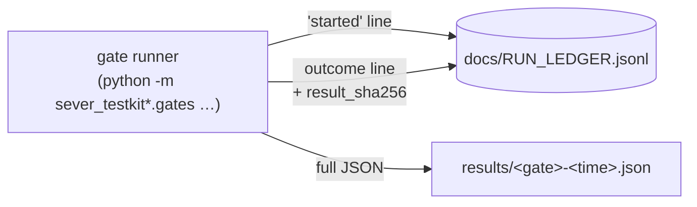

# 11 · Results (from the run ledger and `results/`)

## In simple words

This file lists every measured result of SEVER-DB and where it comes from. Each result was written by
a script (a *gate runner*) into the append-only run ledger `docs/RUN_LEDGER.jsonl`, usually with a
full JSON file in `results/`. Nothing here was copied from a README: each number was read from those
files in this session, and the line number of the ledger entry is given. Some checks are **gates**
(pass/fail, with a threshold fixed in advance), and some are **measures** (just recorded).

> **Prerequisites.** Recall@10 ([B01](background/B01_vectors_embeddings_and_search.md)), crash and
> commit point ([B02](background/B02_how_databases_store_and_delete.md)), mutation testing, coverage
> and fuzzing ([B05](background/B05_software_testing_concepts.md)). Glossary: [gate](16_glossary.md#gate),
> [measure](16_glossary.md#measure), [interim check](16_glossary.md#interim-check), [seed](16_glossary.md#seed).

## The problem this solves

A project report is only as trustworthy as its numbers. Three things go wrong easily: (1) a number is
quoted from an old run, (2) a measure is presented as if it were a pass/fail gate, and (3) a failed or
aborted run is quietly left out. This file avoids all three by quoting the ledger line of every
result, labelling each one, and listing failed and aborted entries too.

## How to read the labels

| Label | Meaning | Example |
|---|---|---|
| **GATE** | Pre-registered pass/fail check with a threshold fixed before the run (Build §2.5). A miss is a bug. | P2-T1: 0 lost acknowledged operations |
| **MEASURE** | Recorded exactly as found; never a reason to change code or rerun (Build §2.5). | P1-T7 Recall@10 |
| **INTERIM** | Laptop evidence gathered before the final gate run; never reported as the gate (DB-94). | P3-T4 on 19 Oct |
| **Status words** | *PASS / FAIL / aborted / RECORDED / measured* are exactly the ledger's `outcome` field. | |

The ledger has **224 lines** (2026-10-04T15:23Z … 2026-11-01T19:51Z) [RUN: `wc -l docs/RUN_LEDGER.jsonl`].
Each runner writes a `started` line and then an outcome line. Every run recorded the platform
`x86_64`, kernel `6.6.114.1-microsoft-standard-WSL2`, CPU flags `avx2 fma aes sha_ni` (WSL2 on the
owner's laptop) [DATA: docs/RUN_LEDGER.jsonl line 224 `platform`]. DB-113 names the laptop as an
Intel Core Ultra 5 226V, 8 cores, 16 GB, WSL2 Ubuntu 24.04 with 12 GB [DOC: Overview DB-113].

**Illustrative example, not from the repository** of how to read one entry: an entry with
`"gate": "P2-T6", "outcome": "FAIL"` followed later by one with `"outcome": "PASS"` means the first
run failed (and stays in the ledger), and a later run on a fixed commit passed.

---

## Part 1 — The Idea (frozen, `part-1-frozen`)

| ID | Kind | What it checks | Threshold | Final outcome and key numbers | Source |
|---|---|---|---|---|---|
| P1-T1, T2, T4, T5 (nq-10k) | GATE | Engine vs reference model; survivors check; scalar = AVX2; no deleted record returned | 0 mismatches | **PASS**, 5 seeds: 89,245 ops; 10,648,947 values compared, 0 mismatches; 43,562 survivor groups checked, 0 failures; 508,183,412 kernel pairs, 0 mismatches; 0 deleted returned | [DATA: ledger line 13; results/p1-differential-nq-10k-20261005T133904Z.json] |
| same (nq-100k) | GATE | same | 0 | **PASS**, 5 seeds: 731,105 ops; 12,389,642 compared, 0 mismatches; 427,455 survivor groups, 0 failures; 2,252,810,672 kernel pairs, 0 mismatches | [DATA: line 38; results/p1-differential-nq-100k-20261006T170158Z.json] |
| L4 synthetic | GATE (level L4) | 1,000 synthetic streams × 1,000 ops | 0 | **PASS**: 1,001,000 ops, 13,155,903 compared, 275,114 survivor groups, 0 failures of any kind | [DATA: line 19; results/p1-synthetic-20261005T134647Z.json] |
| P1-T7 | MEASURE (target T-6 ≥ 0.999) | Recall@10, dequantised Q24 vs float brute force, 3,452 queries | ≥ 0.999 (pre-registered) | **1.0** at nq-100k (86.3 s) and **1.0** at nq-1m (917.4 s); `met: true` both | [DATA: line 9, line 180; results/p1-quant-recall-*.json] |
| P1-T10 | GATE | Coverage | Rust lines ≥ 90 %, branches ≥ 85 %; Python ≥ 90 % | **PASS**: Rust lines 0.9591, branches 0.8701; Python lines 0.9885 | [DATA: line 32] |
| P1-T11 | GATE | Mutation score, survivors triaged | ≥ 85 % | **PASS**: 325 caught, 22 missed, 0 timeout, 71 unviable of 418 → score 0.9366; 0 untriaged | [DATA: line 30] |
| P1-T12 | GATE | Fuzzing, per parser | 10⁸ runs, 0 crashes | First run **FAIL** (line 18: `artefact_parse` crashed — the bug in [12](12_bugs_found_and_fixed.md)); three runs **aborted** (lines 22, 24, 26: OOM kill, WSL restart, machine down); then **PASS** (line 28): `artefact_parse` 10⁸ runs in 1,777 s, `blob_parse` 10⁸ in 619 s | [DATA: lines 18–28] |
| P1-T3, T6, T8, T9, T13 | GATE | Full-tier checks (17 steps incl. sabotage SB-1…SB-10, MSRV, cargo deny) | all steps PASS | First **FAIL** (line 34: step `sabotage`), then **PASS** (line 36, 17/17 steps) | [DATA: lines 34, 36] |
| P1-T13 spikes | GATE | Proof spikes for later parts | tests pass | **PASS** | [DATA: line 16] |
| P1-T9 | GATE | Traceability | 100 % | "70 of 70 requirements have a test (100.0 %)" | [DATA: docs/TRACE_PART_1.md (generated)] |
| P1-T14 | MEASURE | The ghost: distance of baselines' summaries from the survivors-only summary | descriptive | README: "soft-delete IVF 5.0e-3, float mean 1.9e-8, SEVER 0" (nq-10k seed 42). **Not in the ledger or `results/`**; the demo writes it to `artefacts/demo/` (skipped, untracked). | [DOC: README.md L133] [NOT FOUND in ledger/results] |

Aborted P1 runs, kept for honesty: lines 2, 4, 10 (P1-T2/T5; moved repo, VM restart, superseded),
7 (P1-T7, dirty check), 21 (nq-100k OOM) [DATA: lines 2, 4, 7, 10, 21 `reason`].

## Part 2 — The Database (frozen, `part-2-frozen-e2`)

| ID | Kind | What it checks | Final outcome and numbers | Source |
|---|---|---|---|---|
| P2-T1…T3 | GATE | Crash at every VFS step, every 512-byte WAL offset, random points, crashes during recovery | **PASS**, 5 seeds nq-10k: **343,837** crash points (step 321,689; offset 17,148; random 5,000); 6,874 double crashes; 0 not-oracle states, 0 lost acknowledged, 0 partial `delete_user`, 0 failures | [DATA: line 56; results/p2-crash-nq-10k-20261008T012927Z.json] (an earlier one-seed PASS: line 40) |
| P2-T5 | GATE | Part 1 traces through the Part 2 engine, plain/close/crash | **PASS**: 5 seeds × 3 modes, all PASS | [DATA: line 51] |
| P2-T6 | GATE | Fuzz 4 parsers, 10⁸ each | Two **FAIL** (lines 43, 45: no target finished), then **PASS** (line 50): `wal_record` 524 s, `manifest` 580 s, `checkpoint_file` 1,251 s, `store_record` 281 s | [DATA: lines 43–50] |
| P2-T7 | GATE | Proof spikes (AES-GCM-SIV sealer, log and key-rotation participants) | **PASS** | [DATA: line 48] |
| P2-T8 | GATE | SB-1…SB-15 each turn a test red | **PASS** | [DATA: line 53] |
| P2-T9 coverage | GATE | lines ≥ 90 %, branches ≥ 85 % | **PASS**: 0.9481 / 0.8670 | [DATA: line 55] |
| P2-T9 mutants | GATE | ≥ 85 % | **PASS**: 652 caught, 60 missed, 1 timeout, 155 unviable → 0.9144; 0 untriaged | [DATA: line 60] |
| P2-T9 traceability | GATE | 100 % | 46 of 46 | [DATA: docs/TRACE_PART_2.md] |
| P2-T4, T10, E2E-2.x | GATE | Full-tier checks | line 62 **FAIL** (`ruff-format`, `python-tests`), then **PASS** lines 64, 67, 76, 78, 82 | [DATA: lines 62–82] |
| P2-T11 | MEASURE | Bytes and fsyncs per op, recovery time, memory (nq-100k, seed 42) | insert 8,062 B/op, 1.00036 fsync/op; single delete 14,157 B/op; multi-record `delete_user` 24,608 B/op; recovery 0.0518 s (checkpoint only), 0.8472 s (WAL replay); peak RSS (VmHWM) 1,093,044 kB; 146,215 ops | [DATA: line 58; results/p2-measures-nq-100k-20261008T013402Z.json `found`] |
| Errata re-runs | GATE-like | Part 2 clean-room tests after E-1 and E-2 | **PASS** both | [DATA: lines 79, 83] |

## Part 3 — The Receipt (frozen, `part-3-frozen`)

The final Part 3 gates ran on the laptop (DB-113), not the HPC that the README still names.

| ID | Kind | What it checks | Final outcome and numbers | Source |
|---|---|---|---|---|
| P3-T1, T2 (T-4) | GATE | 100 % of honest certificates accepted; 100 % of AT-1…AT-20 rejected at an allowed step | First three runs **FAIL** (lines 103, 113, 119); **PASS** on lines 123, 141, 206. Final (line 206, 1 Nov): 5 seeds × 1,000 honest = **5,000 accepted**, **226,410 attacks rejected**, 0 wrongly judged | [DATA: line 206; results/p3-attacks-nq-10k-20261101T085746Z.json] |
| P3-T4 (T-1 with certificates) | GATE | Crash campaign, every crash point of 20,000 ops, 5 seeds | **PASS** (line 144, 29 Oct): 100,000 ops; crash points step 914,464 + offset 18,665 + random 5,000 = **938,129**; **192,964 certificates checked**, 0 bad certificates, 0 not-oracle states, 0 refusals | [DATA: line 144; results/p3-crash-nq-10k-20261029T225309Z.json] |
| P3-T4 interim | INTERIM | Crash points from op 17,000 on | PASS: 145,919 crash points, 76,852 certificates (19 Oct) | [DATA: line 97] |
| P3-T5 (T-3) | GATE | nq-100k trace replay, five fields and certificate arithmetic | **PASS** 5 seeds (line 148, 30 Oct); interim seed 42 PASS (line 99) | [DATA: lines 99, 148] |
| P3-T9 coverage | GATE | lines ≥ 95 % on sever-crypto and the verifier, ≥ 90 % on the others (Build 3-4 §1.9) | Two **FAIL** (lines 107, 115: verifier 0.7776, then 0.9448); **PASS** lines 121, 176, 200. Final (line 200): crypto 0.9542, commit 0.9158, log 0.9309, cert 0.9589, verifier 0.9627 | [DATA: line 200] |
| P3-T9 mutants | GATE | ≥ 90 % on sever-crypto and the verifier, ≥ 85 % on the others; survivors triaged (Build 3-4 §1.9) | line 147 **FAIL** (verifier 0.0, 83 untriaged — harness fault 1 of DB-114); line 156 **FAIL** (setup fault, all 0.0); **PASS** line 158: cert 0.8516, crypto 0.9344, log 0.8910, verifier 0.9733, 0 untriaged | [DATA: lines 147, 156, 158; DOC: Overview DB-114 items 1–2] |
| P3-T10 | GATE | Fuzz 6 parsers, 10⁸ | Interim 10⁷ PASS (line 102); **PASS** at 10⁸ (line 162) | [DATA: lines 102, 162] |
| P3-T3, T6–T9 sabotage, T11, T12 | GATE | Full-tier checks | **PASS** lines 105 (36 steps), 172, 196 (42 steps) | [DATA: lines 105, 196] |
| Part 3 proof spike | GATE | Part 4 plugs in without touching Part 3 | **PASS** lines 111, 167, 204 | [DATA] |
| P3-T13 | MEASURE | Proof/verify time, certificate size (d = 384) | Final (line 182, 30 Oct): prove median 15.78 ms (max 46.29), verify median 2.74 ms (max 13.74), certificate 1,197–13,645 bytes (predicted 14,093 for a full group); earlier (line 109, 19 Oct): prove 12.17 ms, verify 2.20 ms medians | [DATA: lines 109, 182; results/p3-measures-*.json] |
| Traceability | GATE | 100 % | 108 of 108 | [DATA: docs/TRACE_PART_3.md] |

## Part 4 — The Erasure (frozen, `part-4-frozen` = `v1.0.0`)

| ID | Kind | What it checks | Final outcome and numbers | Source |
|---|---|---|---|---|
| P4-T1, T2 (T-2) | GATE | 0 forensic findings on the raw image after ingest and every deletion rung; 100 % of planted secrets found; each sabotage build ≥ 1 finding | **PASS** (line 159, nq-10k, 5 seeds, 16 GiB images, override `allow_unsafe_fs` recorded): 6 scans per seed, **0 findings in all 30 scans**; sensitivity builds found SB-24 2,374, SB-25 1,178, SB-26 924, SB-28 4,246, SB-29 65,738, SB-30 65,229 findings | [DATA: line 159; results/p4-forensics-nq-10k-20261030T141339Z.json] |
| P4-T3 (T-1 final build) | GATE | Crash campaign on both disks, torn key slots, key losses | Window A **PASS** (line 164, seeds 42/123/777: 15,240 + 15,170 + 15,225 crash points; 100/100 key losses refused each; 0 stale slots, 0 unreadable). Window B **FAIL** (line 168, harness fault 5 of DB-114), then **PASS** (line 192, seeds 2024/9999: 7,915 + 9,050 crash points). Scoped to windows of 300 ops (DB-113). | [DATA: lines 164, 168, 192; DOC: DB-113, DB-114 item 5] |
| P4-T9 (T-3) | GATE | Replay on the final build | **PASS** 5 seeds nq-10k (lines 154, 210) | [DATA] |
| P4-T9 (T-4) | GATE | Attacks on the final build | **PASS** (line 208): 5,000 honest accepted, 226,410 attacks rejected | [DATA: line 208] |
| P4-T10 fuzz | GATE | 5 parsers, 10⁸ | **PASS** (line 153) | [DATA] |
| P4-T10 coverage | GATE | line coverage ≥ 95 % on keys, seal, erasure (Build 3-4 §2.10; `COVERAGE_MIN = 0.95` in python/sever_testkit_p4/gates.py:L47) | line 179 **FAIL** (keys 0.9139, seal 0.9337, erasure 0.9231); **PASS** lines 191, 202: keys 0.9813, seal 0.9615, erasure 0.9558 | [DATA: lines 179, 191, 202] |
| P4-T10 mutants | GATE | ≥ 90 % on keys, seal, erasure (`MUTATION_MIN = 0.90`), 0 untriaged | line 170 **FAIL** (erasure 0.7652, seal 0.7793, 71 untriaged); line 189 **FAIL** (all ≥ 0.90 but **1 untriaged** timeout) — **the owner accepted this as a pass** (DB-114); later line 220 **PASS** (1 Nov): erasure 0.9044, keys 0.9767, seal 0.9586, 0 untriaged | [DATA: lines 170, 189, 220; DOC: DB-114] |
| P4-T4…T8, T10 sabotage, T11 | GATE | Full-tier checks | **PASS** lines 174, 198 (42 steps) | [DATA] |
| Traceability | GATE | 100 % | 69 of 69 | [DATA: docs/TRACE_PART_4.md] |
| P4-T12 (T-5 / EX-6) | MEASURE (target drift ≤ 0.005 per seed) | Search stability under deletion, 4 arms × 6 rungs × 5 seeds, nq-10k | **RECORDED — target not met**: `t5_met: false`. Per-seed drift (ddof 0): 42: 0.01295, 123: 0.01046, 777: 0.01279, 2024: 0.00791, 9999: 0.01037. SEVER-DB Recall@10 falls from about 0.95 at rung 0 to 0.917–0.930 at rung 5; rebuilt IVF falls to 0.933–0.941; soft-delete IVF to 0.900–0.909; frozen-only to 0.855–0.887. Bootstrap 95 % mean drift: SEVER-DB [0.00938, 0.01240] | [DATA: line 161; results/p4-ex6-nq-10k-20261030T154119Z.json `statistics`, `arms`] |
| P4-T13 | MEASURE | Recall@10 at nq-1m | recorded as P1-T7 at nq-1m: 1.0 | [DATA: line 180] |
| P4-T14 (EX-7) | MEASURE | Cost of erasure: three builds | nq-100k seed 42 (line 186): delete p50 109,129 µs (sever) / 59,880 µs (noerase) / 907 µs (softdelete); bytes written per deleted record 39,525 / 27,279 / 11; deletes per second 7.63 / 12.70 / 741.37. nq-10k (line 184), 5 seeds: sever delete p50 74,502–77,198 µs, noerase 64,586–66,892 µs, softdelete 1,303–1,623 µs | [DATA: lines 184, 186; results/p4-ex7-*.json] |
| P4-T15 (EX-8) | MEASURE | Scale at nq-1m | **Not completed, no result.** Killed by the kernel's out-of-memory killer at 10.39 GB after 6 h 11 min; the owner chose not to rerun. **No ledger line exists** for EX-8. | [DOC: Overview DB-114 "What happened (31 October)"] [RUN: `grep -n ex8 docs/RUN_LEDGER.jsonl` → no match] |

What the numbers mean in plain words:
- **0 mismatches across 10.6 M and 12.4 M compared values** means the Rust engine and the separately
  written Python reference model agreed on every placement, outcome and group hash.
- **427,455 survivor checks, 0 failures** means: after each deletion, each touched group was
  byte-identical to a group built only from its surviving members — the core claim of Part 1.
- **343,837 and 938,129 crash points, 0 failures** mean: the database was "killed" at that many
  distinct moments and every recovery gave a state the oracle allows, with nothing acknowledged lost.
- **226,410 attacks rejected** means: every forged or tampered certificate was refused by the
  independent verifier at a step the attack register allows.
- **0 forensic findings in 30 scans** means: after deletion, a scanner searching the raw 16 GiB disk
  image for deleted vectors, keys, `r_t` and passages found nothing, while it did find planted
  controls and leaks in the sabotage builds.
- **Drift 0.008–0.013** means: Recall@10 dropped by about 1 percentage point more than the
  pre-registered 0.005 as records were deleted. This is a *measure*, so it is reported, not "fixed".
- **EX-7** shows the price of provable erasure: a SEVER-DB delete takes about 75–110 ms and writes
  about 39 KB, against about 1–1.6 ms and 10–11 bytes for a soft delete.

## Fair-testing runs (§6.4 of CLAUDE.md)

| Ledger line | Run ID | Part | Outcome |
|---|---|---|---|
| 68 | 20261008T123639Z-p2-55af7ad0-dry | 2 | DRY |
| 72 | 20261008T161930Z-p2-d76a93aa | 2 | FAIL |
| 125, 127, 129 | …-p3/p4 dry runs | 3, 4 | DRY |
| 131, 135 | 20261020T091030Z-p3-4cccfae9, 20261020T141335Z-p3-3f2aef5b | 3 | FAIL |
| 133, 137 | 20261020T094639Z-p4-9189b50a, 20261020T145844Z-p4-4ecbd6cf | 4 | FAIL |
| 194, 213 | 20261031T225306Z-p3-1479019b, 20261101T130254Z-p3-5fee0df5 | 3 | FAIL |
| **215** | **20261101T134211Z-p3-bb4bac5e** | **3** | **PASS** |
| 217, 222 | 20261101T142251Z-p4-a3040146, 20261101T175539Z-p4-587aa09b | 4 | FAIL |
| **224** | **20261101T192712Z-p4-36291aec** | **4** | **PASS** |

[DATA: ledger lines listed; results/fair-*.json]. There is **no Part 2 fair-testing PASS** in the
ledger; Part 2 has the clean-room re-runs after E-1 and E-2 (lines 79, 83, PASS). See
[14](14_status_gaps_and_pending.md).

## Pre-registered experiments EX-1 … EX-8

| EX | Where it is recorded | Status |
|---|---|---|
| EX-1 (crash campaign, target T-1) | P2-T1…T3 (no certificates), P3-T4, P4-T3 (scoped windows) | PASS (lines 56, 144, 164 + 192) |
| EX-2 (forensic scan, T-2) | P4-T1, P4-T2 (nq-10k instead of nq-100k, DB-113) | PASS (line 159) |
| EX-3 (engine vs model, T-3) | P1-T2 (core fields), P3-T5 (five fields), P4-T9 (final build, nq-10k) | PASS (lines 13, 38, 148, 210) |
| EX-3b (comparison with the earlier prototype, optional) | not found in the ledger | [NOT FOUND] |
| EX-4 (certificates, T-4) | P3-T1/T2, P4-T9 | PASS (lines 206, 208) |
| EX-5 (quantised recall, T-6) | P1-T7 / P4-T13 at nq-100k and nq-1m | measured 1.0 and 1.0, target met (lines 9, 180) |
| EX-6 | P4-T12, line 161 | RECORDED (T-5 not met) |
| EX-7 | P4-T14, lines 184, 186 | RECORDED (scoped: nq-10k five seeds, nq-100k one seed; DB-113) |
| EX-8 | P4-T15 | **Not completed** (no ledger entry) |

## README vs ledger

| README claim (line) | Ledger/results value | Match? |
|---|---|---|
| P1-T1 427,455 / 43,562 / 275,114 checks (L120) | lines 38, 13; results/p1-synthetic: 427,455 / 43,562 / 275,114 | ✓ |
| P1-T2 10.6 M, 12.4 M values (L121) | 10,648,947; 12,389,642 | ✓ (rounded) |
| P1-T4 10⁷ random pairs; 508 M; 2.25 B (L123) | 508,183,412; 2,252,810,672; the 10⁷ random pairs are not in the ledger | ✓ / 10⁷ [NOT FOUND in ledger] |
| P1-T6 largest differences 2e-17 and 1.4e-14 (L125) | not in ledger/results | [NOT FOUND] |
| P1-T7 1.000 (L126) | 1.0 (nq-100k); README omits the nq-1m result 1.0 | ✓ |
| P1-T9 70/70 (L128) | TRACE_PART_1: 70 of 70 | ✓ |
| P1-T10 95.9 / 87.0 / 98.8 % (L129) | 0.9591 / 0.8701 / 0.9885 | ✓ |
| P1-T11 325/347 = 93.7 %, 22 survivors (L130) | 325 caught, 22 missed, 0.9366 | ✓ |
| P1-T14 ghost 5.0e-3 / 1.9e-8 / 0 (L133) | not in ledger/results | [NOT FOUND in ledger] |
| P2-T1…T3 343,837; 321,689; 17,148; 5,000; 6,874 (L203) | identical (line 56) | ✓ |
| P2-T1…T3 "28,707 generic-record points" (L203) | no such field in the result file | [NOT FOUND] |
| P2-T9 46/46; 94.8 %, 86.7 %; 652/713 = 91.4 %, 60 survivors (L209) | 46/46; 0.9481, 0.8670; 652+60+1 = 713, 0.9144 | ✓ |
| P2-T11 8.1 / 14.2 / 24.6 KB; 0.05 s, 0.85 s; 1.09 GB; 146,215 ops (L211) | 8,062 / 14,157 / 24,608 B; 0.0518 / 0.8472 s; 1,093,044 kB; 146,215 | ✓ |
| Parts 3 and 4 status "Built … freezes after a fair-testing pass" (L19–L20) | tags `part-3-frozen`, `part-4-frozen`, `v1.0.0` exist; fair PASS lines 215, 224 | **✗ stale** |
| Part 3 gates "run once … on the college HPC" (L294–L295) | gates ran on the laptop (DB-113) | **✗ stale** |
| P3-T4 145,919 crash points, 76,852 certificates (L301) | line 97 interim ✓; final gate line 144: 938,129 points, 192,964 certificates | ✓ interim, **final result not shown** |
| P3-T1/T2 5,000 / 226,410 (L303) | lines 123 and 206: identical | ✓ |
| P3-T9 coverage crypto 95.4, verifier 95.2, commit 91.6, log 92.9, cert 96.2 (L304) | line 121: 0.9542, 0.9517, 0.9158, 0.9287, 0.9622 | ✓ (interim; final line 200 differs slightly) |
| P3-T10 10⁷ (L305) | line 102 ✓; final line 162 at 10⁸ | ✓ interim, final not shown |
| P3-T3… "36 steps" (L306) | line 105: 36 steps; final line 196: 42 | ✓ interim |
| P3-T13 prove 12.2 ms, verify 2.2 ms, 1.2–13.6 KB (L307) | line 109: 12.17, 2.20, 1,197–13,645 B; final line 182: 15.78, 2.74 | ✓ interim, **final differs** |
| Part 4 "Interim (laptop, 19 Oct) … gates run on the college HPC" (L355–L356) | final gates are in the ledger (lines 153–220) | **✗ stale** |
| P4-T3 interim 16/16 runs (L360) | interim, not a ledger gate entry | [DOC] |
| P4-T10 68/68 requirements, 84 proofs (L361) | TRACE_PART_4: **69 of 69** | **✗ (68 vs 69)** |
| P4-T12 T-5 | README does not report that T-5 was not met | **omission** |

## Key points to remember

- 16 of the 17 v1.0 gates pass as recorded; P4-T10 was recorded FAIL on one untriaged timeout and
  accepted by the owner (a later run, line 220, passes) [DOC: DB-114; DATA: lines 189, 220].
- Exactness held everywhere it was tested: 0 mismatches, 0 survivor failures, 0 crash failures.
- Every forged certificate (226,410) was rejected; every honest one (5,000) accepted.
- 0 forensic findings on raw disk images after deletion.
- The pre-registered T-5 search-stability target was **not met**; EX-8 **did not complete**.

## Check your understanding

1. *Is P1-T7 a gate?* — No, a measure (with a pre-registered target T-6 ≥ 0.999, which it met).
2. *Why are FAIL lines kept in the ledger?* — The ledger is append-only; failures are evidence.
3. *What does "0 forensic findings" not prove?* — It covers the tested images and scanner, not every
   possible device (see limits in [14](14_status_gaps_and_pending.md)).
4. *Was T-5 met?* — No: drift 0.008–0.013 per seed vs ≤ 0.005.
5. *Why is EX-8 missing?* — The run was killed by the OOM killer and not repeated.
