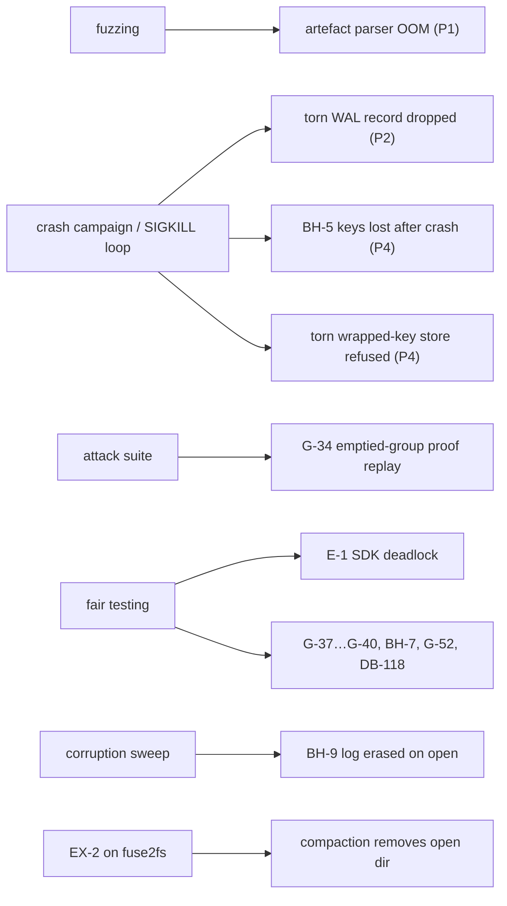

# 12 · Bugs found and fixed

## In simple words

Good tests find real bugs. This file lists the bugs that SEVER-DB's tests, gate runs, bug hunts and
fair-testing sessions actually found, what was wrong in plain words, the commit that fixed it, and the
regression test that now guards it. Sources are git history, `ERRATA.md`, the bug-hunt notes and the
tests themselves [GIT; DOC: ERRATA.md, docs/notes/BUG_HUNT_2026-10.md, BUG_HUNT_2026-11.md;
_notes/history.md].

> **Prerequisites.** Crash recovery and fsync ([B02](background/B02_how_databases_store_and_delete.md));
> fuzzing, sabotage, fair testing ([B05](background/B05_software_testing_concepts.md)); key rotation
> ([07e](07e_encryption_and_crypto_shredding.md)). Glossary: [erratum](16_glossary.md#erratum-e-n),
> [regression test](16_glossary.md#regression-test).

## The problem this solves

A report that says "all tests pass" without saying what the tests caught gives no sense of how strong
they are. The bugs below show which techniques paid off.

## Overview by finding technique

## Errata to frozen parts (the only two)

| ID | What was wrong | How found | Fix | Regression test |
|---|---|---|---|---|
| **E-1** | The Part 2 Python SDK deadlocked when one `Database` was used from several threads: searches during a `delete_user` never returned. The native module took the engine lock while holding Python's global interpreter lock (GIL), then released the GIL. | Clean-room tester (fair run `20261008T164154Z-p2-42fc06df`) | `061d785` (15 Oct): take the lock with the GIL released; tag `part-2-frozen-e1` | `tests/errata/test_p2_e1_sdk_threads.py::test_p2_errata_e1_sdk_searches_from_threads_during_delete_user`, committed red first (`a494354`) |
| **E-2** | The engine never called a participant's `pre_transaction` hook, so Part 3 could not commit its on-demand log checkpoint before a deletion (§15.3 step 3). Part 2 has no participants, so no Part 2 test could notice. | Building Part 3's log participant | `a244264` (15 Oct); tag `part-2-frozen-e2` (tagged 18 Oct) | `crates/sever-engine/tests/errata_e2.rs::p2_errata_e2_a_pre_transaction_commits_on_its_own_before_the_deletion`, red first (`8c314a5`) |

E-3 … E-6 were proposed and then **dropped** (DB-112); their three defects remain as limit L-28 in the
frozen Part 2 builds only [DOC: Overview DB-112, L-28].

## Bugs found by gates and campaigns

| Part | What was wrong (plain words) | Found by | Fix | Guard |
|---|---|---|---|---|
| 1 | The partition-file parser reserved memory based on a size *claimed* in the file header before checking the file was that long: an 88-byte file claimed 5 GB | Fuzzing, P1-T12 (ledger line 18 FAIL) | `e7b4285` (5 Oct) | regression input `golden/p1_regression_artefact_oom.bin` |
| 1 | `apply` could drop the holding area's records on a malformed flush | forged-change-set tests | [DOC: README.md L135-L138] | forged-ChangeSet tests in sever-index |
| 2 | Recovery silently dropped a damaged *committed* record in the newest WAL segment as if it were a torn tail | crash tests | now `IntegrityViolation` "§12.3 corrupt record inside the log" [CODE: crates/sever-wal/src/lib.rs:L345-L358] | [DOC: README.md L213-L215] |
| 3 | Emptied-group proofs verify under any context, so §9.5's "cannot be replayed" was false in that case (G-34) | P3-T2 attack run (AT-2 accepted 3/~900) | spec corrected, attack donors changed (DB-95, `9d1cb3d`/`2cd8b12`/`59e0a45`) | P3-T1/T2 PASS (ledger line 123) |
| 3 | The operator key store read `SECRETS` without the database's sealer (an encrypted database failed) | interim gates | `6887a1c` | sever-p3 tests |
| 4 | **BH-5 (critical)**: a crash after a deletion's COMMIT but before phase C, then a clean restart, made the database unopenable (INV-14) and lost the rotated keys | real-process SIGKILL loop | `449927f` (21 Oct); red test `4f2f725`; G-43, DB-102 | `crates/sever-db/src/tests.rs::p4_db_a_checkpoint_after_recovery_keeps_every_rotated_key`; P4-T3 now reopens after every recovery (DB-104; 137 reopen mismatches with the fix switched off [DOC: PROGRESS.md]) |
| 4 | Recovery refused to start after a crash tore the last record of the wrapped-key store | crash campaign | `adb6bd1` (19 Oct) | crash campaign |
| 4 | Compaction removed `wrapped.old` while a file in it was open, which FUSE and NFS refuse | EX-2 on a `fuse2fs` image | `b320e20` | EX-2 / forensics gate |
| 4 | A test failed 1 run in ~200: it "tore" a key slot by writing 0xFF at a byte that was sometimes already 0xFF | coverage run | `9dd87a2`: flip the byte; 20,000 runs each, old 98 failures, new 0 [DOC: DB-114] | the test itself |

## Bug hunts

**October (BUG_HUNT_2026-10.md):** BH-1 multi-line `#[spec(...)]` invisible to the tracer (`1e8e4b7`);
BH-2 commitment update skipped on error (won't fix; caught by INV-3); BH-3 a CI check passed when
`cargo tree` failed (`bb4bac5`); BH-5 above; BH-6 (Oct) a Part 4 golden file was in no freeze list
(`96cbc0b`); BH-7 (Oct) a Python string with a lone surrogate raised `UnicodeEncodeError` quoting part
of the ID (`e22a495`; tests `test_p4_sdk_a_record_id_that_is_not_utf8_is_invalid_record_id`,
`test_p3_sdk_…`).

**November (BUG_HUNT_2026-11.md, DB-116):** note the IDs BH-6 and BH-7 are **reused** for different bugs.

| ID | What was wrong | Found by | Fix | Test |
|---|---|---|---|---|
| BH-6 (Nov) | log and erasure store scanners ended silently on a record cut short in an **older** segment | silent-fallback search | `c629c6a` | `p3_log_store_an_older_segment_cut_short_is_refused`; `p4_erasure_store_refuses_an_older_segment_cut_short` |
| BH-7 (Nov) | a flipped byte in the log's checkpoint store made the log reopen at genesis (older log accepted) | fair run `20261031T225306Z` + corruption sweep | `a35c5c2`: each certificate's checkpoint must be in the log | `p3_log_txn_a_damaged_checkpoint_store_refuses_to_open` |
| BH-8 | (test error) consistency proof requested for equal sizes; engine was right | fair run | spec §10.1 clarified, G-50 | — |
| BH-9 (severe) | a missing checkpoint store was taken for a half-created log, and **every leaf and certificate was erased** | corruption sweep | `d5e41db` | `p3_log_store_a_lost_checkpoint_store_is_refused_not_recreated` |

Known follow-up: the BH-7 check reads every certificate at each recovery, making crash campaigns about
three times slower [DOC: Overview DB-116].

## Fair-testing findings (clean room)

E-1 (above); G-37 every witness gets an epoch-0 key at creation (`253642f`); G-38 the SDK reports
placements in the §5.1 text form (`53c3b79`); G-39 recovery refuses a stored log leaf past the last
committed one, INV-15 (`3f2aef5`, red `5850860`); G-40 roots refuse an artefact of another dimension
(`45e8808`); BH-7 (Nov); G-52 every `IntegrityViolation` stops the engine and `close()` after a stop fails
(DB-117, `f05d581`); DB-118 `prepare_insert` with an empty vector returned `NotNormalised` instead of
`WrongDimension` (`36291ae`; test `test_p4_sdk_an_empty_vector_is_wrong_dimension`)
[GIT; DOC: _notes/history.md A4].

## Harness faults (the engine was not at fault)

The v1.0 laptop run found faults in the **test harness**, fixed red-first and rerun (DB-114): the
verifier's mutants never ran (out-of-tree inputs missing); sabotage-only lines were counted as surviving
mutants; EX-6's FAISS seed overflowed a signed 32-bit integer; EX-6 never saw its holding area empty;
P4-T3's method check compared a file size recovery legitimately changes [DOC: Overview DB-114].

## Everyday analogy

*Analogy:* Each technique is a different kind of inspector: the fuzzer throws garbage at the door, the
crash campaign pulls the plug at random moments, the attacker forges paperwork, and the outside
inspector (fair testing) reads only the rulebook. Each found something the others missed.
*Where it stops:* finding no more bugs does not prove there are none.

## Key points to remember

- Two errata to frozen Part 2 (E-1, E-2), each with a red-first regression test and a new tag.
- The most serious engine bugs (BH-5, BH-9) were found by crash/corruption campaigns, not unit tests.
- The attack suite found a spec error (G-34); fair testing found the SDK deadlock (E-1).
- Bug-hunt IDs BH-6/BH-7 are used twice (October and November).

## Check your understanding

1. *What made BH-5 critical?* — After a crash at the wrong moment and a clean restart, the database could not open and rotated keys were lost.
2. *Why was E-1 invisible to the author's tests?* — They never used one database from several Python threads.
3. *What did fuzzing find?* — A parser allocating memory from an untrusted size field.
4. *Was G-34 a code bug?* — No; the verifier was right, the spec sentence was too strong.
5. *What is the rule for fixing a frozen part?* — An erratum: failing test first, smallest fix, new tag.
