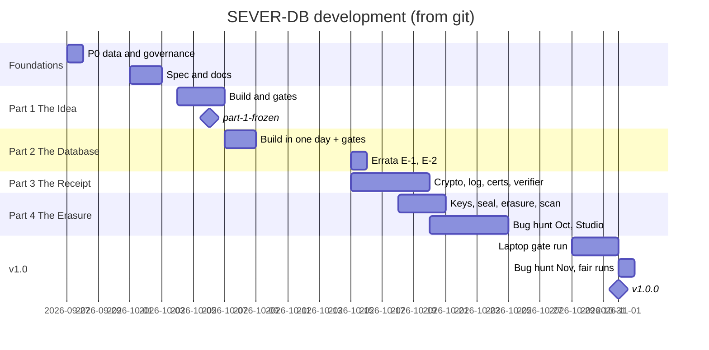

# 13 · Development timeline

## In simple words

SEVER-DB was built in about five weeks, from 27 September to 1 November 2026, in 430 commits. It went
data → Part 1 → Part 2 → errata → Part 3 → Part 4 → bug hunts and the final gate run → freezes and
`v1.0.0`. Dates and hashes below come from `git log` and `git tag` [RUN: `git log --date=short`,
`git for-each-ref refs/tags`].

> **Prerequisites.** The four parts ([01](01_overview_and_core_idea.md)); freeze and errata
> ([09](09_coding_style_and_engineering_rules.md)). Glossary: [freeze](16_glossary.md#freeze), [tag](16_glossary.md#tag-git).

## The problem this solves

A guide or examiner will ask "how long did each part take, and what happened when?" This is the
evidence-backed answer.

## Commits per day [RUN]

27 Sep 17 · 1 Oct 6 · 2 Oct 4 · 4 Oct 14 · 5 Oct 21 · 6 Oct 19 · **7 Oct 43** · **8 Oct 47** · 15 Oct 34 ·
16 Oct 10 · 17 Oct 2 · 18 Oct 15 · 19 Oct 38 · 20 Oct 20 · 21 Oct 29 · 22 Oct 7 · **23 Oct 43** · 24 Oct 9 ·
29 Oct 6 · 30 Oct 16 · 31 Oct 8 · 1 Nov 22. No commits on 9–14 Oct and 25–28 Oct.
Commit kinds: feat 94, docs 90, test 80, fix 74, chore 49, perf 3, ci 3, freeze 2, erratum 2.

## Tags [RUN]

| Tag | Commit | Tag date | Kind |
|---|---|---|---|
| `part-1-frozen` | b1d4576 | 2026-10-06 | annotated (tag object 69c1d20) |
| `part-2-frozen-e1` | 7729302 | 2026-10-15 | annotated (170d308) |
| `part-2-frozen-e2` | a244264 | 2026-10-18 | annotated (13e0aa6) |
| `pre-tidy` | 7c3c313 | 2026-10-31 | — |
| `part-3-frozen` | a304014 | 2026-11-01 (commit date) | lightweight |
| `part-4-frozen` = `v1.0.0` | 7942c1d | 2026-11-01 (commit date) | lightweight |

There is no plain `part-2-frozen` tag; the first Part 2 freeze commit was `23ac9be` (8 Oct).

## Milestones [GIT, from _notes/history.md B, hashes verified where quoted]

- **27 Sep** — P0: dataset manifest (`34b4558`), CLAUDE.md governance (`61e77b7`), data scripts (`906fba7`).
- **4 Oct** — Part 1 modules: sever-types (`1d50f76`), sever-quant (`5fa8ae5`), partition builder C-15
  (`954fddf`), reference model C-18 (`18ed175`), sever-index + sever-search (`76bb293`); repository moved
  to WSL ext4 (first ledger run aborted for the move, ledger line 2).
- **5 Oct** — `sever-demo idea` (`b94afa9`); fuzzing finds the parser bug (`e7b4285`); OOM-killed and
  VM-restart runs recorded as aborted.
- **6 Oct** — Part 1 gates pass; freeze manifest (81 files) `b1d4576`; tag `part-1-frozen`. Commit hashes
  rewritten that day to remove co-author trailers (`docs/COMMIT_MAP.txt` maps old → new; early ledger
  entries cite old hashes) [DOC: docs/COMMIT_MAP.txt L1].
- **7 Oct** — Part 2 built in one day: VFS/SimVfs, formats, WAL, append store, checkpoints, txn, engine,
  crash kit, demo, SDK.
- **8 Oct** — P2-T1…T3 PASS (343,837 crash points); proofs 211/211; "Part 2 frozen" `23ac9be`; fair-testing
  system introduced (DB-73).
- **15 Oct** — E-1 (`061d785`) and E-2 (`a244264`); Part 3 starts: sever-crypto, sever-commit, sever-log,
  sever-cert.
- **16–17 Oct** — sever-p3 root, Part 3 SDK, `sever-verify` (`a89b900`), `sever-audit` (`97df356`), receipt demo.
- **18 Oct** — Part 4 started on branch `p4-prep` before Part 3 froze (DB-89): sever-keys, sever-seal,
  sever-erasure, sever-platform; tag `part-2-frozen-e2`.
- **19 Oct** — sever-db final root, sever-scan, Part 4 demo, crash kit P4; interim gates; G-34 found.
- **20–21 Oct** — fair "bug-hunt" runs (G-37 … G-40); October bug hunt; BH-5 fixed (`449927f`).
- **22–24 Oct** — Studio (DB-106 … DB-109), inspect build, `sever-explain`; HPC plan (DB-111); "nothing
  planned after v1.0" (DB-112); `main` fast-forwarded to `3417b7f`.
- **29 Oct** — HPC no longer available → v1.0 run moved to the laptop, scoped (DB-113).
- **30–31 Oct** — harness faults fixed and rerun (DB-114); run over; EX-8 killed by OOM; navigation
  pages (DB-115).
- **1 Nov** — November bug hunt (BH-6, BH-7, BH-9), DB-116/117/118; Part 3 fair PASS → freeze `a304014`;
  p4-mutants PASS; Part 4 fair PASS → freeze `7942c1d`, `v1.0.0`; progress note `4a03951`.

## Branch state at the time of writing [GIT]

Current branch `bughunt-2026-11` (HEAD `4a03951`) holds the Part 3/4 freezes; it is ahead of
`origin/main` (`3417b7f`) and was not pushed or merged at the time the notes were taken
[DOC: _notes/history.md; memory of the owner's plan, not re-verified with the remote].

## Key points to remember

- Part 1: 4–6 Oct; Part 2: 7–8 Oct (+ errata 15 Oct); Part 3: 15–19 Oct; Part 4: 18–21 Oct.
- Final gate run on the laptop 29–31 Oct; freezes and `v1.0.0` on 1 Nov.
- Commit hashes before 6 Oct were rewritten; use `docs/COMMIT_MAP.txt` for old ledger entries.

## Check your understanding

1. *When was Part 1 frozen?* — 6 Oct 2026 (`part-1-frozen` → b1d4576).
2. *Why are there two Part 2 tags?* — One per erratum (E-1, E-2).
3. *Where did the final gate run happen?* — On the owner's laptop, after the HPC became unavailable (DB-113).
4. *Which commit is `v1.0.0`?* — 7942c1d, the Part 4 freeze.
