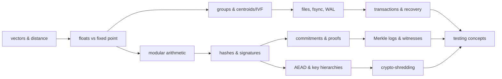

# 15 · Prerequisites: what to learn before reading

For each concept: **what it is** · **why SEVER-DB needs it** (where) · **depth** · **where to learn**.
External links were opened and checked on 2026-11-01/06; where none was verified, only the
background file is given. Depth: *I* = just the intuition, *W* = working understanding, *D* = detailed.

## 1. Programming and systems basics

| Concept | What it is | Why / where | Depth | Learn |
|---|---|---|---|---|
| Bytes, endianness | 8-bit units; byte order of integers | every on-disk format (§0.2, §14) | W | [B03](background/B03_floating_point_vs_exact_integers.md) |
| Files, fsync, directories | durable storage and forcing writes | Part 2 commit point | D | [B02](background/B02_how_databases_store_and_delete.md); SQLite WAL page https://sqlite.org/wal.html |
| Processes, memory, swap, hibernation | how RAM can leak to disk | Part 4 startup checks | W | [07f](07f_platform_safety_and_forensics.md) |
| Filesystems, copy-on-write | how writes land on disk | key-file erasure (§12.9) | W | [07f](07f_platform_safety_and_forensics.md) |
| SIMD / AVX2 | many numbers per instruction | search kernel | I | [05](05_part1_the_idea.md) |

## 2. Maths

| Concept | What | Why / where | Depth | Learn |
|---|---|---|---|---|
| Vectors, dot product, distance | lists of numbers and their geometry | search, routing | W | [B01](background/B01_vectors_embeddings_and_search.md) |
| Floating vs fixed point | approximate vs exact number formats | Q24, exactness claim | D | [B03](background/B03_floating_point_vs_exact_integers.md); Python tutorial https://docs.python.org/3/tutorial/floatingpoint.html |
| Modular arithmetic | clock arithmetic mod n | scalars mod ℓ | W | [B04](background/B04_cryptography_basics.md) |
| Groups (intuition) | sets with addition and inverses | ristretto255, commitments | I | [B04](background/B04_cryptography_basics.md) |
| Covariance, Mahalanobis | spread-aware distance | drift test | I | [05](05_part1_the_idea.md) |

## 3. Vector search and ML

| Concept | What | Why / where | Depth | Learn |
|---|---|---|---|---|
| Embeddings, sentence-transformers | text → vector models | 384-d all-MiniLM-L6-v2 | I | [B01](background/B01_vectors_embeddings_and_search.md); model card https://huggingface.co/sentence-transformers/all-MiniLM-L6-v2 |
| Nearest neighbour, IVF, centroids | approximate search by clusters | Part 1 index | W | [B01](background/B01_vectors_embeddings_and_search.md); Faiss paper arXiv:2401.08281 |
| k-means | clustering | partition builder | I | [B01](background/B01_vectors_embeddings_and_search.md) |
| Recall@10 | search quality metric | P1-T7, EX-6 | W | [B01](background/B01_vectors_embeddings_and_search.md) |

## 4. Databases

| Concept | What | Why / where | Depth | Learn |
|---|---|---|---|---|
| CRUD, indexes | basic DB operations | API | I | [B02](background/B02_how_databases_store_and_delete.md) |
| Soft vs hard delete, tombstones, compaction | how deletion usually works | the ghost problem | W | [B02](background/B02_how_databases_store_and_delete.md); PostgreSQL VACUUM docs https://www.postgresql.org/docs/current/routine-vacuuming.html |
| Transactions, atomicity | all-or-nothing | `delete_user` | D | [B02](background/B02_how_databases_store_and_delete.md) |
| WAL, checkpoints, crash recovery | durability | Part 2 | D | [B02](background/B02_how_databases_store_and_delete.md); https://sqlite.org/wal.html |

## 5. Cryptography

| Concept | What | Why / where | Depth | Learn |
|---|---|---|---|---|
| Hashes, HMAC | fingerprints, keyed fingerprints | log, IDs | W | [B04](background/B04_cryptography_basics.md) |
| Symmetric encryption, AEAD, nonces | confidential + authenticated storage | Part 4 | W | [B04](background/B04_cryptography_basics.md); RFC 8452 |
| Key wrapping, hierarchies, crypto-shredding | keys under keys; destroy to erase | Part 4 | D | [07e](07e_encryption_and_crypto_shredding.md) |
| Digital signatures (Ed25519) | vouching | certificates, log | W | RFC 8032 |
| Elliptic curves (ristretto255) | the group used | commitments | I | RFC 9496 |
| Commitments (Pedersen) | hide + bind + add | Part 3 core | D | [07b](07b_pedersen_commitments_and_proofs.md) |
| Zero-knowledge / proofs of knowledge | prove without revealing | deletion proof | W | [07b](07b_pedersen_commitments_and_proofs.md); Merlin https://merlin.cool |
| Merkle trees, transparency logs, witnesses | tamper-evident history | Part 3 | W | RFC 9162; https://transparency.dev/ |

## 6. Software testing

| Concept | What | Why / where | Depth | Learn |
|---|---|---|---|---|
| Unit, property-based tests | basic and generated tests | L1, L2 | W | [B05](background/B05_software_testing_concepts.md); Hypothesis docs https://hypothesis.readthedocs.io/ |
| Differential, model-based, metamorphic | compare implementations / runs | L4–L6 | W | [B05](background/B05_software_testing_concepts.md) |
| Fuzzing, mutation, coverage, sabotage | do tests catch bugs? | L11, L12 | W | [B05](background/B05_software_testing_concepts.md) |
| Test oracles, traceability | where expected values come from | CLAUDE.md §6.3 | D | [10](10_testing_methodology.md) |

## 7. Tools and languages

| Concept | Why / where | Depth | Learn |
|---|---|---|---|
| Rust basics (crates, traits, `Result`, `?`, ownership, `unsafe`, features) | reading the engine | W | [B06](background/B06_rust_and_python_for_this_project.md); *The Rust Programming Language* https://doc.rust-lang.org/book/ |
| Cargo workspaces | repo layout | W | [B06](background/B06_rust_and_python_for_this_project.md) |
| Python, uv, pytest | tooling | W | [B06](background/B06_rust_and_python_for_this_project.md) |
| PyO3 / maturin | SDK | I | PyO3 guide https://pyo3.rs/ |
| git (commits, tags, branches) | freezes, timeline | W | [13](13_timeline.md) |
| Linux / WSL2 | platform | I | [07f](07f_platform_safety_and_forensics.md) |

## 8. Privacy and law

| Concept | Why | Depth | Learn |
|---|---|---|---|
| Personal data, right to erasure, GDPR Art. 17 | motivation | I | [B07](background/B07_privacy_and_the_right_to_erasure.md) |
| India DPDP Act 2023 | motivation (Indian context) | I | [B07](background/B07_privacy_and_the_right_to_erasure.md) [official text: CITATION NEEDED] |
| Embedding inversion | why embeddings are sensitive | I | Morris et al. EMNLP 2023, arXiv:2310.06816 |

## Suggested study order

## What matters most for the viva

1. Why floats leave a ghost and Q24 integer sums do not (B03, 05).
2. The commit point and all-or-nothing `delete_user` (06).
3. `C_S_post + C_t = C_S_pre` and what the proof proves (07b, 07d).
4. Rotation, phase A/C and INV-14 (07e).
5. Gates vs measures, and the honest limits (11, 14).
