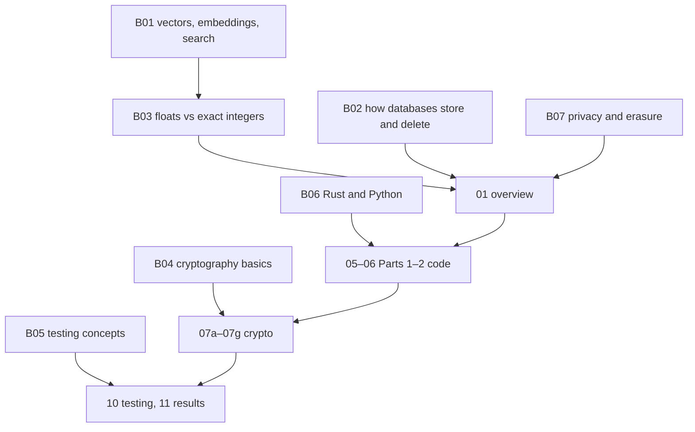

# B00 · Start here

## In simple words

These background files teach, from zero, the ideas you need to understand SEVER-DB. Each one explains a
concept in plain words, gives an everyday analogy and a tiny worked example, and then points to exactly
where SEVER-DB uses it. Read them in the order below, then the project files.

> **Prerequisites.** Basic programming, data structures and school maths. Nothing else.

## The problem this solves

The project combines vector search, databases, cryptography, testing and law. Few readers know all five.
This path builds them up in dependency order.

## Learning path for a total beginner

1. [B01](B01_vectors_embeddings_and_search.md) → [B03](B03_floating_point_vs_exact_integers.md) →
   [B02](B02_how_databases_store_and_delete.md) → [B07](B07_privacy_and_the_right_to_erasure.md)
2. [01 Overview](../01_overview_and_core_idea.md)
3. [B06](B06_rust_and_python_for_this_project.md) → [05 Part 1](../05_part1_the_idea.md) →
   [06 Part 2](../06_part2_the_database.md)
4. [B04](B04_cryptography_basics.md) → [07a](../07a_crypto_overview.md) … [07g](../07g_crypto_attack_testing.md)
5. [B05](B05_software_testing_concepts.md) → [10](../10_testing_methodology.md) → [11](../11_results.md)
6. [14 Status and limits](../14_status_gaps_and_pending.md) — read before any viva.

Keep [16_glossary.md](../16_glossary.md) open; [15_prerequisites.md](../15_prerequisites.md) lists free
external resources.

## What to read before the viva

01, 05 (exact deletion), 06 (commit point), 07b (commitment arithmetic), 07d (verifier steps), 07e
(crypto-shredding), 11 (numbers), 14 (limits), and [R10](../research/R10_viva_and_guide_questions.md).

## Everyday analogy

*Analogy:* a trek with base camps — do not jump to the summit (cryptography) before the first camp
(vectors and integers). *Where it stops:* you may skip a camp you already know.

## Key points to remember

- Background files teach concepts; project files show the code.
- Examples marked "Illustrative" are not from the repository.
- 14 is the honest boundary of every claim.

## Check your understanding

1. *Which file explains why floats break exact deletion?* — B03.
2. *Which file lists what SEVER-DB does not guarantee?* — 14.
