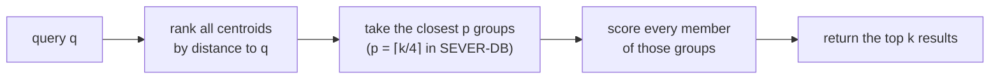

# B01 · Vectors, embeddings and nearest-neighbour search

## In simple words

A **vector database** stores lists of numbers (vectors) and, given a new list, finds the stored
lists that are closest to it. AI systems use this to find text with a similar meaning: a model turns
each piece of text into 384 numbers, and texts with similar meanings get numbers that are close
together. SEVER-DB is such a database. This file explains the ideas from zero: what the numbers are,
what "close" means, why searching everything is slow, and how grouping vectors into clusters makes
search fast — which is also what makes exact deletion possible.

> **Prerequisites.** School-level vectors and the Pythagoras distance; lists and arrays
> ([15_prerequisites §2](../15_prerequisites.md#2-maths), [§3](../15_prerequisites.md#3-vector-search-and-ml)).
> Glossary: [vector](../16_glossary.md#vector), [embedding](../16_glossary.md#embedding).

## The problem this solves

Suppose a help-desk bot has 100,000 stored passages and a user asks "how do I reset my password?".
A keyword search misses a passage titled "Recovering account access", because it shares no words with
the question. We want to find passages by **meaning**. And we want it to be fast: comparing the
question with all 100,000 passages for every question is slow when there are millions.

## Build up step by step

### Step 1 — A vector is a list of numbers

A **vector** of dimension `d` is an ordered list of `d` numbers, for example `(0.6, 0.8)` with `d = 2`.
You can picture a 2-D vector as an arrow from the origin to the point (0.6, 0.8).

### Step 2 — An embedding turns text into a vector

An **embedding model** (definition: a neural network trained so that texts with similar meanings get
nearby vectors) reads a sentence and outputs a fixed-length vector. SEVER-DB uses the
**all-MiniLM-L6-v2** model from the **sentence-transformers** library, which outputs `d = 384`
numbers per text [DOC: README.md L31-L32; DOC: docs/SEVER-DB_SPECIFICATION.md §2.1]. The model name
and exact revision are written inside the partition artefact's `encoder` field so that every
component uses the same model [DOC: §3.3, §6.3].

### Step 3 — Unit length

The **length** (or *L2 norm*) of `x` is `‖x‖ = sqrt(x_0² + x_1² + … + x_{d−1}²)`.
A **unit vector** has length 1. Example: `(0.6, 0.8)` has length `sqrt(0.36 + 0.64) = 1`.
All-MiniLM-L6-v2 outputs unit vectors after normalisation, and SEVER-DB **requires** unit length on
every insert (it checks, it never fixes) [CODE: crates/sever-quant/src/lib.rs:L24-L48]. See
[B03](B03_floating_point_vs_exact_integers.md) for the exact tolerance.

### Step 4 — Distance and similarity

- **Squared Euclidean (L2) distance:** `D(q, x) = Σ_i (q_i − x_i)²`. Smaller means closer.
- **Cosine similarity:** `cos(q, x) = (q · x) / (‖q‖·‖x‖)`, where `q · x = Σ_i q_i·x_i` is the
  **dot product**. Larger means more similar.
- For unit vectors the two agree: `D(q, x) = 2 − 2·cos(q, x)`, so ranking by smallest distance is
  the same as ranking by largest cosine.

**Illustrative example, not from the repository.** `q = (1, 0)`, `a = (0.6, 0.8)`, `b = (0, 1)`.
`D(q, a) = 0.4² + 0.8² = 0.16 + 0.64 = 0.8`; `D(q, b) = 1 + 1 = 2`. So `a` is closer.
Check with cosine: `cos(q, a) = 0.6`, `2 − 2·0.6 = 0.8` ✓.

SEVER-DB scores with squared L2 distance [DOC: §8.1].

### Step 5 — Nearest-neighbour search, and why exact search is slow

**k-nearest-neighbour (k-NN) search** returns the `k` stored vectors with the smallest distance to
the query. **Exact (brute-force) search** compares the query with every stored vector: with
`N` vectors of dimension `d`, that is `N·d` multiply-adds per query. At `N = 1,000,000` and `d = 384`
that is 384 million operations for one question.

### Step 6 — Clustering: put similar vectors in groups

**k-means clustering** (definition: an algorithm that splits points into `k` groups so that each point
belongs to the group whose centre is nearest) produces `k` **centroids** (definition: the mean point
of a group). **Illustrative example, not from the repository:** points `(0,0), (0,1), (10,10), (10,11)`
with `k = 2` give centroids `(0, 0.5)` and `(10, 10.5)`.

### Step 7 — IVF: search only the nearest groups

An **inverted-file index (IVF)** stores, for each centroid, the list of vectors assigned to it (a
*posting list*). A query first ranks the centroids, then scans only the vectors in the few closest
groups. "IVF-flat" means the vectors in each list are stored in full ("flat"), not compressed.



The price is that the true nearest neighbour might sit in a group that was not scanned, so search
becomes **approximate**.

### Step 8 — Measuring quality: Recall@10

**Recall@10** (definition: of the 10 true nearest neighbours found by exact search, the fraction that
the approximate method also returns). If exact search returns 10 IDs and the approximate search finds
9 of them, Recall@10 = 0.9. SEVER-DB uses Recall@10 to measure how much the Q24 quantisation costs
(P1-T7; results in [11_results.md](../11_results.md)).

## Everyday analogy

*Analogy:* An IVF index is a library with shelves by subject. To find books about volcanoes you go
to the two or three closest subjects (geology, geography) and look through those shelves only.
*Where it stops:* a library shelf is chosen by a human; an IVF "shelf" is chosen by distance to a
centroid, and a relevant book can sit on a shelf you did not visit (that is why search is
approximate).

## How SEVER-DB does it

- **Fixed groups.** SEVER-DB's groups are fitted **once, offline**, by k-means with 128 clusters on
  a public reference dataset (SciQ), and never move [DOC: §6.1–6.2]. Each insert touches exactly one
  group, so a deletion touches exactly one group. The fitting code is the Python partition builder
  `python/sever_partition` (component C-15); details in [05_part1_the_idea.md](../05_part1_the_idea.md).
- **Routing.** A new vector goes to its nearest frozen centroid unless a drift test (a Mahalanobis
  distance, [glossary](../16_glossary.md#mahalanobis-distance)) says it does not resemble the
  reference data; then it goes to a *spawned* group or a *holding area*
  [CODE: crates/sever-index/src/index.rs:L233 `Index::route`; distance helpers `sq_dist_f64` and
  `mahalanobis` in crates/sever-index/src/route.rs:L10, L21; DOC: §7].
- **Probe budget.** Search scans `p = ⌈k/4⌉` groups: `probe_count(k)` returns `k.div_ceil(4)`
  [CODE: crates/sever-search/src/lib.rs:L39-L40]. Empty groups still count, so "25 % coverage" means
  the same thing after many deletions [DOC: §8.1 step 2].
- **Pinned scoring.** The score `Σ (q_i − x̂_i)²` is computed in float32 with eight partial sums and a
  fixed final reduction, so the plain (scalar) and the fast SIMD (AVX2) code give bit-identical
  results:

```rust
pub fn score_scalar(q: &[f32], x: &[f32]) -> f32 {
    let mut lanes = [0.0_f32; 8];
    for (qc, xc) in q.chunks_exact(8).zip(x.chunks_exact(8)) {
        for ((l, a), b) in lanes.iter_mut().zip(qc).zip(xc) {
            let t = a - b;
            let sq = t * t; // rounded on its own: Rust never contracts into an FMA
            *l += sq;
        }
    }
    reduce(lanes)
}
```
[CODE: crates/sever-search/src/kernel.rs:L15-L25]

  Line by line: `&[f32]` is a borrowed read-only slice of float32 values (see
  [B06](B06_rust_and_python_for_this_project.md)); `lanes` holds eight running sums `L_0 … L_7`;
  `chunks_exact(8)` walks the vectors eight components at a time; component `i` always goes into lane
  `i mod 8`; the multiply and the add are separate steps (no fused multiply-add); `reduce` adds the
  lanes in the fixed order `((L0+L1)+(L2+L3))+((L4+L5)+(L6+L7))` [CODE: kernel.rs:L10-L11].
- **Why not a graph index (HNSW)?** In a graph index a deleted node's neighbours keep edges chosen
  because of it, a structural trace; an IVF list can drop a record exactly [DOC: §8.3].

## Key points to remember

- An embedding is a vector (here 384 numbers) whose position encodes meaning.
- For unit vectors, smallest L2 distance = largest cosine similarity.
- IVF groups vectors around centroids and scans only the closest groups: fast but approximate.
- SEVER-DB's groups are fixed in advance, so each vector lives in exactly one group.
- Recall@10 measures how many true top-10 neighbours a search finds.

## Check your understanding

1. *Why must vectors be unit length?* — SEVER-DB's quantisation bound and distance assumptions rely on
   it, and the spec requires it on every insert (§4.1).
2. *What is a centroid?* — The mean point of a group of vectors.
3. *With 129 groups, how many does SEVER-DB scan?* — `⌈129/4⌉ = 33`.
4. *If exact search finds IDs {1..10} and IVF returns {1..8, 42, 77}, what is Recall@10?* — 0.8.
5. *Why does SEVER-DB avoid HNSW?* — A deleted node leaves traces in its neighbours' edges.
