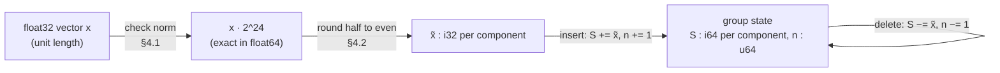

# B03 · Floating point vs exact integers (and what Q24 means)

## In simple words

Computers store most decimal numbers only approximately. When you add a number and then subtract it
again, the approximate result can differ from where you started by a tiny amount. For most programs
that tiny amount does not matter. For SEVER-DB it matters a lot: the whole project promises that
deleting a vector puts a group back **exactly** as it was, bit for bit. So SEVER-DB turns every
vector component into a whole number (an integer) first, and does all its adding and subtracting on
whole numbers, which computers handle exactly.

> **Prerequisites.** Know what a vector is ([B01](B01_vectors_embeddings_and_search.md); glossary:
> [vector](../16_glossary.md#vector), [embedding](../16_glossary.md#embedding)) and what bits and bytes
> are ([15_prerequisites §1](../15_prerequisites.md#1-programming-and-systems-basics)). Nothing else.

## The problem this solves

Imagine a group of three 1-dimensional "vectors": `0.1`, `0.2` and `0.3`. A database keeps their
**sum** so that it can compute the group's centre (the mean). Now a user asks for `0.2` to be deleted.
The obvious approach is "subtract it from the sum". In ordinary 64-bit floating point:

**Illustrative example, not from the repository** (but these are real outputs of Python 3, run in
this session) [RUN: `python3 -c "a=0.1; b=0.2; print(repr(a+b), (a+b)-b==a, repr((a+b)-b))"`]:

| Expression | Result Python prints |
|---|---|
| `0.1 + 0.2` | `0.30000000000000004` |
| `(0.1 + 0.2) - 0.2 == 0.1` | `False` |
| `(0.1 + 0.2) - 0.2` | `0.10000000000000003` |

And with a running mean [RUN: `python3 -c` on the list `[0.1, 0.2, 0.3]`]:

| Step | Value |
|---|---|
| mean of `0.1, 0.2, 0.3` | `0.20000000000000004` |
| "delete 0.2": `(mean·3 − 0.2) / 2` | `0.20000000000000004` |
| mean of the survivors `0.1, 0.3`, computed from scratch | `0.2` |

So after the "deletion", the stored mean is **not** the mean of the survivors. The difference is
tiny (about 4 × 10⁻¹⁷), but it is not zero. That leftover trace of the deleted value is what this
project calls a **ghost** ([glossary: ghost](../16_glossary.md#ghost)). Anyone who can compare the
stored value with a fresh computation can tell that something was there. SEVER-DB's own measurement
of this effect on real data (the float running-mean baseline, P1-T14) is in
[11_results.md](../11_results.md).

## Build up step by step

### Step 1 — Why decimals are approximate

A **floating-point number** (definition: a number stored as a sign, a fixed number of significant
binary digits called the *significand*, and a power of two called the *exponent*) can hold only
numbers of the form `m × 2^e`. `0.5 = 1 × 2⁻¹` fits exactly. `0.1` does not: in binary it is
`0.000110011001100…` forever, so the computer keeps the nearest value it can store. In 32-bit
floating point (**float32**, 24 significant bits) the stored value of `0.1` is
`0.10000000149011612` [RUN: `struct.pack('f', 0.1)` round trip in Python]. In 64-bit floating
point (**float64**, 53 significant bits) it is a different, closer approximation.

Every addition then rounds its result to the nearest storable value. Rounding errors from different
operations do not cancel in general, so `(a + b) − b` can miss `a`.

### Step 2 — Integers are exact (within their range)

An **integer** type such as `i32` (32-bit signed integer) or `i64` (64-bit signed integer) stores
whole numbers exactly. `(a + b) − b == a` is **always** true for integers, as long as the sum does
not overflow the type's range (`i64` holds up to about 9.2 × 10¹⁸).

### Step 3 — Fixed point: whole numbers that stand for fractions

A **fixed-point** encoding stores a fraction as an integer count of tiny steps. Choose a step of
`1/2^f`. Then a real value `x` is stored as the integer `round(x · 2^f)`.

- With `f = 24`, the step is `1/16,777,216 ≈ 5.96 × 10⁻⁸`.
- This is called **Q24** ("24 fractional bits").

**Illustrative example, not from the repository** (real Python output from this session):

| float32 input | `x · 2^24` (exact in float64) | Q24 integer `x̃` |
|---|---|---|
| `0.1` (stored as 0.10000000149011612) | 1677721.625 | 1677722 |
| `0.3` (stored as 0.30000001192092896) | 5033165.0 | 5033165 |
| `0.5` | 8388608.0 | 8388608 |
| `−0.25` | −4194304.0 | −4194304 |

### Step 4 — Rounding ties to even

When `x · 2^24` lands exactly halfway between two integers (for example `2.5`), we must choose. SEVER-DB
uses **round half to even** (also called *banker's rounding*; definition: a tie goes to the even
neighbour, so `2.5 → 2`, `3.5 → 4`, `−2.5 → −2`). This is the IEEE 754 default. Ties go up as often
as down, so no bias builds up in long sums [DOC: docs/SEVER-DB_SPECIFICATION.md §4.2].

### Step 5 — Sums of integers make deletion exact

Keep, per group, the integer sum `S` of all members' `x̃` and the count `n`.

**Illustrative example, not from the repository** (one dimension, the three values above, quantised):

| Member | `x̃` |
|---|---|
| a = 0.1 | 1677722 |
| b = 0.7 | 11744051 |
| c = 0.2 | 3355443 |

- Insert all three: `S = 16777216`, `n = 3`.
- Delete `b`: `S = 16777216 − 11744051 = 5033165`, `n = 2`.
- Never inserted `b`: `S = 1677722 + 3355443 = 5033165`, `n = 2`.

The two results are **identical**, every time, because integer addition and subtraction are exact.
The mean `S/n` is computed only when needed (for a centroid), never stored as the source of truth.



### Step 6 — Will the integers overflow?

Each `|x̃_i|` is at most `2^24 + 16 = 16,777,232` (a unit vector's components are at most 1, plus the
allowed tolerance). A group holds at most 1,000,000 members. So `|S_i| ≤ 1.6777232 × 10¹³ < 2^44`,
which leaves 19 spare bits in an `i64` [DOC: §4.4; CODE: crates/sever-types/src/constants.rs:L55-L58].

## Everyday analogy

*Analogy:* Floating point is like measuring with a ruler marked only in centimetres and writing
down the nearest mark each time: adding and removing lengths can drift by a millimetre. Fixed point
is like counting coins: if you add 7 coins and remove 7 coins, you have exactly what you started
with. *Where the analogy stops:* converting the original real number into "coins" (quantisation)
does lose a little precision **once**, at insert time. SEVER-DB's claim is about the stored integer
state, not about recovering the original float exactly.

## How SEVER-DB does it

The quantiser lives in `sever-quant` and is the only path from floats to a stored vector (INV-1).

```rust
pub fn quantise_component(x: f32) -> i64 {
    // `as i64` saturates; for any |x| ≤ 2^39 the value is exact, far beyond the §4.2 bound.
    (f64::from(x) * SCALE_F64).round_ties_even() as i64
}
```
[CODE: crates/sever-quant/src/lib.rs:L55-L58]

- `pub fn quantise_component(x: f32) -> i64` declares a public function that takes one float32 and
  returns a 64-bit integer. (Rust syntax: `pub` = visible outside the module; `-> T` = return type;
  see [B06](B06_rust_and_python_for_this_project.md).)
- `f64::from(x)` widens float32 to float64 — this is exact.
- `* SCALE_F64` multiplies by `2^24`; multiplying by a power of two is also exact.
- `.round_ties_even()` is the one rounding step: round half to even.
- `as i64` converts to a 64-bit integer.

Before quantising, `check_normalised` rejects bad input
[CODE: crates/sever-quant/src/lib.rs:L24-L48]: wrong length (`WrongDimension`), any NaN or infinity
(`NonFinite`), or a norm farther than `8 · 2⁻²³ ≈ 9.54 × 10⁻⁷` from 1 (`NotNormalised`). The norm is
summed in float64, sequentially from index 0, so every machine gets the same answer. Note that the
code **checks** normalisation and never **performs** it (CLAUDE.md §7: "validate normalisation, never
perform it").

`quantise` then stores each component as `i32`, turning an impossible out-of-range value into an
`IntegrityViolation` error instead of silently wrapping [CODE: crates/sever-quant/src/lib.rs:L67-L80].

The constants are fixed in one place [CODE: crates/sever-types/src/constants.rs:L6-L58]:
`FRACTIONAL_BITS = 24`, `SCALE = 1 << 24`, `NORM_TOLERANCE = 8 / 8,388,608`,
`MAX_GROUP_MEMBERS = 1,000,000`, `MAX_ABS_QUANTISED = SCALE + 16`, `MAX_ACCUMULATOR_BITS = 44`.

The tests include a hand-written tie-to-even check (`p1_quant_ties_to_even_by_hand`) and the exact
tolerance boundary at ±8 ULPs (`p1_quant_tolerance_boundaries`)
[CODE: crates/sever-quant/src/lib.rs:L208, L270].

What it costs: search uses the dequantised vector `x̃ / 2^24`, which is slightly different from the
original float. Part 1 measured the effect on search quality (P1-T7, Recall@10) — see
[11_results.md](../11_results.md).

## Key points to remember

- Floating-point addition rounds, so subtracting what you added may not give back the start value.
- Q24 stores each component as `round_half_to_even(x · 2^24)`, an integer.
- Group sums `S` are `i64`; with at most 10⁶ members they need at most 44 bits.
- Integer subtraction is exact, so a deletion restores `S` and `n` exactly.
- The only rounding happens once, at insert; the stored state never drifts afterwards.

## Check your understanding

1. *Why is `(0.1 + 0.2) − 0.2` not `0.1` in float64?* — Because neither 0.1 nor 0.2 is exactly
   storable, and the addition rounds its result; the errors do not cancel.
2. *What integer does Q24 store for 0.5?* — `0.5 · 2^24 = 8,388,608`.
3. *Why round half to even rather than half up?* — Ties then go up and down equally often, so long
   sums carry no systematic bias.
4. *Could `S` overflow an `i64`?* — No: with ≤ 10⁶ members `|S_i| < 2^44`, far below `2^63`.
5. *Does Q24 make search exact?* — No. Deletion is exact; search uses an approximation of the
   original vector, and the loss is measured (P1-T7).
